[TOC]

## 1. 背景知识
### 1.1 模型加速常用方案简介
#### 1.1.1 更少的参数——模型裁剪
随着数据规模和模型复杂度的不断递增，典型的深度神经网络模型参数规模通常会在几十M甚至几百M的量级，加速模型前向运算最为直接有效的手段之一即是裁剪模型以减少参数量。比如，早期的CNN模型参数量主要集中在全连接层，在实际部署前，通常会对相关的全连接层参数做低秩分解，在允许模型效果微损的条件下，还会进一步对卷积层做分解[^1]。

同时，知识蒸馏技术[^2][^3]的发展成熟，使得模型裁剪带来的效果损失问题，已经能够获得很好的解决，因此在模型部署前，趋向于会对模型的filters直接做大幅度的削减以获得一个原始模型的瘦长型“克隆”小模型，然后用知识蒸馏的方式不断训练降低小模型的效果损失，可实现同等算法效果条件下成倍的速度提升。

另外，自动化模型结构设计技术[^4]的发展，使得针对特定运算平台的专用模型[^5][^6]参数能够大幅缩小，提供了更具性价比的基准模型。

#### 1.1.2 更多的零值——模型稀疏化
影响模型运算性能的因素除了参数的多少外，参数本身的分布也是一个重要因素，对于AI模型而言，稀疏化[^7]不仅有利于参数的存储和传输加载，配合专门的软硬件模块设计，更能直接加速计算。不过与模型裁剪一样，要保证模型精度的微损，模型稀疏化也需要相应的训练微调。

在训练阶段，通过对模型参数施加适当的正则化约束，可以很容易地获得含大量零值的模型。模型的稀疏化程度，除了反应在零值的整体占比外，也反应在零值分布的规律性方面（即结构化稀疏和非结构化稀疏），一般而言，结构化稀疏对于训练微调有着更高的要求，但是对于底层的软硬件加速会更加友好。目前结构化稀疏技术的普及程度仍较为偏低，使得模型稀疏化更多还是应用在优化模型的存储和传输加载上。

#### 1.1.3 更少的算子——计算图优化
AI模型的计算过程可以用计算图表示（图中节点表示算子，边表示算子间的数据流），在最终的实际计算前，可以对相应的计算图做大量的优化，如常量折叠，算子合并，公共子表达式提取等。主流的AI框架都提供了相应的计算图优化模块或者API可以供直接调用，如tensorflow grappler[^8], onnxruntime[^9], pytorch glow[^10]等，此外还有一些独立第三方算法库也支持对模型的计算图优化[^11]。

与模型裁剪和稀疏化不同，通常计算图优化会确保计算的等效性，从而严格保证了模型效果的不变，无需额外的训练调优。

#### 1.1.4 更少的位宽——模型量化

用更少的位宽表示模型参数和中间运算变量，可实现模型存储、传输和运算的整体优化，同时由于整数运算的复杂度远低于浮点数运算，相关的硬件方案实现可以更具性价比。模型量化技术[^12][^13]在过去几年中快速发展成熟，目前已几乎成为模型前向运算的首要标配加速方案。

模型量化用于模型前向运算加速时，通常除了把浮点型的模型参数映射为中低比特（16比特或8比特）的整型参数外，还会对一些复杂的数学函数运算做简化处理（比如通过查找表的方式）。由于AI模型的参数冗余性，量化后的模型效果损失微小，通过量化训练甚至可以恢复和超过原始模型的效果。模型量化技术对于模型本身的网络结构依赖度低，可以直接应用于绝大多数的AI模型。

#### 1.1.5 更好的实现——算子优化

特定硬件平台上的模型运算性能还取决于具体的算子实现优化，有些优化规则可以是通用的（比如Winograd算法[^14]），有些规则可以是自动化的[^15]，有些规则则是深度绑定硬件特性的指令集优化或者汇编优化。

### 1.2 模型量化原理概述

模型量化本质上是将模型运算（通常只涉及前向运算）涉及的浮点计算转换成低比特定点计算。显然，模型量化其实是一种近似算法，理论上必然带来模型效果的损失。

为简化计算，模型参数从浮点域映射到整数域通常使用线性变换，即线性量化[^16]，一般所说的模型量化均是指代线性量化算法。令$x_{f}$表示原始的浮点值，$x_q$表示量化后的整数值，$s_x$表示缩放系数，$zp_x$表示零点值，$n$表示量化的位宽，则线性量化的计算公式$\eqref{quant_eq}$可表示如下：
$$
\begin{equation}
\begin{split}
x_q &= round\left ((x_f - min_{x_f})\underbrace{\frac{2^n - 1}{max_{x_f} - min_{x_f}}}_{s_x} \right) \\
&\approx round (s_x x_f - \underbrace{round(min_{x_f}s_x)}_{zp_x}) \\
&= round (s_x x_f - zp_x)
\end{split}
\label{quant_eq}
\end{equation}
$$

需要注意的是，公式中的$zp_x$会被强制为整数，这对于整数域的零值padding来说是绝对必须的，同时$max_{x_f} == min_{x_f}$时会强制$s_x=1.0$以应对除零问题。此外，公式中的$x_q$用了无符号数表示，实际应用中完全可以替换成有符号数的表示，只需要再减去$2^{n-1}$即可。另外，有些框架（如tensorflow lite[^17]）或者文献中对于线性量化的公式会写作：$x_f' = (x_q' - zp_x') * s_x'$, 容易发现这两种写法其实是等效的，相当于$s_x'=1/s_x , zp_x' = -zp_x$. 实际工程应用时，对于公式中得到的$x_q$还会按照量化后的整型类型做对应的clamp操作以保证其数值范围不越界。

另外，由公式$\eqref{quant_eq}$很容易得到对应的反量化公式为：$x_f'' = (x_q + zp_x) / s_x$，而$x_f''$和$x_f$并不严格相等（即反量化并不能完全恢复量化时丢失的信息）。

#### 1.2.1 量化训练 VS 训练后量化

根据量化算法是否发生在训练阶段可以分为量化训练（quantization aware training, 也叫做在线量化）和训练后量化（post-training quantization, 也叫做离线量化）。

在量化训练过程中，通过引入伪量化操作（将浮点量化到定点，再反量化成浮点），前向时在每层参数的输入后和激活的输出前进行伪量化，以使模型获得量化损失，继而控制每层的参数和激活输出在一定范围内，且分布更均匀，从而降低实际量化后的效果损失。需要注意的是量化训练过程中，伪量化操作并不参与模型的反向传播过程。

顾名思义，训练后量化则是只在模型完成训练后，一次性地将相关的模型参数做量化计算，以获得最终的部署模型。

相较而言，量化训练能够获得更低的效果损失，tensorflow和pytorch等主流的训练框架都已原生支持量化训练。但是在某些特殊情况下（如部署方无法获得合适的训练数据），训练后量化仍然是合适甚至唯一的选项。

#### 1.2.2 非对称量化 VS 对称量化

由公式$\eqref{quant_eq}$可知，量化后的零点值$zp_x$在数值上不保证一定为0，此即为非对称量化。而在某些情形下，为了进一步简化计算（非对称量化模式下，硬件需要额外的逻辑去处理$zp_x$），需要保证零点值$zp_x$在数值上严格为0，此即为对称量化。具体而言，对称量化的计算公式可以表示为：$x_q = round(s_x x_f)$，其中$s_x$的计算方式根据量化后$x_q$的取值范围不同而略有差异，详细情况如下：

|                 | Full Range                              | Restricted Range                        |
| --------------- | --------------------------------------- | --------------------------------------- |
| Quantized Range | $[-2^{n-1}, 2^{n-1} - 1]$               | $[-(2^{n-1} - 1), 2^{n-1} - 1]$         |
| 8-bit example   | [-128, 127]                             | [-127, 127]                             |
| Scale Factor    | $s_x = \frac{(2^n-1)/2}{max(abs(x_f))}$ | $s_x = \frac{2^{n-1}-1}{max(abs(x_f))}$ |

非对称量化和对称量化的主要差异可以由下图简要表示：

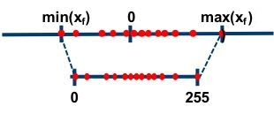

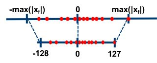

#### 1.2.3 按张量量化 VS 逐通道量化

根据量化算法映射系数的计算粒度不同可分为按张量（per-tensor）量化和逐通道（per-axis or per-channel）量化。按张量量化即对张量$x_f$整体计算出一对量化系数$s_x$和$zp_x$，逐通道（通常使用输出通道即per output channel）量化则会对通道中的每一子项都计算一对$s_x$和$zp_x$，最终的量化系数即为向量$\hat{s_x}$和$\hat{zp_x}$.

逐通道量化会多消耗计算和存储资源，不过其对张量数值分布的反映更加细致，理论上具有更低的效果损失。

#### 1.2.4 端到端量化 VS 部分量化

如果模型从输入到输出的全部运算全是在整数域上进行，即端到端量化，反之，则称为部分量化。部分量化可以是只对模型权重参数量化（主要用于压缩模型），实际前向计算时先反量化至浮点域再与各层的激活值运算，也可以是对部分层的权重参数和激活值都做量化运算于整数域，剩余层则运算于浮点域（比如某些层量化后效果损失过大，则不加以量化而完全用浮点数计算，注意此种情况下激活值从量化层传递到非量化层时需要先做反量化运算以映射回浮点域，同样的，激活值由非量化层传递到量化层时需要先做量化运算以映射到整数域）。

#### 1.2.5 校准算法

由公式$\eqref{quant_eq}$可知，给定量化位宽和量化方式后，量化的结果主要取决于张量$x_f$的min, max值的选取（在8bit以下的超低bit量化情形，round算法的选取也变得非常重要[^19]）。一般来说，直接统计数值上的最大最小值去做量化很可能受到离群点的干扰而无法准确反应原始张量的实际分布规律，尤其对于训练后量化而言（量化训练由于训练过程中即考虑进了量化损失的影响，故基本不存在此种情况）。如下图所示，浮点域的最大最小值附近仅仅聚集了极少量的离群点，实际量化时最好剔除其影响以更精确地反应数值分布规律。

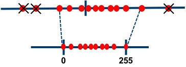

为了能够获得模型网络中各层激活值的真实分布信息，需要准备一个与模型训练集同分布的校准数据集（不需要标签信息），基于此数据集对模型做前向运算，并统计出各层激活值张量的所有必要信息（权重参数张量的信息统计不依赖于此校准数据集，因此既可以单独统计，也可以同时一并加以统计），然后根据这些统计信息应用相关的算法确定每个张量最终用于量化的min, max值。这个过程称为校准，常用的校准算法有：

- extrema: 令$max_i, min_i$分别表示第$i$个批次的样本统计出的最大最小值，则最终采用的最大最小值分别为$max(max_1,max_2,...,max_i,... )$, $min(min_1,min_2,...,min_i,... )$。
- mean: 令$max_i, min_i$分别表示第$i$个批次的样本统计出的最大最小值，则最终采用的最大最小值分别为$\sum{\alpha_i * max_i}$, $\sum{\alpha_i * min_i}$ (where $\alpha_i \in [0, 1]$ and $\sum{\alpha_i} = 1.0$).
- Nstd: 令$mean$和$std$分别表示统计出的均值和标准差，则最终采用的最大最小值分别为$mean+N*std$, $mean-N*std$, 其中N是可配置参数。
- KLD: 利用KL散度度量量化后的张量数值分布和原始分布的差异，遍历求解使得KL散度最小化的门限值作为最终量化的最大最小值，具体算法步骤参见[^18]。

## 2. 周易AIPU模型量化方案概述
### 2.1 周易AIPU硬件架构简介
周易AIPU同时具备（Scalar, Vector, Tensor）通用算力模块和（Convolution, Fully-connected, BatchNormalizaion, Pooling, Eltwise, ...）AI专用算力模块，典型的周易AIPU硬件架构如下图所示：

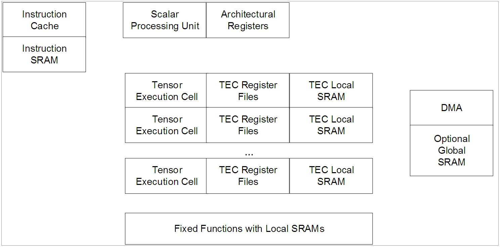

通常，AI模型的大多数密集计算型的layer都能用专用算力模块AIFF（AI Fixed Functions）来完成计算，其余的逻辑密集型的layer（如NMS等后处理层）则使用通用算力模块完成计算。详细的模块构造和相应的参数细则参见硬件规格文档。
### 2.2 周易AIPU软件栈简介
周易软件产品包括了：Toolchain(含compiler, assembler, linker, debugger等), NN compiler(又叫building-tool, 含parser, optimizer, gbuilder等), Operation Library(含内置的各种典型AI算子库), Driver, Runtime, Simulator. 典型的周易AIPU软件架构如下图所示：

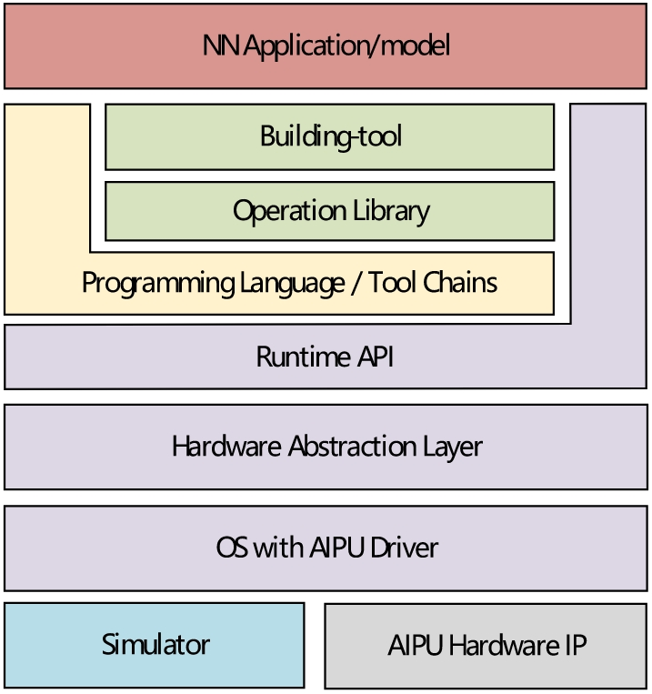

对于模型的离线量化（即将float IR格式的模型转换优化为quantized IR格式的模型，关于周易AIPU的模型IR格式，具体可参见*ARM China AI Platform Zhouyi Compass IR Definition Application Note*）由optimizer完成，相关模块的使用教程参见*Arm China AI Platform Zhouyi Compass Software Programming Guide*.

### 2.3 周易AIPU模型量化方案
#### 2.3.1 概要说明
为较好地兼顾模型的性能和效果损失，周易AIPU当前默认优先支持全对称量化方式，后续版本将会优先支持对权重参数的逐通道对称量化和对激活特征的逐张量非对称量化。Optimizer对模型的量化由如下主要步骤构成：
- **statistic**: 计算模型中各张量的统计量，如extrema, mean, std, histogram等。
- **calibration**: 根据选择的校准算法确定各张量量化时使用的的min,max值。
- **quantization**: 计算模型中各张量的量化系数，并将权重、偏置等常量参数量化取整。
- **metric and serialization**: 计算对比量化前后的模型效果指标，并将量化后的模型序列化保存。

同时，为了获得部分算子的性能提升，会在上述步骤中间穿插一些相应的计算图优化（主要针对量化后整数域前向运算，更通用的计算图优化假定在原始模型上已经完成。），具体内容会在下一章中各算子量化方案介绍时体现。

#### 2.3.2 举例说明
#### 2.3.2.1 四则运算
- 加法：
    由$c_f=a_f + b_f$​
    可得$(c_q + zp_c) / s_c = (a_q + zp_a) / s_a + (b_q + zp_b) / s_b$​
    从而$c_q = ((a_q + zp_a) s_b + (b_q + zp_b) s_a) (s_c / (s_a s_b)) - zp_c$​
    其中$s_a, s_b, s_c / (s_a s_b)$​均为浮点数，且可在离线量化过程中确定，为便于在整数域计算，需离线阶段将这三个浮点数近似转换为$M/2^N$​的规范形式（M, N均为整数，整数域上除以$2^N$​可用移位实现）
    最后容易简化得到：$c_q \approx (((a_q + zp_a) M_1 + (b_q + zp_b) M_2)) M_3 / 2^N) - zp_c$​
- 减法：
    与加法类似，容易得到：$c_q \approx (((a_q + zp_a) M_1 - (b_q + zp_b) M_2)) M_3 / 2^N) - zp_c$
- 乘法：
    由$c_f = a_f b_f$
    可得$(c_q + zp_c) / s_c = ((a_q + zp_a) / s_a) ((b_q + zp_b) / s_b)$
    从而$c_q = (a_q + zp_a) (b_q + zp_b) (s_c / (s_a s_b)) - zp_c$
    其中$s_c / (s_a s_b)$为浮点数，且可在离线量化过程中确定，为便于在整数域计算，近似转换为$M/2^N$的规范形式（M, N均为整数，整数域上除以$2^N$可用移位实现）
    最后容易简化得到：$c_q \approx (a_q + zp_a) (b_q + zp_b) (M / 2^N) - zp_c$
- 除法：
    由$c_f = a_f / b_f$
    可得$(c_q + zp_c) / s_c = ((a_q + zp_a) / s_a) / ((b_q + zp_b) / s_b)$
    从而$c_q = ((a_q + zp_a) / (b_q + zp_b)) ((s_c s_b) / s_a) - zp_c$
    其中$(s_c s_b) / s_a$为浮点数，且可在离线量化过程中确定，为便于在整数域计算，近似转换为$M/2^N$的规范形式（M, N均为整数，整数域上除以$2^N$可用移位实现）
    最后容易简化得到：$c_q \approx ((a_q + zp_a) M // (b_q + zp_b)) / 2^N - zp_c$，$//$表示在整数域中做整除运算（也可以进一步算出余数，并据此决定是否对商做进一步的四舍五入，实际工程实现时也可用$x / y \approx (x+y//2)//y$达成）。
#### 2.3.2.2 非线性函数运算
对于复杂的非线性函数运算，效率起见，通常采取lut查找表方案（lut表越大，相应的计算精度损失越小，但占用的存储计算资源也越多，如何合理利用lut表，在下一章会结合相应算子的量化方案再加以展开。）实现，以sigmoid函数为例：
    由$y_f = sigmoid(x_f)$可得
    $(y_q + zp_y) / s_y = sigmoid((x_q + zp_x) / s_x)$
    从而$y_q = sigmoid((x_q + zp_x) / s_x) s_y - zp_y$
    因此可在离线量化时对$x_q$的可能值集合向量$\hat{x_q}$先用$x$的量化系数反量化，然后计算sigmoid函数值，再用$y$的量化系数量化得到最终的lut表，实际前向运算时只需要查表取值即可。需要说明的是，受限于硬件资源（如AIFF的内置lut单元即为257x16bit），lut不可能任意大，当$\hat{x_q}$范围较大时，可以利用部分函数的对称性只存储半张表，或者直接对$\hat{x_q}$做降采样以缩小lut表，在前向运算时再通过镜像取反或插值的方式获得最终的查找值。

## 3. 周易AIPU模型量化方案分算子介绍
### Abs
#### 算子定义
Absolute takes one input data (Tensor) and produces one output data (Tensor) where the absolute is, y = abs(x), is applied to the tensor elementwise.

#### 量化方法
由$y_f = abs(x_f)$可得$(y_q+zp_y)/s_y = abs((x_q+zp_x)/s_x)$, 从而$y_q=abs(x_q+zp_x) s_y/s_x - zp_y$. 当采用对称量化时，可以进一步令$s_y$等于$s_x$，则整数域上的abs运算方式可与浮点域上一致，无需多余的量化相关操作。
#### 规格说明

```text
Input 0:
   data_type  : int or uint
   granularity: per-tensor
Output 0:
   data_type  : uint
   granularity: per-tensor
restriction: none
```

### ArgMax
#### 算子定义
Returns the index with the largest value of the input tensor X along the specified axis.
#### 量化方法
由$y_f = ArgMax(x_f)$可得$(y_q+zp_y)/s_y = ArgMax((x_q+zp_x)/s_x)$, 从而$y_q=(ArgMax(x_q) + zp_x) s_y/s_x - zp_y$. 令$s_y$等于$s_x$, $zp_y$等于$zp_x$, 则整数域上的ArgMax运算方式可与浮点域上一致，无需多余的量化相关操作。
#### 规格说明

```text
Input 0:
   data_type  : int or uint
   granularity: per-tensor
Output 0:
   data_type  : uint
   granularity: per-tensor
restriction: none
```

### ArgMin
#### 算子定义
Returns the index with the smallest value of the input tensor X along the specified axis.

#### 量化方法
略。参考[ArgMax](###ArgMax)

#### 规格说明
略。参考[ArgMax](###ArgMax)

### AveragePooling2D
#### 算子定义
AveragePooling2D takes an input tensor X and applies average pooling across the tensor by the kernel size, stride size, and padding. AveragePooling-2D consists of computing the average on all values of a subset of the input tensor according to the kernel size and down sampling the data into the output tensor Y for further processing.

#### 量化方法
由算子定义可知，核心的计算为求平均即$y_f = (\sum_{j}^{N} x_f)/N$, 易得$(y_q+zp_y)/s_y = (\sum_{j}^{N} ((x_q+zp_x)/s_x))/N$, 从而$y_q = ((\sum_{j}^{N} x_q)/N + zp_x)(s_y/s_x) - zp_y$. 令$s_y$等于$s_x$, $zp_y$等于$zp_x$, 则整数域上的运算方式可与浮点域上一致，无需多余的量化相关操作。由于N为确定的常数，为进一步加速计算，可将$1/N$提前转换表示为$M/2^N$的规范形式（M, N均为整数，整数域上除以$2^N$可用移位实现）。
注：涉及padding操作的地方，量化方案参见[Pad](###Pad)

#### 规格说明

```text
Input 0:
   data_type  : int or uint
   granularity: per-tensor
Output 0:
   data_type  : int or uint
   granularity: per-tensor
restriction: none
```

### BasicLSTM
#### 算子定义
Computes a one-layer LSTM. Notations:
X: input tensor
I: input gate
O: output gate
F: forget gate
C: cell gate
t: time step (t-1 means the previous time step)
W[i, o, f, c]: parameter weight matrix for input, output, forget and cell gates
R[i, o, f, c]: recurrence weight matrix for input, output, forget and cell gates
B[i, o, f, c]: bias vectors for input, output, forget and cell gates
H: hidden state
f: activation function
g: activation function
h: activation function

Equations (Default: f = SIGMOID, g = TANH, h = TANH. ʘ means element-wise multiplication.):
$I_t = f(W_i X_t + R_i H_{t-1}  + B_i);$
$F_t = f(W_f X_t + R_f H_{t-1} + B_f);$
$C'_t = g(W_c X_t + R_c H_{t-1} + B_c);$
$O_t = f(W_o X_t + R_o H_{t-1}+ B_o);$
$C_t = F_t ʘ C_{t-1} + I_t ʘ C'_t;$
$H_t = O_t ʘ h(C_t).$

#### 量化方法
对于$I_t$, $F_t$, $C'_t$, $O_t$的计算可以概括抽象为$y=w x + r h + b$和$v = \sigma(y)$.
对于$y$有： $(y_q+zp_y)/s_y = ((w_q+zp_w)/s_w) ((x_q+zp_x)/s_x) + ((r_q+zp_r)/s_r) ((h_q+zp_h)/s_h) + (b_q+zp_b)/s_b$,
即： $y_q = \frac{(w_q+zp_w)(x_q+zp_x) + (r_q+zp_r)(h_q+zp_h)(s_ws_x/s_rs_h) + (b_q+zp_b)(s_ws_x/s_b)}{s_w s_x} s_y - zp_y$,
对于偏置项的量化，通常取$s_b=s_ws_x, zp_b=0$，同时可离线将$s_ws_x/s_rs_h$及$s_y/s_ws_x$表示为规范形式$M_0/2^{N_0}$及$M_1/2^{N_1}$($M_0,N_0,M_1,N_1$均为整数),
从而： $y_q = ((w_q+zp_w)(x_q+zp_x) + (r_q+zp_r)(h_q+zp_h)M_0/2^{N_0} + b_q)M_1/2^{N_1} - zp_y$.
（为进一步简化计算，可在精度允许的条件下，将$s_h=s_ws_x/s_r$，则$M_0/2^{N_0}$也可省略。）
对于$v$有： $(v_q+zp_v)/s_v = \sigma((y_q+zp_q)/s_y)$,
从而： $v_q = \sigma((y_q+zp_y)/s_y)s_v - zp_v$,
即可对非线性函数做lut查找表（具体参见[Sigmoid](###Sigmoid), [Tanh](###Tanh)）。

对于$C_t$的计算，
有$(C_{t_q} + zp_{C_t})/s_{C_t} = ((F_{t_q} + zp_{F_t})/s_{F_t}) ʘ ((C_{t-1_q} + zp_{C_{t-1}})/s_{C_{t-1}}) + ((I_{t_q} + zp_{I_t})/s_{I_t}) ʘ ((C'_{t_q} + zp_{C'_t})/s_{C'_t})$,
即： $C_{t_q} = \frac{((F_{t_q} + zp_{F_t}) ʘ (C_{t-1_q} + zp_{C_{t-1}}))(s_{I_t} s_{C'_t}/s_{F_t} s_{C_{t-1}}) + (I_{t_q} + zp_{I_t}) ʘ (C'_{t_q} + zp_{C'_t})}{s_{I_t} s_{C'_t}} s_{C_t} - zp_{C_t}$, 离线将$s_{I_t} s_{C'_t}/s_{F_t} s_{C_{t-1}}$及$s_{C_t}/s_{I_t} s_{C'_t}$表示为规范形式$M_2/2^{N_2}$及$M_3/2^{N_3}$($M_2,N_2,M_3,N_3$均为整数),
从而： $C_{t_q} = (((F_{t_q} + zp_{F_t}) ʘ (C_{t-1_q} + zp_{C_{t-1}}))M_2/2^{N_2} + (I_{t_q} + zp_{I_t}) ʘ (C'_{t_q} + zp_{C'_t}))M_3/2^{N_3} - zp_{C_t}$.

对于$H_t$的计算，有$(H_{t_q} + zp_{H_t})/s_{H_t} = ((O_{t_q} + zp_{O_t})/s_{O_t}) ʘ h((C_{t_q} + zp_{C_t})/s_{C_t})$,
即： $H_{t_q} = (O_{t_q} + zp_{O_t}) ʘ (s_h h((C_{t_q} + zp_{C_t})/s_{C_t})) (s_{H_t}/s_h s_{O_t})  - zp_{H_t}$, 类似地，可离线将$s_{H_t}/s_h s_{O_t}$表示为规范形式$M_4/2^{N_4}$($M_4, N_4$均为整数)，同时对$s_h h((C_{t_q} + zp_{C_t})/s_{C_t})$做lut查找表（具体参见[Tanh](###Tanh)）。

#### 规格说明

```text
Input X:
   data_type  : int or uint
   granularity: per-tensor
Input C0:
   data_type  : int
   granularity: per-tensor
Input H0:
   data_type  : int
   granularity: per-tensor
Output Ct:
   data_type  : int
   granularity: per-tensor
Output Ht:
   data_type  : int
   granularity: per-tensor
Weight W[i, o, f, c]:
   data_type  : int
   granularity: per-tensor or per-channel
Weight R[i, o, f, c]:
   data_type  : int
   granularity: per-tensor or per-channel
Bias B[i, o, f, c]:
   data_type  : int
   granularity: per-tensor or per-channel
restriction: H0,H1,...,Ht must be the same data type.
             C0,C1,...,Ct must be the same data type.
             bias_scale, bias_zero_point = X_scale * W_scale, 0.
```

### BatchNormalization
#### 算子定义
Computes the batch normalization according to the model’s running.

#### 量化方法
仅考虑前向运算，BatchNormalization是典型的线性运算： $y = Wx + b$.
由 $(y_q + zp_y)/s_y = ((W_q + zp_W)/s_W)((x_q + zp_x)/s_x) + (b_q + zp_b)/s_b$,
可得： $y_q = ((W_q + zp_W)(x_q + zp_x) + (b_q + zp_b)(s_ws_x/s_b))s_y/s_ws_x - zp_y$,
对偏置项的量化，通常取$s_b=s_ws_x, zp_b=0$, 同时可离线将$s_y/s_ws_x$表示为规范形式$M/2^N$($M, N$均为整数)，
从而： $y_q = ((W_q + zp_W)(x_q + zp_x) + b_q)M/2^N - zp_y$.

BatchNormalization一般对于量化位宽比较敏感，通常会默认对其权重参数取较高的量化位宽（16bit）。

#### 规格说明

```text
Input 0:
   data_type  : int or uint
   granularity: per-tensor
Output 0:
   data_type  : int or uint
   granularity: per-tensor
Weight 0:
   data_type  : int
   granularity: per-tensor or per-channel
Bias 0:
   data_type  : int
   granularity: per-tensor or per-channel
restriction: bias_scale, bias_zero_point = input_scale * weight_scale, 0.
```

### BatchToDepth
#### 算子定义
BatchToDepth rearranges data from the batch into blocks. More specifically, this operator outputs a copy of the input tensor where values from the batch dimension are moved into blocks of the Channel dimensions.

#### 量化方法
由$y_f = BatchToDepth(x_f)$可得$(y_q+zp_y)/s_y = BatchToDepth(x_q+zp_x)/s_x)$,
从而$y_q = (BatchToDepth(x_q) + zp_x)s_y/s_x - zp_y$. 令$s_y$等于$s_x$, $zp_y$等于$zp_x$, 则整数域上的运算方式可与浮点域上一致，无需多余的量化相关操作。

#### 规格说明

```text
Input 0:
   data_type  : int or uint
   granularity: per-tensor
Output 0:
   data_type  : int or uint
   granularity: per-tensor
restriction: none
```

### BatchToSpace
#### 算子定义
BatchToSpace rearranges (permutes) data from the batch into blocks of spatial data. This is the reverse transformation of SpaceToBatch. More specifically, this operator outputs a copy of the input tensor where values from the batch dimension are moved in spatial blocks to the ‘Height’ and ‘Width’ dimensions.

#### 量化方法
由$y_f = BatchToSpace(x_f)$可得$(y_q+zp_y)/s_y = BatchToSpace(x_q+zp_x)/s_x)$,
从而$y_q = (BatchToSpace(x_q)+ zp_x) s_y/s_x - zp_y$. 令$s_y$等于$s_x$, $zp_y$等于$zp_x$, 则整数域上的运算方式可与浮点域上一致，无需多余的量化相关操作。

#### 规格说明

```text
Input 0:
   data_type  : int or uint
   granularity: per-tensor
Output 0:
   data_type  : int or uint
   granularity: per-tensor
restriction: none
```

### BiasAdd
#### 算子定义
Performs bias addition to the input data tensor X.
#### 量化方法
由算子定义$y_f = x_f + B$.
可得$(y_q+zp_y)/s_y = (x_q+zp_x)/s_x + (B_q+zp_B)/s_B$,
即$y_q = ((x_q+zp_x) + (B_q+zp_B)s_x/s_B)s_y/s_x - zp_y$,
为简化计算，令$s_B=s_x, zp_B=0$，并离线将$s_y/s_x$表示为规范形式$M/2^N$($M,N$均为整数)，
从而$y_q = ((x_q+zp_x) + B_q)M/2^N - zp_y$.
（将$zp_x + B_q$离线计算存储为新的$B'_q$可进一步加速前向运算）

#### 规格说明

```text
Input 0:
   data_type  : int or uint
   granularity: per-tensor
Output 0:
   data_type  : int
   granularity: per-tensor
Bias 0:
   data_type  : int
   granularity: per-tensor or per-channel
restriction: bias_scale, bias_zero_point = input_scale, 0
```

### BNLL
#### 算子定义
Takes one input tensor and produces one output tensor, where the  function `y = x + log(1 + exp(-x)) if x > 0, otherwise y = log(1 + exp(x))`, is applied to the tensor elementwise.

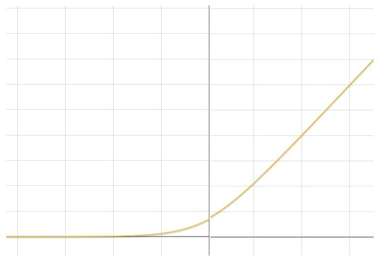

#### 量化方法
对于$y = BNLL(x)$有： $(y_q+zp_y)/s_y = BNLL((x_q+zp_x)/s_x)$,
从而： $y_q = BNLL((x_q+zp_x)/s_x)s_y - zp_y$,
因此可离线做lut查找表：

- 根据$x_q$的数据类型枚举得到值域集合$\hat{x_q}$（若$x_q$范围较大，可采样获得一个子集）
- 对$\hat{x_q}$反量化获得$\hat{x_f}$
- 对$\hat{x_f}$计算BNLL函数值获得$\hat{y_f}$
- 量化$\hat{y_f}$获得最终的lut表

前向计算查表时如果lut是采样后的小表，则需要做相应的插值操作。同时需要注意的是BNLL函数沿x负半轴缓慢下降趋近于零，若输入$x$的min取值过小则会导致量化后的值大量趋同无法区分（即量化后表达精度不够），影响整体算子精度，也浪费了lut空间，故在调节BNLL算子精度时需重点调节$x$的min取值。

#### 规格说明

```text
Input 0:
   data_type  : int or uint
   granularity: per-tensor
Output 0:
   data_type  : uint
   granularity: per-tensor
restriction: none
```

### Cast
#### 算子定义
Casts an input tensor (X) with a given data type and return a new output tensor (Y).

#### 量化方法
由$y_f=Cast(x_f)$有$(y_q+zp_y)/s_y = Cast((x_q+zp_x)/s_x)$, 从而$y_q = Cast((x_q+zp_x)/s_x)s_y - zp_y$, 进而可以有$y_q \approx (Cast(x_q)+zp_x)s_y/s_x - zp_y$. 若令$s_y=s_x, zp_y=zp_x$, 则整数域上的运算仅需将$x_q$的数据类型转换为$y_q$的数据类型即可。相关的量化损失主要来自于$x_f$到$x_q$的量化损失。

如果对于Cast算子精度有更高要求，还可以直接通过lut表实现$y_q = Cast((x_q+zp_x)/s_x)s_y - zp_y$，即：
- 根据$x_q$的数据类型枚举得到值域集合$\hat{x_q}$（若$x_q$范围较大，可采样获得一个子集）
- 对$\hat{x_q}$反量化获得$\hat{x_f}$
- 对$\hat{x_f}$计算Cast结果获得$\hat{y_f}$
- 量化$\hat{y_f}$获得最终的lut表

前向计算时通过查表（如果lut是采样后的小表，还需做相应的插值操作），得到最终的$y_q$.

#### 规格说明

```text
Input 0:
   data_type  : int or uint
   granularity: per-tensor
Output 0:
   data_type  : int or uint
   granularity: per-tensor
restriction: none
```

### Clip
#### 算子定义
Limits the given input tensor within an interval. The interval is specified by the inputs “cmin” and “cmax”.

#### 量化方法
由$y_f=Clip(x_f, cmin_f, cmax_f)$有$(y_q+zp_y)/s_y = Clip((x_q+zp_x)/s_x, cmin_f, cmax_f)$, 从而：
$y_q = Clip((x_q+zp_x)/s_x, cmin_f, cmax_f)s_y - zp_y$
$y_q = Clip((x_q+zp_x)s_y/s_x, \ cmin_f * s_y, \ cmax_f * s_y) - zp_y$
$y_q = Clip((x_q+zp_x)s_y/s_x - zp_y, \ cmin_f * s_y - zp_y, \ cmax_f * s_y - zp_y)$
离线将$s_y/s_x$表示为规范形式$M/2^N$($M,N$均为整数)，$cmin_f, cmax_f$按$y$的量化系数量化为$cmin_q, cmax_q$, 则最终：
$y_q = Clip((x_q+zp_x)M/2^N - zp_y, \ cmin_q, \ cmax_q)$.
为最大限度利用量化位宽，$y$量化时所用的min,max即可定为cmin,cmax.

#### 规格说明

```text
Input 0:
   data_type  : int or uint
   granularity: per-tensor
Output 0:
   data_type  : int or uint
   granularity: per-tensor
restriction: none
```

### Concat
#### 算子定义
This operator concatenates a list of tensors into a single tensor. All input tensors must have the same shape, except for the dimension size of the axis to concatenate on.

#### 量化方法
由$y_f = Concat(x_{1_f}, x_{2_f}, ...)$可得：$(y_q+zp_y)/s_y = Concat((x_{1_q}+zp_{x_1})/s_{x_1}, (x_{2_q}+zp_{x_2})/s_{x_2}, ...)$, 从而：
$y_q = Concat((x_{1_q}+zp_{x_1})/s_{x_1}, (x_{2_q}+zp_{x_2})/s_{x_2}, ...) s_y - zp_y$,
$y_q = Concat((x_{1_q}+zp_{x_1})s_y/s_{x_1}, (x_{2_q}+zp_{x_2})s_y/s_{x_2}, ...)  - zp_y$,
可离线将$s_y/s_{x_1}, s_y/s_{x_2}, ...$表示为规范形式$M_1/2^{N_1}, M_2/2^{N_2}, ...$, 则有：
$y_q = Concat((x_{1_q}+zp_{x_1})M_1/2^{N_1}, (x_{2_q}+zp_{x_2})M_2/2^{N_2}, ...)  - zp_y$,
为进一步加速计算，可在不影响精度的条件下，微调各输入分支的量化系数使得$s_y=s_{x_1}=s_{x_2}=...$, $zp_y=zp_{x_1}=zp_{x_2}=...$, 从而无需多余的量化相关操作。

#### 规格说明

```text
Input 0:
   data_type  : int or uint
   granularity: per-tensor
Input 1:
   data_type  : int or uint
   granularity: per-tensor
Input 2:
   data_type  : int or uint
   granularity: per-tensor
...
Output 0:
   data_type  : int or uint
   granularity: per-tensor
restriction: none
```

### Constant
#### 算子定义
Creates a constant tensor as a given format. Generally, the data type is inferred from the type of value.

#### 量化方法
若表征的常量为不需要量化的数值（如表征index相关的量），则强令其量化系数为$s=1.0, zp=0$以避免错误量化带来的损失。周易AIPU会通过在float IR中为Constant节点的layer_top_type字段指定int类型（由parser模块完成）来标示对应的Constant为不需要量化的数值。

#### 规格说明

```text
Weight 0:
   data_type  : int or uint
   granularity: per-tensor
Output 0:
   data_type  : int or uint
   granularity: per-tensor
restriction: depending on the layer_top_type field in float IR to indicate whether the scale, zero_point should be set to 1.0 and 0
```

### Convolution2D
#### 算子定义
Performs a filter on the input tensor (X) and produces the output tensor (Y). If bias is necessary, a bias vector will be added to the output tensor. Similarly, if the activation function is necessary, it is applied to the output tensor as well.

#### 量化方法
根据是否含有融合的激活函数（当前支持融合的激活函数为CLIP, RELU, RELU6, LEAKYRELU）分别讨论：
- 无激活函数，
  即$y_f = Conv(x_f) = w_f x_f + b_f$.
  由$(y_q + zp_y)/s_y = ((w_q + zp_w)/s_w) ((x_q + zp_x)/s_x) + (b_q + zp_b)/s_b$,

  可得$y_q = ((w_q + zp_w) (x_q + zp_x) + (b_q + zp_b)s_ws_x/s_b) s_y/s_ws_x - zp_y$,

  对偏置项的量化通常取$s_b=s_ws_x, zp_b=0$, 同时可离线将$s_y/s_ws_x$表示为规范化的形式$M, 2^N$($M,N$均为整数)，

  从而$y_q = ((w_q + zp_w) (x_q + zp_x) + b_q)M/2^N - zp_y$.

- 融合激活函数CLIP,
  即$y_f = CLIP(Conv(x_f), c_f, d_f) = CLIP(w_f x_f + b_f, \ c_f, \ d_f)$.

  由$(y_q + zp_y)/s_y = CLIP(((w_q + zp_w)/s_w) ((x_q + zp_x)/s_x) + (b_q + zp_b)/s_b, \ c_f, \ d_f)$,

  可得$y_q = CLIP(((w_q + zp_w) (x_q + zp_x) + (b_q + zp_b)s_ws_x/s_b) s_y/s_ws_x - zp_y, \ c_fs_y-zp_y, \ d_fs_y-zp_y)$,

  对偏置项的量化通常取$s_b=s_ws_x, zp_b=0$, 同时可离线将$s_y/s_ws_x$表示为规范化的形式$M, 2^N$($M,N$均为整数)，$c_f,d_f$按$y$的量化系数量化为$c_q, d_q$,

  从而$y_q = CLIP(((w_q + zp_w) (x_q + zp_x) + b_q)M/2^N - zp_y, \ c_q, \ d_q)$.
  为最大限度利用量化位宽，$y$量化时所用的min,max即可定为$c_f,d_f$.

- 融合激活函数RELU,
  即$y_f = RELU(Conv(x_f), c_f, d_f)$.
  RELU可看成是特殊的CLIP, 即$y_f = CLIP((Conv(x_f), c_f, d_f) = CLIP(Conv(x_f), \ 0, \ +\infty)$，则量化方法等效于CLIP的情况。

- 融合激活函数RELU6,
  即$y_f = RELU6(Conv(x_f), c_f, d_f)$.
  RELU6可看成是特殊的CLIP, 即$y_f = CLIP((Conv(x_f), c_f, d_f) = CLIP(Conv(x_f), \ 0, \ 6)$，则量化方法等效于CLIP的情况。
- 融合函数LEAKYRELU,
  即$y_f = LEAKYRELU(Conv(x_f)) = maximum(Conv(x_f), 0) + minimum(Conv(x_f), 0) \ l_f$.
  由$(y_q+zp_y)/s_y = maximum(Conv((x_q + zp_x)/s_x), \ 0) + minimum(Conv((x_q + zp_x)/s_x), \ 0) \ (l_q+zp_l)/s_l$,
  可得$y_q = maximum(Conv((x_q + zp_x)/s_x) \ s_y, \ 0) + minimum(Conv((x_q + zp_x)/s_x) \ s_y, \ 0) \ (l_q+zp_l)/s_l - zp_y$,
  为简便计算，令$s_l = 2^{N_l}, zp_l=0$($N_l$为整数，$l_q=round(l_f * 2^{N_l})$即量化后的negative_slope)，即得：
  $y_q = maximum(((w_q + zp_w) (x_q + zp_x) + b_q)M/2^N, 0) + minimum(((w_q + zp_w) (x_q + zp_x) + b_q)M/2^N, 0)l_q/2^{N_l} - zp_y$

注：涉及padding操作的地方，量化方案参见[Pad](###Pad)

#### 规格说明

```text
Input 0:
   data_type  : int or uint
   granularity: per-tensor
Output 0:
   data_type  : int or uint
   granularity: per-tensor
Weight 0:
   data_type  : int
   granularity: per-tensor or per-channel
Bias 0:
   data_type  : int
   granularity: per-tensor or per-channel
restriction: bias_scale, bias_zero_point = input_scale * weight_scale, 0.
```

### ConvTranspose2D
#### 算子定义
ConvTranspose2D is really the transpose of convolution2D. Performs a filter on the input tensor (X) and produces the output tensor (Y).

#### 量化方法
ConvTranspose2D和Convolution2D一样都可以抽象为线性运算+激活函数，其量化方法参考[Convolution2D](####Convolution2D).

#### 规格说明
略。参考[Convolution2D](####Convolution2D).

### Cosine
#### 算子定义
Calculates the cosine of the given input tensor by element-wise.

#### 量化方法
对于$y = Cosine(x)$有： $(y_q+zp_y)/s_y = Cosine((x_q+zp_x)/s_x)$,
从而： $y_q = Cosine((x_q+zp_x)/s_x)s_y - zp_y$,
因此可离线做lut查找表：

- 根据$x_q$的数据类型枚举得到值域集合$\hat{x_q}$（若$x_q$范围较大，可采样获得一个子集）
- 对$\hat{x_q}$反量化获得$\hat{x_f}$
- 对$\hat{x_f}$计算Cosine函数值获得$\hat{y_f}$
- 量化$\hat{y_f}$获得最终的lut表

前向计算查表时如果lut是采样后的小表，则需要做相应的插值操作。同时需要注意的是，对Cosine函数有对称性Cosine(x)=Cosine(-x), 故实际制作lut表可只对x的正数部分做表以节省lut空间。

#### 规格说明

```text
Input 0:
   data_type  : int or uint
   granularity: per-tensor
Output 0:
   data_type  : int
   granularity: per-tensor
restriction: none
```

### Crelu
#### 算子定义
Performs a Relu operation on the input tensor (X) which selects the positive part of the activation and negative part of the activation respectively, then concatenate them as an output tensor (Y) along with the specified axis. That is,
Crelu(x) = Concat [Relu(x), Relu(-x)].

#### 量化方法
由$y_f=Concat(Relu(x_f), \ Relu(-x_f))$可得：
$(y_q+zp_y)/s_y=Concat(Relu((x_q+zp_x)/s_x), \ Relu(-(x_q+zp_x)/s_x))$
$y_q=Concat(Relu((x_q+zp_x)/s_x)s_y, \ Relu(-(x_q+zp_x)/s_x)s_y) - zp_y$
$y_q=Concat(Relu((x_q+zp_x)s_y/s_x), \ Relu(-(x_q+zp_x)s_y/s_x)) - zp_y$
可离线将$s_y/s_x$表示为规范形式$M/2^N$($M,N$均为整数)，即有：
$y_q=Concat(Relu((x_q+zp_x)M/2^N), \ Relu(-(x_q+zp_x)M/2^N)) - zp_y$

#### 规格说明

```text
Input 0:
   data_type  : int or uint
   granularity: per-tensor
Output 0:
   data_type  : uint
   granularity: per-tensor
restriction: none
```

### Crop
#### 算子定义
Crops the input tensor into the output tensor with the shape computing by the given beginning and end index (exclusive the ending indices) and the shape of the output tensor.

#### 量化方法
由$y_f = Crop(x_f)$可得$(y_q+zp_y)/s_y = Crop((x_q+zp_x)/s_x)$, 从而$y_q=(Crop(x_q) + zp_x) s_y/s_x - zp_y$. 令$s_y$等于$s_x$, $zp_y$等于$zp_x$, 则整数域上的Crop运算方式可与浮点域上一致，无需多余的量化相关操作。
#### 规格说明

```text
Input 0:
   data_type  : int or uint
   granularity: per-tensor
Output 0:
   data_type  : int or uint
   granularity: per-tensor
restriction: none
```

### CTCGreedyDecoder
#### 算子定义
Performs greedy decoding on the logits given in the input tensor, including the score tensor and sequence length tensor.

#### 量化方法
由算子定义可知$(y_q+zp_y)/s_y = CTCGreedyDecoder((x_q+zp_x)/s_x)$,
从而$y_q=(CTCGreedyDecoder(x_q) + zp_x) s_y/s_x - zp_y$. 令$s_y$等于$s_x$, $zp_y$等于$zp_x$, 则整数域上的CTCGreedyDecoder运算方式可与浮点域上一致，无需多余的量化相关操作。
#### 规格说明

```text
Input 0:
   data_type  : int or uint
   granularity: per-tensor
Output 0:
   data_type  : uint
   granularity: per-tensor
restriction: none
```

### DataStride
#### 算子定义
Performs an input data tensor (X) to produce a output tensor (Y) with a stride combination, which means taking kernel size numbers of data after every stride operation and gathering all these data along each axis respectively.

#### 量化方法
由算子定义可知$(y_q+zp_y)/s_y = DataStride((x_q+zp_x)/s_x)$, 从而$y_q=(DataStride(x_q) + zp_x) s_y/s_x - zp_y$. 令$s_y$等于$s_x$, $zp_y$等于$zp_x$, 则整数域上的DataStride运算方式可与浮点域上一致，无需多余的量化相关操作。
#### 规格说明

```text
Input 0:
   data_type  : int or uint
   granularity: per-tensor
Output 0:
   data_type  : int or uint
   granularity: per-tensor
restriction: none
```

### DepthToSpace
#### 算子定义
DepthToSpace permutes data from depth into blocks of spatial data. This is the reverse transformation of SpaceToDepth. More specially, this operator outputs a copy of the input tensor where values from the depth dimension are moved in spatial blocks to the ‘height’ and ‘width’ dimensions.

#### 量化方法
由算子定义可知$(y_q+zp_y)/s_y = DepthToSpace((x_q+zp_x)/s_x)$, 从而$y_q=(DepthToSpace(x_q) + zp_x) s_y/s_x - zp_y$. 令$s_y$等于$s_x$, $zp_y$等于$zp_x$, 则整数域上的DepthToSpace运算方式可与浮点域上一致，无需多余的量化相关操作。
#### 规格说明

```text
Input 0:
   data_type  : int or uint
   granularity: per-tensor
Output 0:
   data_type  : int or uint
   granularity: per-tensor
restriction: none
```

### DepthwiseConvolution
#### 算子定义
Performs a different filter to each channel of input tensor (X) and then concatenates the results of convolution together.

#### 量化方法
略。参考[Convolution2D](####Convolution2D)，需要说明的是由于DepthwiseConvolution的Weight在不同Channel上分布差异很大，一般默认采用per-channel量化方式以保证量化精度。

#### 规格说明
略。参考[Convolution2D](####Convolution2D)

### Div
#### 算子定义
Performs element-wise division (with Numpy-style broadcasting support).

#### 量化方法
由$y_f = a_f/b_f$可知$(y_q+zp_y)/s_y=((a_q+zp_a)/s_a)/((b_q+zp_b)/s_b)$, 从而$y_q=((a_q+zp_a)/(b_q+zp_b))(s_ys_b/s_a) - zp_y$. 可离线将$s_ys_b/s_a$表示为规范形式$M/2^N$($M,N$均为整数)，则有$y_q=((a_q+zp_a)M/(b_q+zp_b))/2^N - zp_y$, 计算$((a_q+zp_a)M)/(b_q+zp_b)$可以用整除（进一步可以得到余数，并据此对商做四舍五入以减少误差）。

为进一步减少计算，也可以用lut查表替代上述的整除运算，即
$y_q=((a_q+zp_a)M/(b_q+zp_b))/2^N - zp_y$
$y_q=((a_q+zp_a)M(2^{N_b}/(b_q+zp_b)))/2^{N+N_b} - zp_y$
$y_q \approx (a_q+zp_a)\ M \ \hat{lut(b_q)} \ / \ 2^{N'} - zp_y$
其中$\hat{lut(b_q)} = round(2^{N_b}/(b_q+zp_b)), \ N'=N+N_b$且$N', N, N_b$均为整数。同时注意到$\frac{1}{x}=-\frac{1}{-x}$，因此实际制作lut表时可只对正数部分做表以节约lut空间。

#### 规格说明

```text
Input 0:
   data_type  : int or uint
   granularity: per-tensor
Input 1:
   data_type  : int or uint
   granularity: per-tensor
Output 0:
   data_type  : int or uint
   granularity: per-tensor
restriction: none
```

### ElementwiseAdd
#### 算子定义
Performs elementwise addition of each of the input tensors (with Numpy-style broadcasting support).

#### 量化方法
由$y_f = a_f + b_f$可知$(y_q+zp_y)/s_y=(a_q+zp_a)/s_a + (b_q+zp_b)/s_b$,
从而$y_q=((a_q+zp_a)s_b + (b_q+zp_b)s_a)s_y/s_as_b - zp_y$. 可离线将$s_a,s_b,s_y/s_as_b$分别表示为规范形式$M_1/2^{N_1}, M_2/2^{N_2}, M_3/2^{N_3}$并且假定$N_1>=N_2$，则有：
$y_q=((a_q+zp_a)M_2 2^{N_1-N_2} + (b_q+zp_b)M_1)M_3/2^{N_1+N_3} - zp_y$
$y_q=((a_q+zp_a)M_2 M_3 2^{N_1-N_2} + (b_q+zp_b)M_1 M_3)/2^{N_1+N_3} - zp_y$
$y_q=((a_q+zp_a)M' + (b_q+zp_b)M'')/2^{N'} - zp_y$
其中$M'=M_2 M_3 2^{N_1-N_2}, M''=M_1 M_3, N'=N_1+N_3$且$M_1,M_2,M_3,M',M'',N_1,N_2,N_3,N'$均为整数。

#### 规格说明

```text
Input 0:
   data_type  : int or uint
   granularity: per-tensor
Input 1:
   data_type  : int or uint
   granularity: per-tensor
Output 0:
   data_type  : int or uint
   granularity: per-tensor
restriction: none
```

### ElementwiseMax
#### 算子定义
Performs elementwise maximum of each of the input tensors (with Numpy-style broadcasting support).

#### 量化方法
由$y_f=maximum(a_f, b_f)$可得$(y_q+zp_y)/s_y=maximum((a_q+zp_a)/s_a , \ (b_q+zp_b)/s_b)$，即：
$y_q=maximum((a_q+zp_a)s_y/s_a , \ (b_q+zp_b)s_y/s_b) - zp_y$
可离线将$s_y/s_a, s_y/s_b$表示为规范形式$M_1/2^{N_1}, M_2/2^{N_2}$, 且假定$N_1 >= N_2$，则：
$y_q = maximum((a_q+zp_a)M_1/2^{N_1} , \ (b_q+zp_b)M_2/2^{N_2}) - zp_y$
$y_q = maximum((a_q+zp_a)M_1 , \ (b_q+zp_b)M_2 2^{N_1-N_2}) \ 2^{N_1} - zp_y$
$y_q = maximum((a_q+zp_a)M_1 , \ (b_q+zp_b)M_3) \ 2^{N_1} - zp_y$
其中$M_3 = M_2 2^{N_1-N_2}$且$M_1,M_2,M_3,N_1,N_2$均为整数。

#### 规格说明

```text
Input 0:
   data_type  : int or uint
   granularity: per-tensor
Input 1:
   data_type  : int or uint
   granularity: per-tensor
Output 0:
   data_type  : int or uint
   granularity: per-tensor
restriction: none
```

### ElementwiseMin
#### 算子定义
Performs elementwise minimum of each of the input tensors (with Numpy-style broadcasting support).

#### 量化方法
略。参见[ElementwiseMax](###ElementwiseMax)

#### 规格说明
略。参见[ElementwiseMax](###ElementwiseMax)

### ElementwiseMul
#### 算子定义
Performs element-wise multiplication of the input tensors.

#### 量化方法
由$c_f = a_f b_f$可得$(c_q + zp_c) / s_c = ((a_q + zp_a) / s_a) ((b_q + zp_b) / s_b)$，从而$c_q = (a_q + zp_a) (b_q + zp_b) (s_c / (s_a s_b)) - zp_c$. 其中$s_c / (s_a s_b)$可在离线量化过程中近似转换为$M/2^N$的规范形式（M, N均为整数），则有：$c_q \approx (a_q + zp_a) (b_q + zp_b) (M / 2^N) - zp_c$.

#### 规格说明

```text
Input 0:
   data_type  : int or uint
   granularity: per-tensor
Input 1:
   data_type  : int or uint
   granularity: per-tensor
Output 0:
   data_type  : int or uint
   granularity: per-tensor
restriction: none
```

### ElementwiseSub
#### 算子定义
Performs elementwise subtraction of each of the input tensors (with Numpy-stype broadcasting support).

#### 量化方法
略。参见[ElementwiseAdd](###ElementwiseAdd)

#### 规格说明
略。参见[ElementwiseAdd](###ElementwiseAdd)

### Elu
#### 算子定义
Takes an input tensor (X) and produces one output tensor (Y). Where, the function `f(x) = alpha * (exp(x) -1) for x < 0, f(x) = x for x >= 0`, is applied to the tensor elementwise.

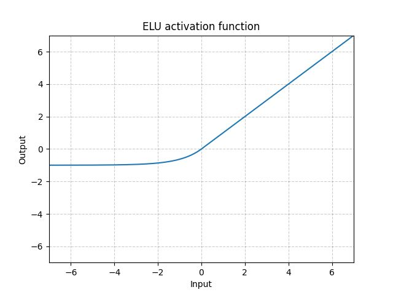

#### 量化方法
对于$y = Elu(x)$有： $(y_q+zp_y)/s_y = Elu((x_q+zp_x)/s_x)$,
从而： $y_q = Elu((x_q+zp_x)/s_x)s_y - zp_y$,
因此可离线做lut查找表：

- 根据$x_q$的数据类型枚举得到值域集合$\hat{x_q}$（若$x_q$范围较大，可采样获得一个子集）
- 对$\hat{x_q}$反量化获得$\hat{x_f}$
- 对$\hat{x_f}$计算Elu函数值获得$\hat{y_f}$
- 量化$\hat{y_f}$获得最终的lut表

前向计算查表时如果lut是采样后的小表，则需要做相应的插值操作。同时需要注意的是Elu函数沿x负半轴缓慢下降趋于平坦，若输入$x$的min取值过小则会导致量化后的值大量趋同无法区分（即量化后表达精度不够），影响整体算子精度，也浪费了lut空间，故在调节Elu算子精度时需重点调节$x$的min取值。另外，由于$x>=0$时Elu其实是恒等函数，故为节约lut空间，还可以只对$x<0$的情况做lut表。

#### 规格说明

```text
Input 0:
   data_type  : int or uint
   granularity: per-tensor
Output 0:
   data_type  : int or uint
   granularity: per-tensor
restriction: none
```

### Exp
#### 算子定义
Calculates the exponential of the given input tensor (X), where the function f(x) = exp(x), is applied to the tensor elementwise.

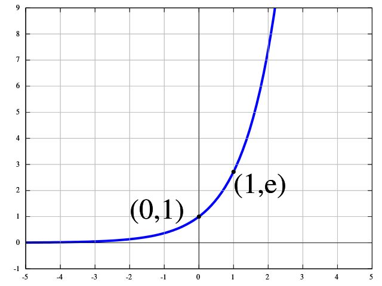

#### 量化方法
对于$y = Exp(x)$有： $(y_q+zp_y)/s_y = Exp((x_q+zp_x)/s_x)$,
从而： $y_q = Exp((x_q+zp_x)/s_x)s_y - zp_y$,
因此可离线做lut查找表：

- 根据$x_q$的数据类型枚举得到值域集合$\hat{x_q}$（若$x_q$范围较大，可采样获得一个子集）
- 对$\hat{x_q}$反量化获得$\hat{x_f}$
- 对$\hat{x_f}$计算Exp函数值获得$\hat{y_f}$
- 量化$\hat{y_f}$获得最终的lut表

前向计算查表时如果lut是采样后的小表，则需要做相应的插值操作。同时需要注意的是Exp函数：沿x负半轴缓慢下降趋于平坦，若输入$x$的min取值过小则会导致量化后的值大量趋同无法区分（即量化后表达精度不够）；沿x正半轴快速上升趋于无穷大，若输入$x$的max取值过大则会导致量化后的值过大从而要求其输出$y$用较大的位宽来量化以保证精度。故在调节Exp算子量化精度时需适当考虑提升该层以及后续关联层的量化位宽。

#### 规格说明

```text
Input 0:
   data_type  : int or uint
   granularity: per-tensor
Output 0:
   data_type  : uint
   granularity: per-tensor
restriction: none
```

### Filter
#### 算子定义
Takes one input data tensor (X) and filter tensor (B) to return an output tensor (Y) after filtration. Where the element will be filtered with accordingly zero selector in filter tensor B, otherwise remaining. Here, the filter tensor is a vector which composed of `0` or `1` with a same length as the specified axis in data tensor X. Similarity, multi input tensors (X[i]) will return multi outputs after the same filteration.

#### 量化方法
由$y_f = Filter(x_f, B)$可得$(y_q+zp_y)/s_y = Filter((x_q+zp_x)/s_x, B)$, 从而$y_q=(Filter(x_q, B) + zp_x) s_y/s_x - zp_y$. 令$s_y$等于$s_x$, $zp_y$等于$zp_x$, 则整数域上的Filter运算方式可与浮点域上一致，无需多余的量化相关操作。
#### 规格说明

```text
Input 0:
   data_type  : int or uint
   granularity: per-tensor
Input 1 (the filter tensor):
   data_type  : uint
   granularity: per-tensor
Output 0:
   data_type  : int or uint
   granularity: per-tensor
restriction: none
```

### FullyConnected
#### 算子定义
Takes input tensor (X) and computes the class scores and outputs the 1-D array of size equal to the number of classes. In other words, it performs a ‘dot(input_tensor, kernel)’ operation with a bias addition, then outputs the tensor after the activation function.

#### 量化方法
由算子定义，可知FullyConnected等效于特殊的卷积操作，其量化方法参见[Convolution2D](###Convolution2D)

#### 规格说明
略。参见[Convolution2D](###Convolution2D)

### Gather
#### 算子定义
Given parameters and indices tensor, gathers entries of the parameters tensor indexed by indices and concatenates them in an output tensor. The indices are a tensor of integer, and there will be an error if any of the index values are out of bounds. Generally, a negative value in the indices tensor means counting the index from the back.

#### 量化方法
由$y_f = Gather(x_f, Indices)$可得$(y_q+zp_y)/s_y = Gather((x_q+zp_x)/s_x, Indices)$,
从而$y_q=(Gather(x_q, Indices) + zp_x) s_y/s_x - zp_y$. 令$s_y$等于$s_x$, $zp_y$等于$zp_x$, 则整数域上的Filter运算方式可与浮点域上一致，无需多余的量化相关操作。
#### 规格说明

```text
Input 0:
   data_type  : int or uint
   granularity: per-tensor
Input 1 (Indices):
   data_type  : int or uint
   granularity: per-tensor
Output 0:
   data_type  : int or uint
   granularity: per-tensor
restriction: none
```
### GatherND
#### 算子定义
Given the input indices tensor, then gather slices from input tensor X into the output tensor Y with shape specified by indices. The output tensor has the shape `indices.shape[ :-1] + X.shape[indices.shape[-1] + batch_dims: ]` with the left closed and right open interval. Generally, `indices[-1] + batch_dims` should be less than or equal to `rank(X)`. Note that the negative value in indices tensor means counting the index from the back.

#### 量化方法
略。参见[Gather](###Gather)

#### 规格说明
略。参见[Gather](###Gather)

### GridSample
#### 算子定义
Given one tensor input $(X)$ and the other tensor input ${(grid)}$, computes the output $(Y)$ using $(X)$ values and pixel locations from the ${(grid)}$. For spatial input $(X)$ with shape (N, H, W, C), the ${(grid)}$. will have shape (N, H_out, W_out, 2), the output $(Y)$ will have shape (N, H_out, W_out, C). ${(grid)}$ specifies the sampling locations normalized by the input spatial dimensions. Therefore, it should have most values in the range of [-1, 1]. If ${(grid)}$ has values outside the range of [-1, 1], the corresponding outputs will be handled as defined by padding_mode.

onnx官方伪代码流程如下:

```python
def grid_sample(X, grid):
   N, H_in, W_in, C = X.shape
   _, H_out, W_out, _ = grid.shape
   grid_x = grid[:, :, :, 0]
   grid_y = grid[:, :, :, 1]

   if align_corners:
      #align_corners: true => [-1, 1] to [0, length - 1]
      grid_x = (grid_x + 1) / 2.f * (W_in - 1)
      grid_y = (grid_y + 1) / 2.f * (H_in - 1)
      x_min = 0.f
      x_max = W_in - 1.f
      y_min = 0.f
      y_max = H_in - 1.f
   else:
      #align_corners: false => [-1, 1] to [-0.5, length - 0.5]
      grid_x = ((grid_x + 1) * W_in - 1) / 2.f
      grid_y = ((grid_y + 1) * H_in - 1) / 2.f
      x_min = -0.5
      x_max = W_in - 0.5
      y_min = -0.5
      y_max = H_in - 0.5
   if grid_x < x_min or grid_x > x_max or grid_y < y_min or grid_y > y_max:
      if padding_mode_ == 'Border':
         grid_x = clamp(grid_x, 0, W_in - 1)
         grid_y = std::clamp(grid_y, 0, H_in - 1)
      else:
         #reflection or zeros
         ...
   if mode = 'Bilinear':
      x1 = floor(grid_x)
      y1 = floor(grid_y)
      x2 = x1 + 1
      y2 = y1 + 1

      border = [x_min, y_min, x_max, y_max]
      #The function of PixelAtGrid is to obtain X values corresponding to four coordinate points according to x1,y1,x2,y2
      p11 = PixelAtGrid(X, y1, x1, H_in, W_in, border)
      p12 = PixelAtGrid(X, y1, x2, H_in, W_in, border)
      p21 = PixelAtGrid(X, y2, x1, H_in, W_in, border)
      p22 = PixelAtGrid(X, y2, x2, H_in, W_in, border)

      dx = x - x1
      dy = y - y1
      top = p11 + ((p12 - p11) * dx)
      bottom = p21 + ((p22 - p21) * dx)
      output = top + ((bottom - top) * dy)
   else:
      #reflection or zeros
      ...
```

- align_corners: if align_corners=1, the extrema (-1 and 1) are considered as referring to the center points of the input's corner pixels. If align_corners=0, they are instead considered as referring to the corner points of the input's corner pixels, making the sampling more resolution agnostic.
- mode: three interpolation modes: linear (default), nearest and cubic.
- padding_mode: support padding modes for outside grid values: zeros(default), border, reflection.


#### 量化方法
对应上述官方onnx伪代码的量化方法如下（以双线性插值为例）：

- 当根据align_corners计算grid_x 和 grid_y 时，这部分量化方法如下（以align_corners= true时为例）:
     $b_q$为量化后的输入坐标，$a_f$为反量化后的坐标，
     将上述公式简化为：$a_f \approx ((b_q + zp_b)/s_b * offset + offset)/2$,
     其中$1/(s_b)$可在离线量化过程中近似转换为$M/2^N$的规范形式（M, N均为整数），则有：$a_f \approx ((b_q + zp_b) * offset * M / 2^N + offset)/2$,

     为了使得整个运算过程中不超过32bit且对grid_x 和 grid_y进行适当扩大，则

     $a_f 2^{N_1} \approx ((b_q + zp_b) * offset * M / 2^N + offset)/2 * 2^{N_1}$,

     $a_f 2^{N_1+1} \approx ((b_q + zp_b) * offset * M / 2^{N - N_1} + offset * 2^{N_1}$,

     $a_q \approx ((b_q + zp_b) * offset * M / 2^{N_0} + offset * 2^{N_1}$,

     其中$a_q = round(a_f 2^{N_1+1}), N_0=N - N_1$.

     使用上述量化公式来计算grid_x 和 grid_y（两者量化系数相同，即$s_{grid_x}=s_{grid_y}=s_b, zp_{grid_x}=zp_{grid_y}=zp_b$），则得到：

     $q_x = (q_{grid_x} + zp_{b}) * offset_x * M / 2^{N_0} + offset_x * 2^{N_1}$,

     $q_y = (q_{grid_y} + zp_{b}) * offset_y * M / 2^{N_0} + offset_y * 2^{N_1}$,

     其中$offset_y = H_{in} - 1, offset_x = W_{in} - 1$

- 计算$x_1, y_1, x_2, y_2$时，其量化计算过程为： $x_1 = q_x >> (N_1+1)$, $y_1 = q_y >> (N_1+1)$, $x_2 = x_1 + 1$, $y_2 = y_1 + 1$

- 计算$d_x, d_y$时，其量化计算过程为：

     $d_x 2^{(N_1+1)} = q_x - x_1 * 2^{(N_1+1)}$, $d_y 2^{(N_1+1)} = q_y - y_1 * 2^{(N_1+1)}$

     $q_{d_x} = q_x - x_1 * 2^{(N_1+1)}$, $q_{d_y} = q_y - y_1 * 2^{(N_1+1)}$

     其中 $q_{d_x} = round(d_x 2^{(N_1+1)}), q_{d_y} = round(d_y 2^{(N_1+1)})$.

- 根据已经获取到的$p_{11}, p_{12}, p_{21}, p_{22}$，则插值计算为：

     $top = p_{11} + (((p_{12} - p_{11}) * q_{d_x}) >> (N_1+1))$,

     $bottom = p_{21} + (((p_{22} - p_{21}) * q_{d_x}) >> (N_1+1))$,

     $output = (top + (((bottom - top) * q_{d_y}) >> (N_1+1)))$.


#### 规格说明
```text
Input 0:
   data_type  : int or uint
   granularity: per-tensor
Input 1 (Indices):
   data_type  : int or uint
   granularity: per-tensor
Output 0:
   data_type  : same to input 0 data_type
   granularity: per-tensor
restriction: none
```

### GroupConvolution
#### 算子定义
Performs a filter on the input tensor (X) and produces the output tensor (Y). If bias is necessary, a bias vector will be added to the output tensor. Similarly, if the activation function is necessary, it is applied to the output tensor as well.

#### 量化方法
由算子定义，可知GroupConvolution等效于特殊的卷积操作，其量化方法参见[Convolution2D](###Convolution2D)

#### 规格说明
略。参见[Convolution2D](###Convolution2D)，需要说明的是由于GroupConvolution的Weight在不同Group上分布差异很大，建议采用per-channel量化方式以保证量化精度（尤其当Group较多时）。

### GRUv1
#### 算子定义
Computes a one-layer GRU with the first mode. Notations:
x: Input tensor
z: Update gate
r: Reset gate
h: Hidden gate
t: Time step (t-1 means the previous time step)
W[r, z, c]: Parameter weight matrix for reset, update and hidden gates
R[r, z, c]: Recurrence weight matrix for reset, update and hidden gates
b[r, z, c, n]: Bias vectors for reset, update, and two hidden gates
H: Hidden state
f: Activation function
g: Activation function

Equations (Default: f = SIGMOID, g = TANH):
$r_t = f(W_r x_t + R_r H_{t-1} + b_r)$;
$z_t = f(W_z x_t + R_z H_{t-1} + b_z)$;
$h_t = g(W_c x_t + (R_c H_{t-1} + b_n) ʘ r_t + b_c)$;
$H_t = z_t ʘ H_{t-1} + (1 - z_t) ʘ h_t$.
Where ʘ means element-wise multiplication (or Hadamard product).

#### 量化方法
对于$r_t,z_t$的计算可以概括抽象为$y=w x + r h + b$和$v = \sigma(y)$.
对于$y$有： $(y_q+zp_y)/s_y = ((w_q+zp_w)/s_w) ((x_q+zp_x)/s_x) + ((r_q+zp_r)/s_r) ((h_q+zp_h)/s_h) + (b_q+zp_b)/s_b$,
即： $y_q = \frac{(w_q+zp_w)(x_q+zp_x) + (r_q+zp_r)(h_q+zp_h)(s_ws_x/s_rs_h) + (b_q+zp_b)(s_ws_x/s_b)}{s_w s_x} s_y - zp_y$,
对于偏置项的量化，通常取$s_b=s_ws_x, zp_b=0$，同时可离线将$s_ws_x/s_rs_h$及$s_y/s_ws_x$表示为规范形式$M_0/2^{N_0}$及$M_1/2^{N_1}$($M_0,N_0,M_1,N_1$均为整数),
从而： $y_q = ((w_q+zp_w)(x_q+zp_x) + (r_q+zp_r)(h_q+zp_h)M_0/2^{N_0} + b_q)M_1/2^{N_1} - zp_y$.
（为进一步简化计算，可在精度允许的条件下，将$s_h=s_ws_x/s_r$，则$M_0/2^{N_0}$也可省略。）
对于$v$有： $(v_q+zp_v)/s_v = \sigma((y_q+zp_q)/s_y)$,
从而： $v_q = \sigma((y_q+zp_y)/s_y)s_v - zp_v$,
即可对非线性函数做lut查找表（具体参见[Sigmoid](###Sigmoid)）。

对于$h_t$的计算可以分解为$y=Wx+(RH+b)ʘr+b'$和$v = \sigma(y)$, 后者同样为对非线性函数做lut查找表（具体参见[Tanh](###Tanh)）。下面对前者做展开分析，有：
$(y_q+zp_y)/s_y=(W_q+zp_W)(x_q+zp_x)/s_Ws_x+((R_q+zp_R)(H_q+zp_H)/s_Rs_H+(b_q+zp_b)/s_b)ʘ((r_q+zp_r)/s_r)+(b'_q+zp_{b'})/s_{b'}$
$y_q=\frac{(W_q+zp_W)(x_q+zp_x)+((R_q+zp_R)(H_q+zp_H)+(b_q+zp_b)s_Rs_H/s_b)(s_Ws_x/s_Rs_H) ʘ ((r_q+zp_r)/s_r)+(b'_q+zp_{b'})s_Ws_x/s_{b'}}{s_Ws_x}s_y- zp_y$
$y_q=\frac{(W_q+zp_W)(x_q+zp_x)+((R_q+zp_R)(H_q+zp_H)+(b_q+zp_b)s_Rs_H/s_b)(s_Ws_x/s_Rs_Hs_r) ʘ (r_q+zp_r)+(b'_q+zp_{b'})s_Ws_x/s_{b'}}{s_Ws_x}s_y- zp_y$
对于偏置项的量化，取$s_b=s_Rs_H, zp_b=0, s_{b'}=s_Ws_x, zp_{b'}=0$, 同时可离线将$s_Ws_x/s_Rs_Hs_r$及$s_y/s_Ws_x$表示为规范形式$M_0/2^{N_0}$及$M_1/2^{N_1}$($M_0,N_0,M_1,N_1$均为整数)，从而：
$y_q=((W_q+zp_W)(x_q+zp_x)+b'_q + ((R_q+zp_R)(H_q+zp_H)+b_q)M_0/2^{N_0} ʘ (r_q+zp_r))M_1/2^{N_1}- zp_y$

对于$H_t$有
$(H_{t_q} + zp_{H_t})/s_{H_t} = ((z_{t_q} + zp_{z_t})/s_{z_t}) ʘ ((H_{t-1_q} + zp_{H_{t-1}})/s_{H_{t-1}}) + (1 - (z_{t_q} + zp_{z_t})/s_{z_t}) ʘ ((h_{t_q} + zp_{h_t})/s_{h_t})$，
即：
$H_{t_q} = ((z_{t_q} + zp_{z_t})/s_{z_t}) ʘ ((H_{t-1_q} + zp_{H_{t-1}})s_{H_t}/s_{H_{t-1}}) + (1 - (z_{t_q} + zp_{z_t})/s_{z_t}) ʘ ((h_{t_q} + zp_{h_t})s_{H_t}/s_{h_t}) - zp_{H_t}$
$H_{t_q} = \frac{(z_{t_q} + zp_{z_t}) ʘ ((H_{t-1_q} + zp_{H_{t-1}})s_{H_t}/s_{H_{t-1}}) + (s_{z_t} - (z_{t_q} + zp_{z_t})) ʘ ((h_{t_q} + zp_{h_t})s_{H_t}/s_{h_t})}{s_{z_t}} - zp_{H_t}$
取$s_{H_t}=s_{H_{t-1}}$，同时取$s_{z_t}$为整数$Z$（由于$z_t$为SIGMOID的输出，取值范围$(0,1)$，对其量化正好可以通过放大整数倍并取整实现，相应的$zp_{z_t}=0$），并离线将$s_{H_t}/s_{h_t}$及$1/s_{z_t}$表示为规范形式$M_0/2^{N_0}$及$M_1/2^{N_1}$($M_0,N_0,M_1,N_1$均为整数)，从而：
$H_{t_q} = ((z_{t_q} + zp_{z_t}) ʘ (H_{t-1_q} + zp_{H_{t-1}}) + ((Z - (z_{t_q} + zp_{z_t})) ʘ (h_{t_q} + zp_{h_t}))M_0/2^{N_0}) M_1/2^{N_1} - zp_{H_t}$

#### 规格说明

```text
Input X:
   data_type  : int or uint
   granularity: per-tensor
Input H0:
   data_type  : int
   granularity: per-tensor
Output Ht:
   data_type  : int
   granularity: per-tensor
Weight W[r, z, c]:
   data_type  : int
   granularity: per-tensor or per-channel
Weight R[r, z, c]:
   data_type  : int
   granularity: per-tensor or per-channel
Bias b[r, z, c, n]:
   data_type  : int
   granularity: per-tensor or per-channel
restriction: H0,H1,...,Ht must be the same data type.
             bias_scale, bias_zero_point = X_scale * W_scale, 0.
```

### GRUv3
#### 算子定义
Computes a one-layer GRU. Notations:
x: Input tensor
z: Update gate
r: Reset gate
h: Hidden gate
t: Time step (t-1 means the previous time step)
W[r, z, c]: Parameter weight matrix for reset, update and hidden gates
R[r, z, c]: Recurrence weight matrix for reset, update and hidden gates
b[r, z, c]: Bias vectors for reset, update and hidden gates
H: Hidden state
f: Activation function
g: Activation function

Equations (Default: f = SIGMOID, g = TANH):
$r_t = f(W_r x_t + R_r H_{t-1} + b_r)$;
$z_t = f(W_z x_t + R_z H_{t-1} + b_z)$;
$h_t = g(W_c x_t + R_c (H_{t-1} ʘ r_t) + b_c)$;
$H_t = z_t ʘ H_{t-1} + (1 - z_t) ʘ h_t$
Where ʘ means element-wise multiplication (or Hadamard product).

#### 量化方法
由算子定义，可知其量化方法基本和[GRUv1](###GRUv1)相对应，仅$h_t$的计算略有不同。对于$y=Wx + R(H ʘ r) + b$有：
$(y_q+zp_y)/s_y=(W_q+zp_W)(x_q+zp_x)/s_Ws_x+((R_q+zp_R)/s_R)(((H_q+zp_H)/s_H) ʘ ((r_q+zp_r)/s_r))+(b_q+zp_b)/s_b$
$y_q=\frac{(W_q+zp_W)(x_q+zp_x)+(R_q+zp_R)((H_q+zp_H) ʘ (r_q+zp_r))s_Ws_x/s_Rs_Hs_r + (b_q+zp_b)s_Ws_x/s_b}{s_Ws_x}s_y - zp_y$
对于偏置项的量化，取$s_b=s_Ws_x, zp_b=0$, 同时可离线将$s_Ws_x/s_Rs_Hs_r$及$s_y/s_Ws_x$表示为规范形式$M_0/2^{N_0}$及$M_1/2^{N_1}$($M_0,N_0,M_1,N_1$均为整数)，从而：
$y_q=((W_q+zp_W)(x_q+zp_x) + b_q + (R_q+zp_R)((H_q+zp_H) ʘ (r_q+zp_r))M_0/2^{N_0})M_1/2^{N_1} - zp_y$

#### 规格说明

```text
Input X:
   data_type  : int or uint
   granularity: per-tensor
Input H0:
   data_type  : int
   granularity: per-tensor
Output Ht:
   data_type  : int
   granularity: per-tensor
Weight W[r, z, c]:
   data_type  : int
   granularity: per-tensor or per-channel
Weight R[r, z, c]:
   data_type  : int
   granularity: per-tensor or per-channel
Bias b[r, z, c]:
   data_type  : int
   granularity: per-tensor or per-channel
restriction: H0,H1,...,Ht must be the same data type.
             bias_scale, bias_zero_point = X_scale * W_scale, 0.
```

### HardSwish
#### 算子定义
Applies the hardswish function element-wise. That is, `HardSwish(x) = 0 if x <= -3; HardSwish(x) = x if x >= 3; HardSwish(x) = (x * (x + 3)) /6 if -3 < x <3`. Also, the formula can be expressed as HardSwish(x) = (x * Relu6(x + 3)) / 6.

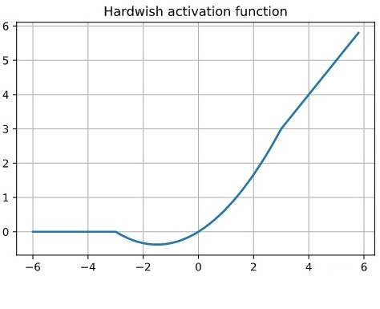

#### 量化方法
对于$y = HardSwish(x)$有： $(y_q+zp_y)/s_y = HardSwish((x_q+zp_x)/s_x)$,
从而： $y_q = HardSwish((x_q+zp_x)/s_x)s_y - zp_y$,
因此可离线做lut查找表：

- 根据$x_q$的数据类型枚举得到值域集合$\hat{x_q}$（若$x_q$范围较大，可采样获得一个子集）
- 对$\hat{x_q}$反量化获得$\hat{x_f}$
- 对$\hat{x_f}$计算HardSwish函数值获得$\hat{y_f}$
- 量化$\hat{y_f}$获得最终的lut表

前向计算查表时如果lut是采样后的小表，则需要做相应的插值操作。

#### 规格说明

```text
Input 0:
   data_type  : int or uint
   granularity: per-tensor
Output 0:
   data_type  : int
   granularity: per-tensor
restriction: none
```

### Histogram
#### 算子定义
Applies to the input numeric tensor X and returns a 1-D histogram to count the number of entries in numeric tensor that fell into every bin. Generally, the bins are equal width and determined by the parameters `min`, `max` and `nbins`.

#### 量化方法
根据定义，容易得出，对于$y_f = Histogram(x_f, a_f, b_f, n)$其中$a,b,n$代表`min`, `max`和`nbins`，有
$y_q = Histogram(x_q, round(a_f*s_x - zp_x), round(b_f*s_x - zp_x), n)$. 即仅需要将直方图统计的上下界阈值按输入张量的量化系数离线量化即可，前向运算过程和浮点域上的计算方式一样，无需多余的量化相关运算。

#### 规格说明

```text
Input 0:
   data_type  : int or uint
   granularity: per-tensor
Output 0:
   data_type  : uint
   granularity: per-tensor
restriction: none
```

### InstanceNormalization
#### 算子定义
Carries out instance normalization. That is, y = gamma * (x -mean) / sqrt(variance + epsilon) + beta, where mean and variance are computed per instance. Here, ‘gamma’ and ‘beta’ are the input dimensional scale and bias tensor of size channel in NHWC format.

#### 量化方法
对于均值和方差的计算，参见[Moments](###Moments)

然后是计算$x'=(x-\bar{x})/\sqrt{\var}$，其中$\bar{x},\var$分别指代均值和方差，则有：
$(x'_q+zp_{x'})/s_{x'}=((x_q+zp_x)/s_x - (\bar{x}_q+zp_{\bar{x}})/s_{\bar{x}})/\sqrt{(\var{_q} + zp_\var)/s_\var}$
取$s_{\bar{x}} = s_x, \ zp_{\bar{x}} = zp_x, \ s_\var=(s_x)^2, \ zp_\var = 0$，即有：
$x'_q =\frac{x_q - \bar{x}_q}{\sqrt{\var{_q}}}s_{x'} - zp_{x'}$
对$\frac{1}{\sqrt{\var{_q}}}$可采用查lut表计算，由于$\var{_q}$数值范围可能较大，为减少lut表大小，前向运算时可将$\var{_q}$近似为$M_\var * 2^{2N_\var}$($M_\var, N_\var$为整数，且$0<= M_\var <= 2^B-1$, 可调节B的取值以平衡精度要求和资源开销)，则离线仅需对$[0, 2^B-1]$范围内的值计算$\frac{1}{\sqrt{M_\var}} \approx round(\frac{2^C}{\sqrt{M_\var}}) \frac{1}{2^C} = lut(M_\var) / 2^C $，其中C为整数并可根据寄存器位宽具体取值。同时可离线将$s_{x'}$表示为规范形式$M/2^N$，其中$M, N$均为整数。如此，则有：
$x'_q \approx ((x_q - \bar{x}_q) \ lut(M_\var) \ / 2^{C+N_\var}) M/2^N - zp_{x'}$

最后是计算$y = gamma * x' + beta$，这是典型的线性运算，参见[BatchNormalization](###BatchNormalization)

#### 规格说明

```text
Input 0:
   data_type  : int or uint
   granularity: per-tensor
Weight 0:
   data_type  : int
   granularity: per-tensor or per-channel
Bias 0:
   data_type  : int
   granularity: per-tensor or per-channel
Output 0:
   data_type  : int or uint
   granularity: per-tensor
restriction: bias_scale, bias_zero_point = X'_scale * W_scale, 0.
```
### InTopK
#### 算子定义
Performs the input tensor (X) with `bach_size` classes to check whether the targets are in the top k predictions, and outputs a `batch_size` bool array. That is, the output Y[i] returns `true` if the predication for the target class exists among the top `k` predications,
Y[i] = `true` if predications[`target_classes_id (Si)`] ϵ {top-k predications}.
#### 量化方法
根据定义，容易得出，对于$y_f = InTopK(x1_f, \ x2_f)$有$y_q = InTopK(x1_q, \ x2_q)$. 即前向运算过程和浮点域上的计算方式一样，无需多余的量化相关运算。

#### 规格说明

```text
Input 0:
   data_type  : int or uint
   granularity: per-tensor
Input 1:
   data_type  : uint
   granularity: per-tensor
Output 0:
   data_type  : uint
   granularity: per-tensor
restriction: none
```

### LayerNormalization
#### 算子定义
Computes the activation normalization of the previous layer for the given axis in a batch independently. That is, y = gamma * (x -mean) / sqrt(variance + epsilon) + beta, where mean and variance are computed under all effective axis. By default, the shape of ‘gamma’ and ‘beta’ are the batch size in NHWC format.

#### 量化方法
略。参考[InstanceNormalization](###InstanceNormalization)

#### 规格说明
略。参考[InstanceNormalization](###InstanceNormalization)

### LeakyRelu
#### 算子定义
Takes one input tensor (X) and produces one output tensor (Y), where the rectified linear function `y = alpha * x for x < 0, y = x for x >= 0`, is applied to the tensor elementwise.

#### 量化方法
由定义有$(y_q+zp_y)/s_y = maximum((x_q+zp_x)/s_x, 0) + minimum((x_q+zp_x)/s_x, 0) (\alpha{_q}+zp_\alpha)/s_\alpha$，即：
$y_q = maximum((x_q+zp_x)s_y/s_x, 0) + minimum((x_q+zp_x)s_y/s_x, 0) (\alpha{_q}+zp_\alpha)/s_\alpha  - zp_y$
取$s_\alpha = 2^{N_\alpha}, zp_\alpha = 0$，并离线将$s_y/s_x$表示为规范形式$M/2^N$（其中$N_\alpha, M, N$均为整数），则：
$y_q = maximum((x_q+zp_x)M/2^N, 0) + minimum((x_q+zp_x)M/2^N, 0) \alpha{_q}/2^{N_\alpha}  - zp_y$

#### 规格说明

```text
Input 0:
   data_type  : int or uint
   granularity: per-tensor
Output 0:
   data_type  : int
   granularity: per-tensor
restriction: none
```

### Log
#### 算子定义
Calculates the natural log of the given input tensor (X), where the function $f(x) = log_e(x)$, is applied to the tensor elementwise.

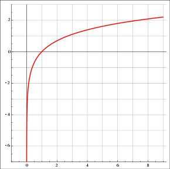

#### 量化方法
对于$y = Log(x)$有： $(y_q+zp_y)/s_y = Log((x_q+zp_x)/s_x)$,
从而： $y_q = Log((x_q+zp_x)/s_x)s_y - zp_y$,
因此可离线做lut查找表：

- 根据$x_q$的数据类型枚举得到值域集合$\hat{x_q}$（若$x_q$范围较大，可采样获得一个子集）
- 对$\hat{x_q}$反量化获得$\hat{x_f}$
- 对$\hat{x_f}$计算Log函数值获得$\hat{y_f}$
- 量化$\hat{y_f}$获得最终的lut表

前向计算查表时如果lut是采样后的小表，则需要做相应的插值操作。

#### 规格说明

```text
Input 0:
   data_type  : int or uint
   granularity: per-tensor
Output 0:
   data_type  : int
   granularity: per-tensor
restriction: none
```

### LogSoftmax
#### 算子定义
Calculates the natural log of softmax values for the given input tensor (X), where the function $f(x) = log_e(softmax(x))$, is applied to the tensor elementwise.

#### 量化方法
目前有两种量化方案，一种方案直接查lut表，其lut表值是经过量化后的定点值，查找lut表之后直接作为输出；另一种方案是中间计算过程带有float计算的量化。直接查表就是对log和softmax中的exp函数来构造表，可以参考log和softmax算子的构造lut表过程，这里不再赘述；以下主要说明第二种量化方案：
因为softmax具有平移不变性，根据x和axis可求得$x_{max}$, 原始公式等价于$y = Log(softmax(x - x_{max}))$, 则$y = Log(e^{(x - x_{max})}/\sum{e^{(x - x_{max})}}) = (x - x_{max}) - Log(\sum{e^{(x - x_{max})}})$, 其中$e^{(x - x_{max})}$离线生成float类型的lut表, 则$y_q = round((x_q - x_{max}) * (s_y / s_x) - Log(\sum{lut(x_q - x_{max})}) * S_y - zp_y)$.
离线生成float类型lut表的过程：

- 根据$x_q$的数据类型枚举得到值域集合$\hat{x_q}$（若$x_q$范围较大，可采样获得一个子集）
- 对$\hat{x_q} - x_{max}$反量化获得$\hat{x_f}$
- 对$\hat{x_f}$计算Exp函数值获得$\hat{y_f}$

前向计算查表时如果lut是采样后的小表，则需要做相应的插值操作。

#### 规格说明

```text
Input 0:
   data_type  : uint
   granularity: per-tensor
Output 0:
   data_type  : int
   granularity: per-tensor
restriction: none
```

### Logical
#### 算子定义
Returns the tensor resulted from performing logical operation elementwise on the input tensor. It supports multidirectional broadcasting as Numpy-style and returns a tensor of Boolean values.

#### 量化方法
对于数值比较的逻辑操作：EQUAL, NOT_EQUAL, GREATER, GREATER_EQUAL, LESS, LESS_EQUAL. 可抽象为$y_f = L(a_f, b_f)$，即有：
$(y_q + zp_y)/s_y = L((a_q+zp_a)/s_a, \ (b_q+zp_b)/s_b) s_y - zp_y$
$y_q = L((a_q+zp_a)/s_a, \ (b_q+zp_b)s_a/s_bs_a) s_y - zp_y$
$y_q = L((a_q+zp_a), \ (b_q+zp_b)s_a/s_b) s_y - zp_y$
由于$y_f,y_q$均为布尔类型，故$s_y=1, zp_y=0$，同时可离线将$s_a/s_b$表示为规范形式$M/2^N$（$M,N$均为整数），则有：
$y_q = L((a_q+zp_a), \ (b_q+zp_b)M/2^N)$
$y_q = L((a_q+zp_a)2^N, \ (b_q+zp_b)M)$

对于逻辑运算的操作：OR, AND, XOR, NOT. 其输入输出均为布尔类型，运算过程与浮点域上一致，无需多余的量化操作。

#### 规格说明

```text
Input 0, 1:
   data_type  : int or uint
   granularity: per-tensor
Output 0:
   data_type  : uint
   granularity: per-tensor
restriction: none
```

### LRN
#### 算子定义
It normalizes over local input regions. The normalization function `Y[i] = X[i]/ (bias + (alpha/size) * square_sum(X[j]))^beta`, is applied to the tensor elementwise.

#### 量化方法
由算子定义有$(Y[i]_q + zp_y)/s_y = ((X[i]_q + zp_x)/s_x) \ (bias + (alpha/size) * (\sum((X[j]_q + zp_x)/s_x)^2))^{-beta}$，即：
$Y[i]_q = ((X[i]_q + zp_x)s_y/s_x) \ (bias + (alpha/size) * (\sum((X[j]_q + zp_x)/s_x)^2))^{-beta} - zp_y$
$Y[i]_q = ((X[i]_q + zp_x)s_y/s_x) \ (bias + (alpha/{s_x}^2) * (\sum(X[j]_q + zp_x)^2)/size)^{-beta} - zp_y$
其中$V = (\sum(X[j]_q + zp_x)^2)/size$即为局部范围内的值的平方的平均值，在线计算时可用乘法、累加、整除取四舍五入得到（计算$V$时为加速计算，也可离线将$1/size$表示为规范形式$M_s/2^{N_s}$以替换更耗时的整除）。同时可离线为$f(V)=(bias + (alpha/{s_x}^2) * V)^{-beta}$制作lut查找表：
- 根据$V$的数据类型枚举得到值域集合$\hat{V}$（$V$范围较大，可采样获得一个子集，前向计算查表时做相应的插值操作）
- 对$\hat{V}$计算$L = f(V)$获得$\hat{L_f}$
- 对$\hat{L_f}$量化获得$\hat{L_q}$作为lut表

另，可取$zp_L = 0$，并将$s_y/s_xs_L$可离线表示为规范形式$M/2^N$（$M, N$均为整数），则最终：
$Y[i]_q = ((X[i]_q + zp_x) s_y/s_x) \ ((lut(V) + zp_L) / s_L)  - zp_y$
$Y[i]_q = (X[i]_q + zp_x) \ lut(V) \ s_y/s_xs_L  - zp_y$
$Y[i]_q = (X[i]_q + zp_x) \ lut(V) \ M/2^N  - zp_y$

#### 规格说明

```text
Input 0:
   data_type  : int or uint
   granularity: per-tensor
Output 0:
   data_type  : int or uint
   granularity: per-tensor
restriction: none
```

### MatMul
#### 算子定义
Matrix product of two input tensors (X, Y) as Numpy-style. If either argument is N-D, N>2, it is treated as a stack of matrices residing in the last two indexes and broadcast accordingly.

#### 量化方法
对于$Z_f = MatMul(X_f, Y_f)$有$(Z_q + zp_Z)/s_Z = MatMul((X_q + zp_X)/s_X, (Y_q + zp_Y)/s_Y)$，即：
$Z_q = MatMul((X_q + zp_X)/s_X, (Y_q + zp_Y)/s_Y)s_Z - zp_Z $
$Z_q = MatMul((X_q + zp_X), (Y_q + zp_Y))s_Z/s_Xs_Y - zp_Z $
可离线将$s_Z/s_Xs_Y$表示为规范形式$M/2^N$（$M, N$均为整数），则：
$Z_q = MatMul((X_q + zp_X), (Y_q + zp_Y))M/2^N - zp_Z $

#### 规格说明

```text
Input 0:
   data_type  : int or uint
   granularity: per-tensor
Input 1:
   data_type  : int or uint
   granularity: per-tensor
Output 0:
   data_type  : int or uint
   granularity: per-tensor
restriction: none
```

### MaxPooling2D
#### 算子定义
MaxPooling-2D takes an input tensor X and applies max pooling across the tensor by the kernel size, stride size, and padding.

#### 量化方法
由$y_f = MaxPooling2D(x_f)$可得$(y_q+zp_y)/s_y = MaxPooling2D((x_q+zp_x)/s_x)$,
从而$y_q = (MaxPooling2D(x_q) + zp_x) s_y/s_x - zp_y$. 令$s_y$等于$s_x$, $zp_y$等于$zp_x$, 则整数域上的运算方式可与浮点域上一致，无需多余的量化相关操作。
注：涉及padding操作的地方，量化方案参见[Pad](###Pad)

#### 规格说明

```text
Input 0:
   data_type  : int or uint
   granularity: per-tensor
Output 0:
   data_type  : int or uint
   granularity: per-tensor
restriction: none
```

### MaxPoolingWithArgMax
#### 算子定义
Performs max pooling on the inputs and returns both max values and indices.

#### 量化方法
略。参见[MaxPooling2D](###MaxPooling2D)

#### 规格说明

```text
Input 0:
   data_type  : int or uint
   granularity: per-tensor
Output 0:
   data_type  : int or uint
   granularity: per-tensor
Output 1:
   data_type  : uint
   granularity: per-tensor
restriction: none
```

### MaxRoiPool
#### 算子定义
Region of interest (ROI) pooling is used for converting all the proposals to fixed shape as required by the next special layers, especially in object detection network. That is, ROI pooling produces the fixed size of feature maps from non-uniform inputs by commonly doing max-pooling on the input tensors. Generally, the number of output channels is equal to the number of input channels for this layer. And it takes two inputs, one is feature map obtained from a Convolutional Neural Network after multiple convolutions and pooling layers; the other is `num_rois` proposal or ROIs from Region proposal network (so-called bounding box). Each proposal has five values, the first one indicating the `batch_indices` and the rest of the four are proposal coordinates in original image. The four coordinates indicate the top-left and bottom-right corner coordinates of the proposal and the shape will be [num_rois, 5]. Where the value `5` means [batch_indices, x1, y1, x2, y2].

#### 量化方法
主体的pool计算部分与[MaxPooling2D](###MaxPooling2D)一致，无需多余的量化相关计算。仅注意到，浮点类型的spatial_scale参数（spatial_scale_x, spatial_scale_y）在整数域的前向计算时需要提前转换成整数形式，具体方法为对其放大整数倍变为$M/2^N$形式以保留一定精度的小数部分。

#### 规格说明

```text
Input 0:
   data_type  : int or uint
   granularity: per-tensor
Input 1:
   data_type  : uint
   granularity: per-tensor
Output 0:
   data_type  : int or uint
   granularity: per-tensor
restriction: none
```

### MeanVarianceNormalization
#### 算子定义
Performs mean variance normalization on the input data tensor (X), and the formula is `Y=(X-E(X)) / sqrt(Z), where Z = E(X – E(X))^2`.

#### 量化方法
略。参见[InstanceNormalization](###InstanceNormalization)

#### 规格说明

```text
Input 0:
   data_type  : int or uint
   granularity: per-tensor
Output 0:
   data_type  : int
   granularity: per-tensor
restriction: none
```

### Moments
#### 算子定义
Computes the mean and variance of the input tensor (X) along the specified axis.

#### 量化方法
对于mean的计算由$\bar{x} = \frac{1}{n} \sum x_i$，有$(\bar{x}_q + zp_{\bar{x}})/s_{\bar{x}} = \frac{1}{n} \sum (x_{i_q} + zp_x)/s_x$，即$\bar{x}_q = \frac{1}{n} \sum{(x_{i_q} + zp_x)s_{\bar{x}}/s_x} - zp_{\bar{x}}$. 取$s_{\bar{x}} = s_x, zp_{\bar{x}} = zp_x$则有$\bar{x}_q = \frac{1}{n} \sum x_{i_q}$. 对于除以n既可以用整数域上的整除实现，也可以离线将$1/n$转换为规范形式$M/2^N$（其中$M,N$均为整数）。

对于variance的计算由$\var = \bar{x^2} - {\bar{x}}^2 = \frac{\sum{{x_i}^2}}{n} - (\frac{\sum{x_i}}{n})^2$，有$(\var{_q} + zp_{\var})/s_{\var} = \frac{\sum{((x_{i_q} + zp_x)/s_x)^2}}{n} - (\frac{\sum{(x_{i_q} + zp_x)/s_x}}{n})^2$，即：
$\var{_q} = (\frac{\sum{(x_{i_q} + zp_x)^2}}{n} - (\frac{\sum{(x_{i_q} + zp_x)}}{n})^2)s_{\var}/{s_x}^2 - zp_{\var} = (\frac{\sum{{x_{i_q}}^2}}{n} - (\frac{\sum{x_{i_q}}}{n})^2)s_{\var}/{s_x}^2 - zp_{\var}$
取$s_{\var} = {s_x}^2, zp_{\var}=0$, 则有：
$\var{_q} = \frac{\sum{{x_{i_q}}^2}}{n} - (\frac{\sum{x_{i_q}}}{n})^2$
对于无偏修正的情况，同样易得：
$\var{_q} = (\frac{\sum{{x_{i_q}}^2}}{n} - (\frac{\sum{x_{i_q}}}{n})^2)\frac{n}{n-1}$
对于$\frac{n}{n-1}$部分的计算可以先乘以$n$再整除$n-1$, 或者离线将$\frac{n}{n-1}$转换为规范形式$M_u/2^{N_u}$（其中$M_u,N_u$均为整数）。
需要注意的是，若不取$s_{\var} = {s_x}^2$，只需离线将$s_{\var} / {s_x}^2$转换为规范形式$M_\var/2^{N_\var}$（其中$M_\var,N_\var$均为整数）。

#### 规格说明

```text
Input 0:
   data_type  : int or uint
   granularity: per-tensor
Output 0:
   data_type  : int or uint
   granularity: per-tensor
Output 1:
   data_type  : uint
   granularity: per-tensor
restriction: none
```

### Negative
#### 算子定义
Computes numerical negative value to the input tensor X by elements-wise and returns the output tensor Y. The equation is Y(i) = -X(i), where ‘i’ means the index.

#### 量化方法
由$y_f = - x_f$，有$(y_q+zp_y)/s_y = - (x_q+zp_x)/s_x$，即$y_q = - (x_q+zp_x)s_y/s_x - zp_y$. 取$s_y = s_x, zp_y=-zp_x$, 即有$y_q = -x_q$, 整数域上前向计算与浮点域上一致，无需多余量化相关计算。

#### 规格说明

```text
Input 0:
   data_type  : int or uint
   granularity: per-tensor
Output 0:
   data_type  : int
   granularity: per-tensor
restriction: none
```

### NMS
#### 算子定义
Non-maximum suppression (NMS) filters out boxes that have high intersection-over-union (IoU) overlap with previously selected boxes. Bounding boxes with score less than Score_Threshold are droped or discarded in the last output. Bounding box are supplied as [y1, x1, y2, x2], where (y1, x1) and (y2, x2) are the coordinates of any diagonal pair of box corners and the coordinates can be provided as normalized (i.e., lying in the interval [0, 1]) or absolute. Note that this algorithm is agnostic to where the origin is in the coordinate system and more generally is invariant to orthogonal transformations and translations of the coordinate system; so, translating or reflections of the coordinate system result in the same boxed being selected by the algorithm. The selected output is a set of integers indexing into the input collection of bounding boxes representing the selected boxes. The bounding box coordinates corresponding to the seltected indices can then be obtain using the Gather operation.

Inputs:
- X1 means the coordinates of the maximum output boxes per batch;
- X2 means the boxes number of ervery classes per batch;
- X3 means the classes of every batch;
- X4 means the scores of all the boxes per batch;

Outputs:
- Y1 means the coordinates of the selected boxes per batch;
- Y2 means the boxes number of ervery classes per batch after selection;
- Y3 means the scores of all the selected boxes per batch;
- Y4 means the indices of the selected boxes per batch in input tensor X4.

#### 量化方法
由算子定义可知，在整数域上对box的过滤操作，主体逻辑上与浮点域上一致，无需多余的量化计算，仅需注意到，对于浮点类型的Score_Threshold参数在整数域的前向计算时需要提前转换成整数形式，具体方法为对齐放大整数倍变为$M/2^N$以保留一定精度的小数部分。

#### 规格说明
```text
Input 0:
   data_type  : uint
   granularity: per-tensor
Input 1:
   data_type  : uint
   granularity: per-tensor
Input 2:
   data_type  : uint
   granularity: per-tensor
Input 3:
   data_type  : uint
   granularity: per-tensor
Output 0:
   data_type  : uint
   granularity: per-tensor
Output 1:
   data_type  : uint
   granularity: per-tensor
Output 2:
   data_type  : uint
   granularity: per-tensor
Output 3:
   data_type  : uint
   granularity: per-tensor
restriction: none
```

### OneHot
#### 算子定义
Return a one-hot tensor (Y) based on the input `indice` tensor and input scalar `depth`. Generally, the index value in the “indices” input tensor means there is a “on_value” in that locations and the other will have a value of “off_value” in the output tensor.

#### 量化方法
由算子定义有$(y_q+zp_y)/s_y = OneHot(x_q, d_q, v_{on}, v_{off})$, 其中$x_q=x_f, s_x=1, zp_x=0$为`indice`, $d_q=d_f, s_d=1, zp_d=0$为`depth`, $v_{on}, v_{off}$分别为`on_value`, `off_value`. 从而：
$y_q = OneHot(x_q, d_q, v_{on}, v_{off}) \ s_y - zp_y$
$y_q = OneHot(x_q, d_q, v_{on} s_y - zp_y, v_{off} s_y - zp_y)$
即仅需离线将`on_value`, `off_value`用Y的量化系数量化，前向计算时无需多余的量化相关操作。

#### 规格说明

```text
Input 0:
   data_type  : int or uint
   granularity: per-tensor
Input 1:
   data_type  : uint
   granularity: per-tensor
Output 0:
   data_type  : int
   granularity: per-tensor
restriction: none
```

### Pad
#### 算子定义
Given the input tensor containing the data to be padded, a tensor containing the number of the start and end pad values for specified axis and mode.

#### 量化方法
由$y_f = Pad(x_f)$可得$(y_q+zp_y)/s_y = Pad((x_q+zp_x)/s_x)$，从而：
对于CONSTANT模式，
$y_q = Pad((x_q+zp_x)/s_x, \ v_f)s_y - zp_y$
$y_q = Pad((x_q+zp_x)s_y/s_x, \ v_fs_y) - zp_y$
$y_q = Pad((x_q+zp_x)s_y/s_x - zp_y, \ v_fs_y - zp_y)$
令$s_y=s_x, zp_y=zp_x$，则有
$y_q = Pad(x_q, \ v_q)$，其中$v_q=round(v_fs_y - zp_y)$
即实际pad的数值value需要变成量化后的新值（如zero padding时，实际用$-zp_y$替代）。
对于REFLECT，SYMMETRIC，REPLICATE模式，
$y_q = Pad((x_q+zp_x)/s_x)s_y - zp_y$
$y_q = Pad((x_q+zp_x)s_y/s_x - zp_y)$
令$s_y=s_x, zp_y=zp_x$，则有
$y_q = Pad(x_q)$
前向计算时无需多余的量化相关操作。

#### 规格说明

```text
Input 0:
   data_type  : int or uint
   granularity: per-tensor
Output 0:
   data_type  : int or uint
   granularity: per-tensor
restriction: none
```

### Pow
#### 算子定义
Takes input data tensor (X) and exponent Tensor (Y), then produces an output tensor (Z) where the function `z = x ^exponent` (that is, exponent is from exponent tensor Y), is applied to the data tensor elementwise.

#### 量化方法
若exponent是一个离线可知的常数$\alpha$，则可直接用lut查表，离线做lut查找表：
- 根据$x_q$的数据类型枚举得到值域集合$\hat{x_q}$（若$x_q$范围较大，可采样获得一个子集）
- 对$\hat{x_q}$反量化获得$\hat{x_f}$
- 对$\hat{x_f}$计算$Pow(x_f, \alpha)$获得$\hat{z_f}$
- 量化$\hat{z_f}$获得最终的lut表

前向计算查表时如果lut是采样后的小表，则需要做相应的插值操作。


若exponent是变量y，则有：
$z_f = {x_f}^{y_f} = (Sign(x_f))^{y_f} \ (Abs(x_f))^{y_f} = (Sign(x_f))^{y_f} \ Exp(Log((Abs(x_f))^{y_f})) = (Sign(x_f))^{y_f} \ Exp(y_f \ Log(Abs(x_f)))$

对于$u_f = (Sign(x_f))^{y_f}$有$(u_q+zp_u)/s_u = (Sign((x_q+zp_x)/s_x))^{y_f}$
即$u_q = (Sign((x_q+zp_x)/s_x))^{(y_q+zp_y)/s_y} s_u - zp_u = (Sign(x_q+zp_x))^{(y_q+zp_y)/s_y} s_u - zp_u$
令$s_u=1, zp_u=0$以简化计算，即$u_q=(Sign(x_q+zp_x))^{(y_q+zp_y)/s_y}$

对于$L_f = Log(Abs(x_f))$有$(L_q+zp_L)/s_L = Log(Abs((x_q+zp_x)/s_x))$
即$L_q = Log(Abs((x_q+zp_x)/s_x)) s_L - zp_L$，对$L_q$可通过lut查表，离线做lut查找表：
- 根据$x_q$的数据类型枚举得到值域集合$\hat{x_q}$（若$x_q$范围较大，可采样获得一个子集）
- 对$\hat{x_q}$反量化获得$\hat{x_f}$
- 对$\hat{x_f}$计算$Log(Abs(x_f))$获得$\hat{L_f}$
- 量化$\hat{L_f}$获得最终的lut表

对于$v_f = y_f \ L_f$有$(v_q+zp_v)/s_v = ((y_q + zp_y)/s_y)((L_q + zp_L)/s_L) $，即$v_q = (y_q + zp_y)(L_q + zp_L)s_v/s_ys_L - zp_v$. 离线将$s_v/s_ys_L$表示为规范形式$M/2^N$，其中$M,N$均为整数，则$v_q = (y_q + zp_y)(L_q + zp_L)M/2^N - zp_v$

如此，则$(z_q + zp_z)/s_z = (u_q+zp_u)/s_u \ Exp((v_q+zp_v)/s_v)$，即$z_q = u_q \ Exp((v_q+zp_v)/s_v)s_u - zp_u$，对Exp的计算再次通过离线做lut查找表：
- 根据$v_q$的数据类型枚举得到值域集合$\hat{v_q}$（若$v_q$范围较大，可采样获得一个子集）
- 对$\hat{v_q}$反量化获得$\hat{v_f}$
- 对$\hat{v_f}$计算$Exp(v_f)$获得$\hat{E_f}$
- 量化$\hat{E_f}$获得最终的lut表

需要注意的是两次lut查表会一定程度增加量化的精度损失，因此，可适当提升中间变量$L_q$的量化位宽以提升整体精度。

最后即有：$z_q=(Sign(x_q+zp_x))^{(y_q+zp_y)/s_y} \ lut_{exp}((y_q + zp_y)(lut_{log}(x_q) + zp_L)M/2^N - zp_v)$.
当$y_f$在浮点域上即为整数型时可令$s_y=1, zp_y=0$，从而
$z_q=(Sign(x_q+zp_x))^{y_q} \ lut_{exp}((y_q + zp_y)(lut_{log}(x_q) + zp_L)M/2^N - zp_v)$.
当$y_f$在浮点域上带小数时，则要求$x_f$不能为负数（否则会产生复数结果，当前无法表示支持），那么
$z_q=lut_{exp}((y_q + zp_y)(lut_{log}(x_q) + zp_L)M/2^N - zp_v) \quad if \quad x_q +zp_x > 0 \quad else \quad 0$

#### 规格说明
```text
Input 0:
   data_type  : int or uint
   granularity: per-tensor
Input 1:
   data_type  : int or uint
   granularity: per-tensor
Output 0:
   data_type  : int or uint
   granularity: per-tensor
restriction: input0 must be nonnegative if the input1 is float type.
```

### Prelu
#### 算子定义
Takes one input tensor (X) and produces one output tensor (Y), where the rectified linear function y = alpha * x for x < 0, y = x for x >= 0, is applied to the tensor elementwise. But the difference with RELU Operation is that ‘alpha’ is a learned array with the same shape as the input tensor (X).

#### 量化方法
略。参见[LeakyRelu](###LeakyRelu). 需要说明的是当alpha为向量时（维度同input channels），可对alpha采用per-channel量化以进一步提升精度。

#### 规格说明
略。参见[LeakyRelu](###LeakyRelu)

### Reduce
#### 算子定义
Reduces the input tensor’s element along the provided axis.The reduce method, where MIN computes the minimum value of the input tensor’s element along the axis. MAX computes the maximum value of the input tensor’s element along the axis. ANY computes the ‘Logical OR’ value of the input tensor’s element along the axis. ALL computes the “Logical AND” value of the input tensor’s element along the axis. SUM computes the sum value of the input tensor’s element along the axis. MEAN computes the mean value of the input tensor’s element along the axis.

#### 量化方法
由$y_f = Reduce(x_f)$，有$(y_q+zp_y)/s_y = Reduce((x_q+zp_x)/s_x)$，即$y_q = Reduce((x_q+zp_x)/s_x)s_y - zp_y$.

对于'MIN, MAX, MEAN', $y_q = (Reduce(x_q)+zp_x))s_y/s_x - zp_y$,  令$s_y=s_x, zp_y=zp_x$; 对于'ANY, ALL', 输入输出均为布尔类型，令$s_y=1, zp_y=0, s_x=1, zp_x=0$. 则$y_q = Reduce(x_q)$，即整数域上的运算与浮点域上一致，无需多余的量化操作。

对于'SUM', $y_q = Reduce(x_q+zp_x)s_y/s_x - zp_y$, 可离线将$s_y/s_x$表示为规范形式$M/2^N$，其中$M,N$均为整数。则$y_q = Reduce(x_q+zp_x)M/2^N - zp_y$.

#### 规格说明
```text
Input 0:
   data_type  : int or uint
   granularity: per-tensor
Output 0:
   data_type  : int or uint
   granularity: per-tensor
restriction: none
```

### Relu
#### 算子定义
Takes one input tensor and produces one output tensor, where the rectified linear function y = max(0, x), is applied to the tensor elementwise.

#### 量化方法
由算子定义$y_f = maximum(0, x_f)$，有$(y_q+zp_y)/s_y = maximum(0, (x_q+zp_x)/s_x)$，即
$y_q = maximum(0, (x_q+zp_x))s_y/s_x - zp_y$, 可离线将$s_y/s_x$表示为规范形式$M/2^N$，其中$M,N$均为整数，则$y_q = maximum(0, (x_q+zp_x))M/2^N - zp_y$.

#### 规格说明
```text
Input 0:
   data_type  : int or uint
   granularity: per-tensor
Output 0:
   data_type  : uint
   granularity: per-tensor
restriction: none
```

### Relu6
#### 算子定义
Takes one input tensor and produces one output tensor, where the rectified linear function y = min(max(0, x), 6) = Clip(x, 0, 6), is applied to the tensor elementwise.

#### 量化方法
略。参见[Clip](###Clip)

#### 规格说明

```text
Input 0:
   data_type  : int or uint
   granularity: per-tensor
Output 0:
   data_type  : uint
   granularity: per-tensor
restriction: none
```

### Repeat
#### 算子定义
Repeat elements of input tensor X along the corresponding axis. Repeat tensor is a 1-D inter tensor which means the number of repetitions for each element.

#### 量化方法
由$y_f = Repeat(x_f)$可得$(y_q+zp_y)/s_y = Repeat((x_q+zp_x)/s_x)$, 从而$y_q=(Repeat(x_q) + zp_x) s_y/s_x - zp_y$. 令$s_y$等于$s_x$, $zp_y$等于$zp_x$, 则整数域上的Repeat运算方式可与浮点域上一致，无需多余的量化相关操作。

#### 规格说明

```text
Input 0:
   data_type  : int or uint
   granularity: per-tensor
Input 1:
   data_type  : uint
   granularity: per-tensor
Output 0:
   data_type  : int or uint
   granularity: per-tensor
restriction: none
```

### Reshape
#### 算子定义
Returns a tensor that has the same value as the input tensor with shape changing.

#### 量化方法
由$y_f = Reshape(x_f)$可得$(y_q+zp_y)/s_y = Reshape((x_q+zp_x)/s_x)$, 从而$y_q=(Reshape(x_q) + zp_x) s_y/s_x - zp_y$. 令$s_y$等于$s_x$, $zp_y$等于$zp_x$, 则整数域上的Reshape运算方式可与浮点域上一致，无需多余的量化相关操作。

#### 规格说明

```text
Input 0:
   data_type  : int or uint
   granularity: per-tensor
Output 0:
   data_type  : int or uint
   granularity: per-tensor
restriction: none
```

### Resize
#### 算子定义
Resizes the input tensor (X) using the specified method. The method to resize the input tensor: BILINEAR, NEAREST.

#### 量化方法
由$y_f = Resize(x_f)$可得$(y_q+zp_y)/s_y = Resize((x_q+zp_x)/s_x)$, 从而$y_q=(Resize(x_q) + zp_x) s_y/s_x - zp_y$. 令$s_y$等于$s_x$, $zp_y$等于$zp_x$, 则整数域上的Resize运算方式可与浮点域上一致，无需多余的量化相关操作。

需要说明的是插值时候的缩放系数以及双线性插值时候的加权系数项为浮点数，在整数域前向计算时需先放大$2^N$整数倍以保留部分小数的精度，最后再除以$2^N$.

#### 规格说明

```text
Input 0:
   data_type  : int or uint
   granularity: per-tensor
Output 0:
   data_type  : int or uint
   granularity: per-tensor
restriction: none
```

### ReverseSequence
#### 算子定义
Reverses batch of sequences having different lengths specified by ‘sequence_lens’. For each slice ‘i’ iterating on the batch axis, the operator reverses the first ‘sequence_lens[i]’ element to ‘time_axis’, and copies elements whose indexes are beyond ‘sequence_lens[i]’ to the output. So, the output slice ‘i’ includes reverse sequences elements in the first ‘sequence_lens[i]’ and original elements copied beyond the ‘sequence_lens’ index.

#### 量化方法
由$y_f = ReverseSequence(x_f)$可得$(y_q+zp_y)/s_y = ReverseSequence((x_q+zp_x)/s_x)$,
从而$y_q=(ReverseSequence(x_q) + zp_x) s_y/s_x - zp_y$. 令$s_y$等于$s_x$, $zp_y$等于$zp_x$, 则整数域上的ReverseSequence运算方式可与浮点域上一致，无需多余的量化相关操作。

#### 规格说明

```text
Input 0:
   data_type  : int or uint
   granularity: per-tensor
Input 1:
   data_type  : uint
   granularity: per-tensor
Output 0:
   data_type  : int or uint
   granularity: per-tensor
restriction: none
```

### RMSNorm
#### 算子定义
Computes the activation normalization of the previous layer for the given axis in a batch independently. The calculation process is similar to layernorm, except that RMSNorm does not subtract the mean. That is, $y = gamma * x / sqrt(mean(x^2) + epsilon) + beta$.

#### 量化方法
整个计算过程可分为3步，$v_x = mean(x^2)$, $norm = x / \sqrt{v_x}$, $y = gamma * norm + beta$.

- 首先对于$v_x = mean(x^2)$, 则$(v_{x_q} + zp_{v}) / s_{v} = mean({((x_q + zp_x) / s_x})^2)$,令$zp_{v} = 0$, $s_{v} = {s_x}^2$，
则 $v_{x_q} = mean({(x_q + zp_x)}^2)$

- 接下来计算 $norm = x / \sqrt{v_x}$, 则$(norm_q + zp_{norm}) / s_{norm} = (x_q + zp_x) / s_x / \sqrt{(v_{x_q} + zp_{v}) / s_{v}}$;
同样的，令$zp_{v} = 0$, $s_{v} = {s_x}^2$, 则$norm_q = (x_q + zp_x) / \sqrt{v_{x_q}} * s_{norm} - zp_{norm}$.
对于$\frac{1}{\sqrt{v_{x_q}}}$，采用查lut表计算，构造lut表的相关过程可参考[InstanceNormalization](###InstanceNormalization)，
即可以将$\frac{1}{\sqrt{v_{x_q}}} \approx lut(M_{v}) / 2^{C+N_{v}}$, $N_{v}$, $M_{v}$, $C$为整数， C可根据寄存器位宽具体取值。同时可离线将$s_{norm}$表示为规范形式$M/2^N$，其中$M, N$均为整数，则$norm_q = (x_q + zp_x) * (lut(M_{v}) / 2^{C+N_{v}} * M / 2^N) - zp_{norm}$

- 最后是计算$y = gamma * norm + beta$，这是典型的线性运算，参见[BatchNormalization](###BatchNormalization).

#### 规格说明

```text
Input 0:
   data_type  : int or uint
   granularity: per-tensor
Output 0:
   data_type  : int or uint
   granularity: per-tensor
restriction: none
```


### Rsqrt
#### 算子定义
Computes reciprocal of square root of the input tensor (X) element-wise as the output tensor (Y), where the equation, y = 1/ (x^0.5), is applied to the tensor elementwise.

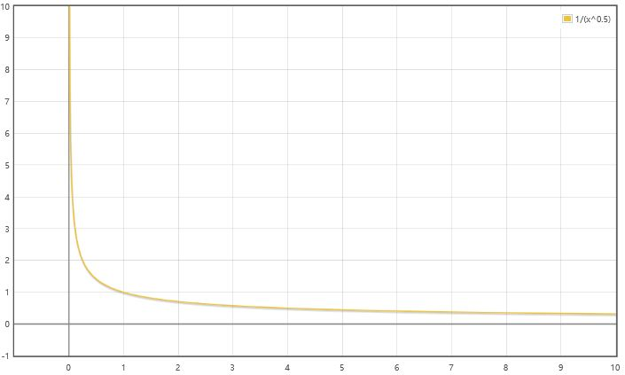

#### 量化方法
对于$y = Rsqrt(x)$有： $(y_q+zp_y)/s_y = Rsqrt((x_q+zp_x)/s_x)$,
从而： $y_q = Rsqrt((x_q+zp_x)/s_x)s_y - zp_y$,
因此可离线做lut查找表：

- 根据$x_q$的数据类型枚举得到值域集合$\hat{x_q}$（若$x_q$范围较大，可采样获得一个子集）
- 对$\hat{x_q}$反量化获得$\hat{x_f}$
- 对$\hat{x_f}$计算Rsqrt函数值获得$\hat{y_f}$
- 量化$\hat{y_f}$获得最终的lut表

前向计算查表时如果lut是采样后的小表，则需要做相应的插值操作。

#### 规格说明

```text
Input 0:
   data_type  : uint
   granularity: per-tensor
Output 0:
   data_type  : uint
   granularity: per-tensor
restriction: none
```

### Selu
#### 算子定义
Takes an input tensor (X) and prodeces one output tensor (Y), where the scaled exponential linear unit function `f(x) = gamma * (alpha * (exp(x) -1)) for x <= 0, f(x) = gamma * x for x > 0`, is applied to the tensor elementwise.

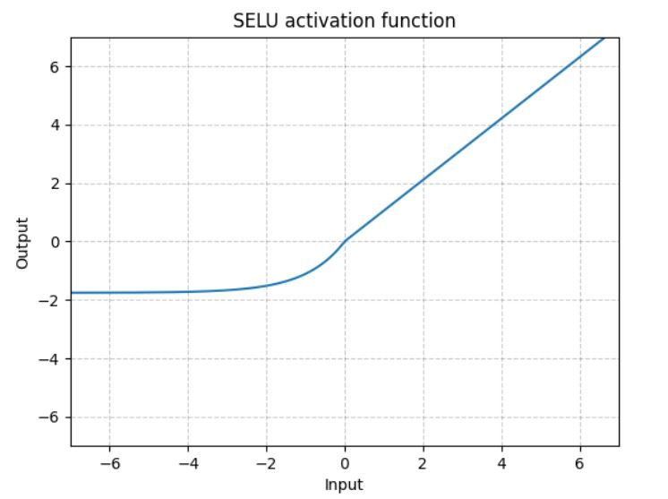

#### 量化方法
对于$y = Selu(x)$有： $(y_q+zp_y)/s_y = Selu((x_q+zp_x)/s_x)$,
从而： $y_q = Selu((x_q+zp_x)/s_x)s_y - zp_y$,
因此可离线做lut查找表：

- 根据$x_q$的数据类型枚举得到值域集合$\hat{x_q}$（若$x_q$范围较大，可采样获得一个子集）
- 对$\hat{x_q}$反量化获得$\hat{x_f}$
- 对$\hat{x_f}$计算Selu函数值获得$\hat{y_f}$
- 量化$\hat{y_f}$获得最终的lut表

前向计算查表时如果lut是采样后的小表，则需要做相应的插值操作。需要注意的是Selu函数沿x负半轴缓慢下降趋于平坦，若输入$x$的min取值过小则会导致量化后的值大量趋同无法区分（即量化后表达精度不够），影响整体算子精度，也浪费了lut空间，故在调节Selu算子精度时需重点调节$x$的min取值。

#### 规格说明

```text
Input 0:
   data_type  : int or uint
   granularity: per-tensor
Output 0:
   data_type  : int or uint
   granularity: per-tensor
restriction: none
```

### Sigmoid
#### 算子定义
Takes one input tensor and produces one output tensor, where the sigmoid function y = 1 / (1 + exp(-x)), is applied to the tensor elementwise.

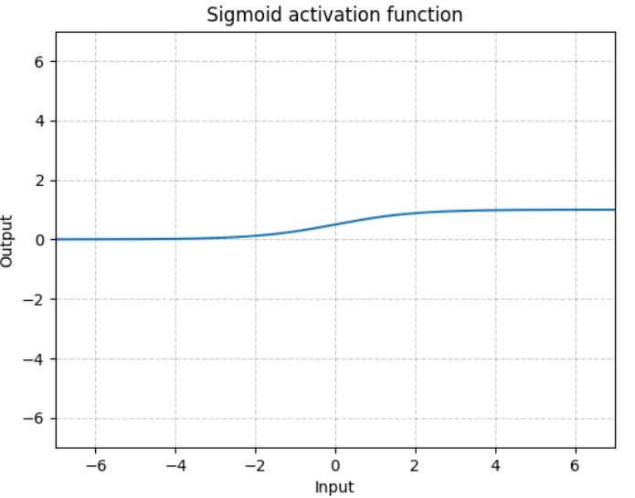

#### 量化方法
对于$y = Sigmoid(x)$有： $(y_q+zp_y)/s_y = Sigmoid((x_q+zp_x)/s_x)$,
从而： $y_q = Sigmoid((x_q+zp_x)/s_x)s_y - zp_y$,
因此可离线做lut查找表：

- 根据$x_q$的数据类型枚举得到值域集合$\hat{x_q}$（若$x_q$范围较大，可采样获得一个子集）
- 对$\hat{x_q}$反量化获得$\hat{x_f}$
- 对$\hat{x_f}$计算Sigmoid函数值获得$\hat{y_f}$
- 量化$\hat{y_f}$获得最终的lut表

前向计算查表时如果lut是采样后的小表，则需要做相应的插值操作。需要注意的是Sigmoid函数沿x正负半轴均缓慢趋于平坦，若输入$x$的min取值过小或max取值过大则会导致量化后的值大量趋同无法区分（即量化后表达精度不够），影响整体算子精度，调节精度时输入的min,max取值可于较近处截断（如经验值6.0附近）。

#### 规格说明

```text
Input 0:
   data_type  : int or uint
   granularity: per-tensor
Output 0:
   data_type  : uint
   granularity: per-tensor
restriction: none
```

### Sine
#### 算子定义
Calculates the sine of the given input tensor by element-wise.

#### 量化方法
略。参考[Cosine](###Cosine)

#### 规格说明
略。参考[Cosine](###Cosine)

### Sign
#### 算子定义
Calculates the sign of the given input tensor (X) element-wise. That is, `f(x) = 1 if x >0; f(x) = 0 if x == 0; f(x) = -1 if x < 0`.

#### 量化方法
由$y_f = Sign(x_f)$，有$(y_q + zp_y)/s_y = Sign((x_q + zp_x)/s_x)$，即
$y_q = Sign((x_q + zp_x)/s_x)s_y - zp_y$，
$y_q = Sign(x_q + zp_x)s_y - zp_y$.
令$s_y=1, zp_y=0$，即有：$y_q = Sign(x_q + zp_x)$

#### 规格说明

```text
Input 0:
   data_type  : int or uint
   granularity: per-tensor
Output 0:
   data_type  : int
   granularity: per-tensor
restriction: none
```

### Slice
#### 算子定义
Produces a slice of the input tensor (X) along multiple axes.

#### 量化方法
略。参考[Crop](###Crop)

#### 规格说明
略。参考[Crop](###Crop)

### Softmax
#### 算子定义
Applies the Softmax function to an n-dimensional input Tensor rescaling them so that the elements of the n-dimensional output Tensor lie in the range [0,1] and sum to 1.

Softmax is defined as: $ Softmax(x_i) = \frac{e^{x_i}}{\sum_j{e^{x_i}}} $

#### 量化方法
由$y_f=Softmax(x_f)$, 可得$(y_q+zp_y)/s_y = Softmax((x_q+zp_x)/s_x)$,
从而$y_q = (e^{(x_q+zp_x)/s_x} / \sum_j{e^{(x_q+zp_x)/s_x}}) s_y - zp_y$.

对于$e^x$计算，采用LUT(lookup table)查表的方式计算，由于指数函数（见下图）对于$x$的负数值非常平坦（此类值量化后大量变成0或1导致精度丢失），对于$x$的正数值迅速攀升（LUT不能存储过大的数），故限定LUT中存储的最大值恰好不得超过$2^{20}$（在使用32bit数做累加器时，则最多允许$2^{12}=4096$个项求和），实现时通过对输入值做整体平移使得最大输入值接近$\log({2^{20}})$（易看出对于softmax函数，有softmax(x)=softmax(x+a), 其中a为常量）。


LUT表具体构建如下：

- step1 确定LUT允许的最大值2^20对应的输入值即xm_f = log(2^20)
- step2 确定xm_f对应（按softmax的输入tensor的量化参数）量化后的值xm_q
- step3 根据LUT表的大小size确定定义域Xq
- step4 将定义域Xq（按softmax的输入tensor的量化参数）反量化得到Xf
- step5 对Xf中各项计算指数函数结果并取整，然后存入LUT

LUT表离线构建完成后，量化forward在线运算时步骤如下：

- step1 对于输入值Xq查表得到其指数函数结果
- step2 对指数函数结果做累加运算
- step3 对Softmax公式中分子放大M倍（即乘以$s_y \approx M/2^N$中的M, M,N均为整数）
- step4 进行Softmax公式中的除法计算（即整数域上的整除和求余，并根据余数对商做四舍五入）
- step5 执行剩余的移位, 减zero point运算（精度允许的条件下，可取$s_y = 2^B-1,zp_y=0$以省略本步骤, 其中B为最终结果的量化比特数）

#### 规格说明

```text
Input 0:
   data_type  : int or uint
   granularity: per-tensor
Output 0:
   data_type  : uint
   granularity: per-tensor
restriction: only support j <= 4096 in softmax formula, due to numerical precision issue
```

### Softplus
#### 算子定义
Takes one input tensor (X) and produces one output tensor (Y), where the function y = loge(exp(x) + 1), is applied to the tensor elementwise.

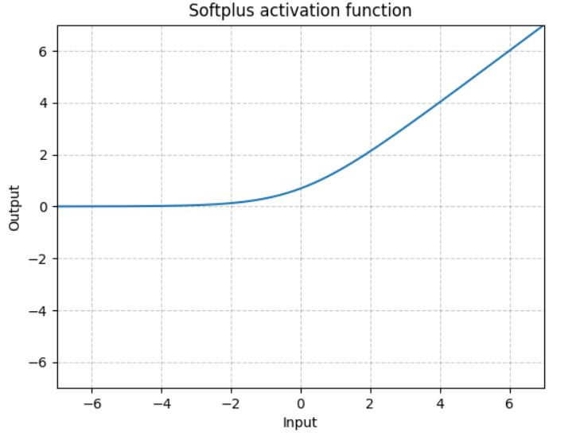

#### 量化方法
对于$y = Softplus(x)$有： $(y_q+zp_y)/s_y = Softplus((x_q+zp_x)/s_x)$,
从而： $y_q = Softplus((x_q+zp_x)/s_x)s_y - zp_y$,
因此可离线做lut查找表：

- 根据$x_q$的数据类型枚举得到值域集合$\hat{x_q}$（若$x_q$范围较大，可采样获得一个子集）
- 对$\hat{x_q}$反量化获得$\hat{x_f}$
- 对$\hat{x_f}$计算Softplus函数值获得$\hat{y_f}$
- 量化$\hat{y_f}$获得最终的lut表

前向计算查表时如果lut是采样后的小表，则需要做相应的插值操作。同时需要注意的是Softplus函数沿x负半轴缓慢下降趋于平坦，若输入$x$的min取值过小则会导致量化后的值大量趋同无法区分（即量化后表达精度不够），影响整体算子精度，也浪费了lut空间，故在调节算子精度时需重点调节$x$的min取值。

#### 规格说明

```text
Input 0:
   data_type  : int or uint
   granularity: per-tensor
Output 0:
   data_type  : uint
   granularity: per-tensor
restriction: none
```

### Softsign
#### 算子定义
Takes one input tensor (X) and produces one output tensor (Y), where the function `y = x / (abs(x) + 1)`, is applied to the tensor elementwise.

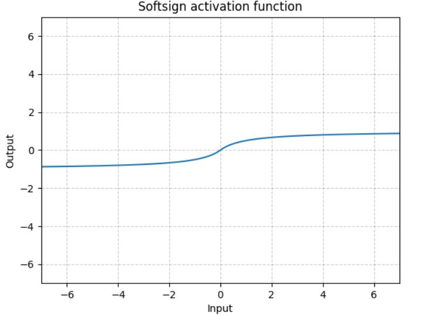

#### 量化方法
对于$y = Softsign(x)$有： $(y_q+zp_y)/s_y = Softsign((x_q+zp_x)/s_x)$,
从而： $y_q = Softsign((x_q+zp_x)/s_x)s_y - zp_y$,
因此可离线做lut查找表：

- 根据$x_q$的数据类型枚举得到值域集合$\hat{x_q}$（若$x_q$范围较大，可采样获得一个子集）
- 对$\hat{x_q}$反量化获得$\hat{x_f}$
- 对$\hat{x_f}$计算Softsign函数值获得$\hat{y_f}$
- 量化$\hat{y_f}$获得最终的lut表

前向计算查表时如果lut是采样后的小表，则需要做相应的插值操作。同时需要注意的是由对称性Softsign(-x)=-Softsign(x)，实际可只对正半轴存储lut表以节约空间。

#### 规格说明

```text
Input 0:
   data_type  : int or uint
   granularity: per-tensor
Output 0:
   data_type  : int
   granularity: per-tensor
restriction: none
```

### SpaceToBatch
#### 算子定义
Rearranges (permutes) data from blocks of spatial data into batch. This is the reverse transformation of BatchToSpace. More specifically, this operator outputs a copy of the input tensor where values from the height and width dimensions are moved to the batch dimensions.

#### 量化方法
略。参见[BatchToSpace](###BatchToSpace)

#### 规格说明
略。参见[BatchToSpace](###BatchToSpace)

### SpaceToDepth
#### 算子定义
Rearranges (permutes) data from blocks of spatial data into depth. This is the reverse transformation of DepthToSpace. More specifically, this operator outputs a copy of the input tensor where values from the height and width dimensions are moved to the depth dimensions.

#### 量化方法
略。参见[DepthToSpace](###DepthToSpace)

#### 规格说明
略。参见[DepthToSpace](###DepthToSpace)

### Split
#### 算子定义
Splits a tensor into a list of tensors along the specified ‘axis’ direction.

#### 量化方法
略。参考[Crop](###Crop)

#### 规格说明
略。参考[Crop](###Crop)

### Sqrt
#### 算子定义
Square root takes one input tensor (X) and produces one output tensor (Y), where the square root is, y = x^0.5, is applied to the tensor elementwise.

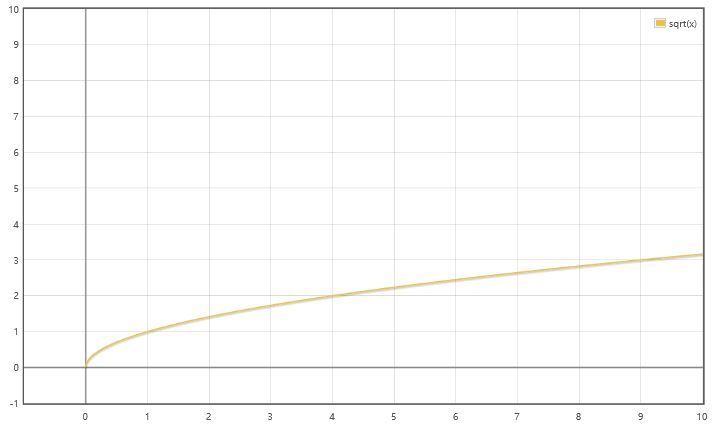

#### 量化方法
对于$y = Sqrt(x)$有： $(y_q+zp_y)/s_y = Sqrt((x_q+zp_x)/s_x)$,
从而： $y_q = Sqrt((x_q+zp_x)/s_x)s_y - zp_y$,
因此可离线做lut查找表：

- 根据$x_q$的数据类型枚举得到值域集合$\hat{x_q}$（若$x_q$范围较大，可采样获得一个子集）
- 对$\hat{x_q}$反量化获得$\hat{x_f}$
- 对$\hat{x_f}$计算Sqrt函数值获得$\hat{y_f}$
- 量化$\hat{y_f}$获得最终的lut表

前向计算查表时如果lut是采样后的小表，则需要做相应的插值操作。

#### 规格说明

```text
Input 0:
   data_type  : uint
   granularity: per-tensor
Output 0:
   data_type  : uint
   granularity: per-tensor
restriction: none
```

### Square
#### 算子定义
Computes square of input tensor (X) elements-wise, where the equation is y = x^2.

#### 量化方法
略，可参考[ElementwiseMul](###ElementwiseMul)

为快速计算也可采用lut查表方式计算，并且利用Square(-x)=Square(x)对称性只存储正半轴的表以节约空间。

#### 规格说明

```text
Input 0:
   data_type  : int or uint
   granularity: per-tensor
Output 0:
   data_type  : uint
   granularity: per-tensor
restriction: none
```

### SquareDifference
#### 算子定义
Computes square of difference of input tensor $(x_1, x_2)$ elements-wise, where the equation is $y = (x_1 - x_2)^2$.

#### 量化方法
对于$y = (x_1 - x_2)^2$： 令$s_{min} = min(s_{x_1}, s_{x_2})$， $scale1 = s_{min} / s_{x_1} * multiplier$, $scale2 = s_{min} / s_{x_2} * multiplier$, multiplier是扩大因子。

则${x'_1}_q = ({x_1}_q + zp_{q1})* scale1$, ${x'_2}_q = ({x_2}_q + zp_{q2})* scale2$, 因为${x'_1}_q$和${x'_2}_q$统一到了相同的$s_{min}$, 则$diff_q = {x'_1}_q - {x'_2}_q$, $y_q = {diff_q}^2 * s_y / {(s_{min}* multiplier)}^2 - zp_y$.

因$scale1$, $scale2$和$s_y / {(s_{min} * multiplier)}^2$为浮点数，且可在离线量化过程中确定，为便于在整数域计算，近似转换为$M/2^N$的规范形式（M, N均为整数）。

令$scale1 = M_0 / 2^{N_0}$, $scale2 = M_1 / 2^{N_1}$, $s_y / {(s_{min} * multiplier)}^2 = M_2 / 2^{N_2}$，

所以${x'_1}_q = ({x_1}_q + zp_{q1})* M_0 / 2^{N_0}$, ${x'_2}_q = ({x_2}_q + zp_{q2})* M_1 / 2^{N_1}$, $y_q = {diff_q}^2 * M_2 / 2^{N_2} - zp_y$.

#### 规格说明

```text
Input 0:
   data_type  : int or uint
   granularity: per-tensor
Output 0:
   data_type  : uint
   granularity: per-tensor
restriction: none
```

### Tanh
#### 算子定义
Calculates the hyperbolic tangent of the given input tensor element-wise.

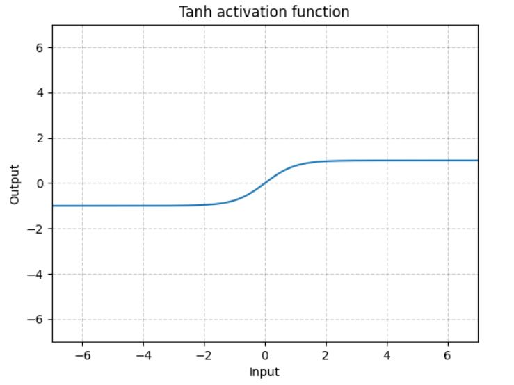

#### 量化方法
对于$y = Tanh(x)$有： $(y_q+zp_y)/s_y = Tanh((x_q+zp_x)/s_x)$,
从而： $y_q = Tanhc((x_q+zp_x)/s_x)s_y - zp_y$,
因此可离线做lut查找表：

- 根据$x_q$的数据类型枚举得到值域集合$\hat{x_q}$（若$x_q$范围较大，可采样获得一个子集）
- 对$\hat{x_q}$反量化获得$\hat{x_f}$
- 对$\hat{x_f}$计算Tanh函数值获得$\hat{y_f}$
- 量化$\hat{y_f}$获得最终的lut表

前向计算查表时如果lut是采样后的小表，则需要做相应的插值操作。需要注意的是Tanh函数沿x正负半轴均缓慢趋于平坦，若输入$x$的min取值过小或max取值过大则会导致量化后的值大量趋同无法区分（即量化后表达精度不够），影响整体算子精度，调节精度时输入的min,max取值可于较近处截断（如经验值3.0附近）。同时注意到对称性Tanh(-x)=-Tanh(x)，可只对正半轴做表以节约lut空间。

#### 规格说明

```text
Input 0:
   data_type  : int or uint
   granularity: per-tensor
Output 0:
   data_type  : int
   granularity: per-tensor
restriction: none
```

### Tile
#### 算子定义
Constructs a tensor by tiling a given tensor.

#### 量化方法
略。参考[Crop](###Crop)

#### 规格说明
略。参考[Crop](###Crop)

### TopK
#### 算子定义
Retrieves the top-K largest or smallest elements along a specified axis, it returns two outputs: Values, Indices.

#### 量化方法
根据定义，容易得出，对于$y_f, z_f = TopK(x_f)$有$y_q, z_q = TopK(x_q)$. 即前向运算过程和浮点域上的计算方式一样，无需多余的量化相关运算。

#### 规格说明

```text
Input 0:
   data_type  : int or uint
   granularity: per-tensor
Output 0:
   data_type  : int or uint
   granularity: per-tensor
Output 1:
   data_type  : uint
   granularity: per-tensor
restriction: none
```

### Transpose
#### 算子定义
Permutes the input tensor similarly to Numpy-style.

#### 量化方法
略。参考[Reshape](###Reshape)

#### 规格说明
略。参考[Reshape](###Reshape)

### UpsampleByIndex
#### 算子定义
Performs Upsample operation on the inputs according to the index in corresponding indices tensor and returns the output tensor Y.

#### 量化方法
由算子定义可知$(y_q+zp_y)/s_y = UpsampleByIndex((x_q+zp_x)/s_x, \ indices)$,
从而$y_q=(UpsampleByIndex(x_q, \ indices) + zp_x) s_y/s_x - zp_y$. 令$s_y$等于$s_x$, $zp_y$等于$zp_x$, 则整数域上的UpsampleByIndex运算方式可与浮点域上一致，无需多余的量化相关操作。

#### 规格说明

```text
Input 0:
   data_type  : int or uint
   granularity: per-tensor
Input 1:
   data_type  : uint
   granularity: per-tensor
Output 0:
   data_type  : int or uint
   granularity: per-tensor
restriction: none
```

### Where
#### 算子定义
Selects elements from x or y, depending on different conditions. That is, the condition tensor acts as a mask that chooses, based on the value at each element, whether the corresponding element or row in the output should be taken from x (condition `True`) or y (condition `False`). The parameters are in order of [condition, X1, X2]. Generally, the data type of input condition tensor (C1) is an integer in float or int IR, and its value is 0 or 1.

#### 量化方法
由算子定义$z_f = where(c_f, x_f, y_f)$，有$(z_q+zp_z)/s_z = where((c_q+zp_c)/s_c, \ (x_q+zp_x)/s_x, \ (y_q+zp_y)/s_y)$，从而：
$z_q = where((c_q+zp_c)/s_c, \ (x_q+zp_x)/s_x, \ (y_q+zp_y)/s_y)s_z - zp_z$
$z_q = where((c_q+zp_c)/s_c, \ (x_q+zp_x)s_z/s_x - zp_z, \ (y_q+zp_y)s_z/s_y - zp_z)$
因c为布尔类型，令$s_c=1, zp_c=0$. 同时可离线将$s_z/s_x, s_z/s_y$分别表示为规范形式$M_0/2^{N_0}, M_1/2^{N_1}$，其中$M_0, N_0, M_1, N_1$均为整数。则最终：
$z_q = where(c_q, \ (x_q+zp_x)M_0/2^{N_0} - zp_z, \ (y_q+zp_y)M_1/2^{N_1} - zp_z)$

#### 规格说明

```text
Input 0:
   data_type  : uint
   granularity: per-tensor
Input 0:
   data_type  : int or uint
   granularity: per-tensor
Input 1:
   data_type  : int or uint
   granularity: per-tensor
Output 1:
   data_type  : int or uint
   granularity: per-tensor
restriction: none
```

## 4. 周易AIPU模型量化实例教程

### 4.1 Mask R-CNN
Mask R-CNN[^20][^21][^22]是ICCV2017的best paper，在一个网络中同时做目标检测（`object detection`）和实例分割（`instance segmentation`）。在COCO数据集的三个挑战赛：`instance segmentation`、`bounding-box object detecton`、`person keypoint detection`中的效果都要优于之前的单模型算法（包括COCO2016比赛的冠军算法）。

#### 4.1.1 模型结构简介
从名字就可知道，它与R-CNN系列有着密不可分的关系，若对Faster R-CNN[^23]熟悉的话就会发现其结构有很大的相似性，接下来我们先大致分析下其异同点（从量化角度来考量）。

模型整体结构如下图所示，原始图片经过特征提取之后，与Faster R-CNN的RoIPooling不同的是这里经过RoiAlign进行处理从而得到固定大小的特征图，而后进行分类、分割等任务处理。

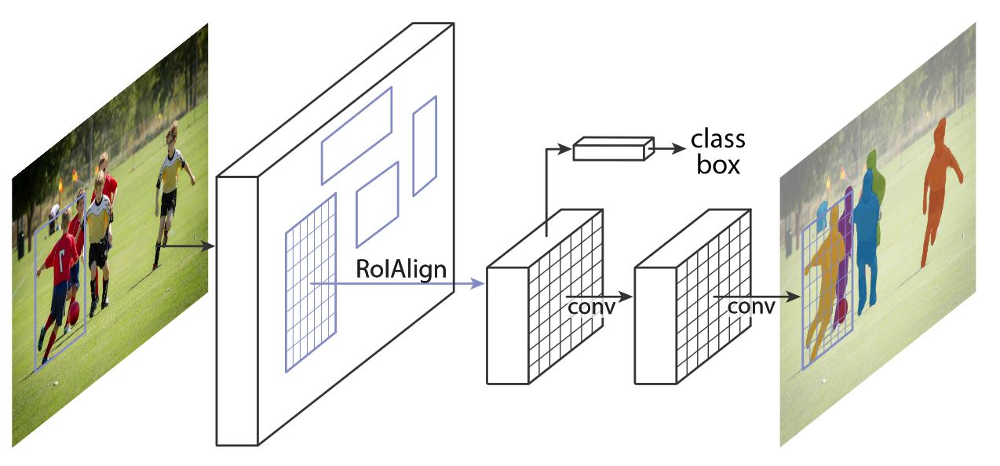

需要注意的是，Mask R-CNN不是指某一种具体的算法，而是一个灵活的框架，其具有很好的拓展性以及易用性，大致认为在Faster R-CNN负责检测的基础上加入不同的分支就可以完成不同的任务，比如可以实现目标分类、目标检测、语义分割、实例分割、人体姿势识别等。

整个模型的算法思路非常直观，就是在原始的Faster R-CNN算法基础上增加了FCN来产生对应的mask分支，具体到tensorflow实现版本来说就是，FPN特征金字塔模型进行特征提取，然后ROIalign进行特征固定size，最后分别走类Faster R-CNN的检测分支，跟FCN分支，整体如下图所示:

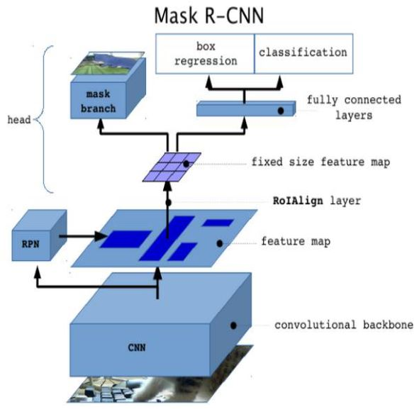

我们就tensorflow版的代码进行一下梳理，可以得到以下的具体实现细节：

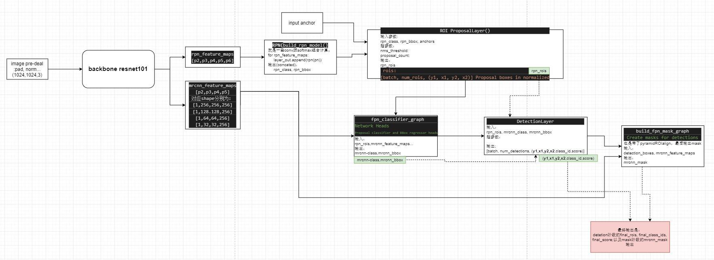

- 原始的输入图像尺寸是1024\*1024\*3，经过backbone模型resnet101，并通过FPN结构得到rpn层的特征层（P2,P3,P4,P5,P6），得到mrcnn特征层(P2,P3,P4,P5)；

- rpn的每一个特征层经过一系列conv以及softmax计算，得到rpn_class,rpn_bbox,将不同层的输出拼接起来，跟anchor节点一起送入ROI proposal层，基于预设的一些筛选超参数，最终输出固定size的rpn_rois格式为：`[batch, num_rois, (y1, x1, y2, x2)] Proposal boxes in normalized`；

- 这部分rois第一阶段候选框会首先进入分类头网络fpn_classifier,在里面先PyramidROIAlign得到固定size的特征（需要结合mrcnn的各层特征来做），然后同样的接FC、softmax得到mrcnn_probs, mrcnn_bbox输出（给detection使用的）；

- detection层拿到第二阶段分类后的结果就进行调整框、NMS等操作了，最后输出一系列的框，这就是模型最后确定的输出框了；

- 然后mask分支拿到第二阶段确定好的框，以及mrcnn_feature_maps，就开始用FCN进行分割计算了，其内部也是先进行PyramidROIAlign操作，得到固定大小的shape，然后全卷积网络FCN直接算，最后经过sigmoid输出每个像素的概率。

再后面就是最后的数据后处理了，并没有包含在网络内，因此暂不考虑，实践中直接放到CPU中计算即可。

#### 4.1.2 模型算子一览
经过上述的分析，我们可以把需要量化的算子逐一筛选出来，然后分别量化，最后进行整网组合,追加细致微调即可实现Mask R-CNN量化：
- 由于backbone是resnet101，基于已有经验，这不是量化瓶颈点，因此直接用常规量化方案即可；
- proposal layer是由一系列的逻辑操作完成的，因此我们需要把这部分当做一个整体来考虑量化；
- NMS层在全定点模式下需要微调精度，同时需要考虑硬件可适配性，因此需要特殊设计量化方案；
- PyramidRoIalign层需要特殊量化以保证精度；
- fpn_classifier层中的softmax层需要特殊量化以保证模型整体精度；
- 其他例如concat, eltwise层等都需要结合模型微调方可达到很好的精度。

#### 4.1.3 量化精度调节
量化精度主要分为两个步骤，第一步把上一小节拆分的算子，先单个**算子粒度**量化完成，然后进行**block粒度**、**graph粒度**的精度调节即可。

##### 4.1.3.1 backbone resnet101 量化
resnet[^24]系列网络得整体结构如下所示：

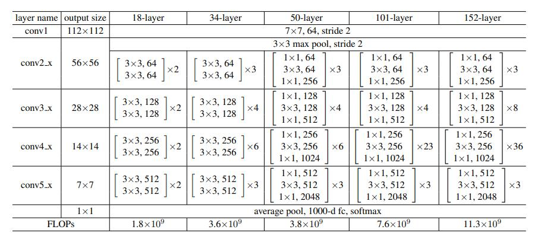

Mask R-CNN选择的是resnet101，包括如下主要算子需要量化:
1. Padding
2. Conv2D
3. BatchNormalization
4. ReLU
5. MaxPooling2D
6. **Conv_block**
7. **Identity_block**
8. AveragePooling2D
9. Softmax
10. ...

除了6、7号算子，其他算子均在前面章节有介绍，因此不再赘述。

而6、7号算子则是下图所示的模块，identity_block则是右图所示结构，包含Conv2D，BN，ReLU，ElementwiseAdd等组成部分，**而conv_block跟identity_block的唯一区别在于残差分支（shortcut）上有一个conv层**。

|基本residual模块结构|Identity block|Conv block|
|:----:|:----:|:----:|
|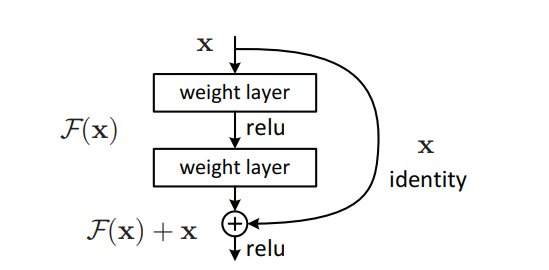|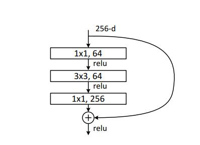|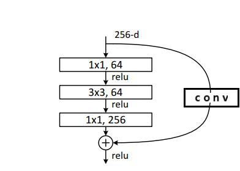|

**小结**：这一部分的量化直接遵循常规量化方案即可，基本无量化精度风险点。

##### 4.1.3.2 proposal layer量化
这一层是紧接在RPN层之后的，输入参数为RPN输出的候选框跟对应前后景概率，以及预先生成的anchors.
> `Region Proposal Network层：把（P2~P6）每一层都进行映射，映射成对应的候选框跟对应的前后景概率，每层的输出再分别拼接（Concatenate）起来；`

对应源码接口如下所示，proposal_count指定第一阶段筛选出多少个框，nms_threshold顾名思义作为阈值。
```python
rpn_rois = ProposalLayer(
    proposal_count=proposal_count,
    nms_threshold=config.RPN_NMS_THRESHOLD,
    name="ROI",
    config=config)([rpn_class, rpn_bbox, anchors])

```
实现细节参见源码[ProposalLayer](https://github.com/matterport/Mask_RCNN/blob/master/mrcnn/model.py). 计算流程大致为：
1. 输入anchors,rpn_scores,rpn_bbox(为deltas，调整参数)，为了性能考虑，首先基于NUMS = min(PRE_NMS_LIMIT=6000, anchor数量)参数，取rpn_scores的TopK，然后把这NUMS个数据抽离出来，当然对应的anchor也需要这样抽离一次；
2. 先粗选一遍，然后把剩下的NUMS个框直接applay_box_deltas()操作，也就是进行框的位置调整；
3. 调整完之后，框有可能是超出0~1归一化范围的，因此把超出范围的框给截取掉，此时接一个clip操作即可完成；
4. 此时已是调整之后的框了，我们需要把框进行NMS操作，选出第一阶段的输出框。

**TopK量化：**

由于8bit量化时进来的sores是int8量化的，同时topk选出来的个数为6000，因此很明显，精度可能会面临不够的问题，保守设计，我们在此处，scores采用int16精度进行表示。

采用了混合精度量化，为保证精度，score之前的softmax也必须采用int16，softmax采用的是LUT方案，因此，对应的softmax之前的conv2D层采用了int8 activation * int8 weights --> int16 output的量化方案，至此，精度链条才得以保证。

**applay_box_deltas()量化：**

从backbone过来的数据为int8类型，是从RPN输出的值进行concatenate得到的。

```python
# Note that P6 is used in RPN, but not in the classifier heads.
rpn_feature_maps = [P2, P3, P4, P5, P6]
mrcnn_feature_maps = [P2, P3, P4, P5]
anchors = input_anchors
# RPN Model
rpn = build_rpn_model(config.RPN_ANCHOR_STRIDE,
        len(config.RPN_ANCHOR_RATIOS),
        config.TOP_DOWN_PYRAMID_SIZE)
# Loop through pyramid layers
layer_outputs = []  # list of lists
for p in rpn_feature_maps:
    layer_outputs.append(rpn([p]))
# Concatenate layer outputs
# Convert from list of lists of level outputs to list of lists
# of outputs across levels.
# e.g. [[a1, b1, c1], [a2, b2, c2]] => [[a1, a2], [b1, b2], [c1, c2]]
output_names = ["rpn_class_logits", "rpn_class", "rpn_bbox"]
outputs = list(zip(*layer_outputs))
outputs = [KL.Concatenate(axis=1, name=n)(list(o))
            for o, n in zip(outputs, output_names)]

rpn_class_logits, rpn_class, rpn_bbox = outputs
```
此处需要注意的是，由于不同rpn_feature层[P2, P3, P4, P5, P6]的数据分布范围不一样，因此在量化时，量化模型就变为:

>out_f = [P2_f\*scale2, P3_f\*scale3, P4_f\*scale4, P5_f\*scale5, P6_f\*scale6 ]
> 此时在进行量化的时候，则面临选择哪个scale作为out_scale的问题了！不同的scale选择在当前节点tensor下有不同的精度损失，同时，在整个模型的精度表现中又有不同的精度损失贡献，而且这个节点是处于backbone跟postprocess过程的交界处，因此这一部分精度的重要性不言而喻。

我们量化的设计原则是：**“先保证单个算子精度，再融合进模型中进行微调或者全graph调优。”**， 因此，我们设计proposal layer层量化的时候，先假设进来的值是只有一次量化rounding误差的，于是，我们来统计其量化分布范围（Mask R-CNN stage1 box_encoding数据）：

|在TopK6000之前proposal输入分布|在TopK6000之后proposal输入分布|
|:----:|:----:|
|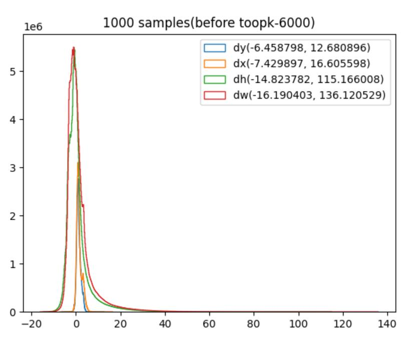|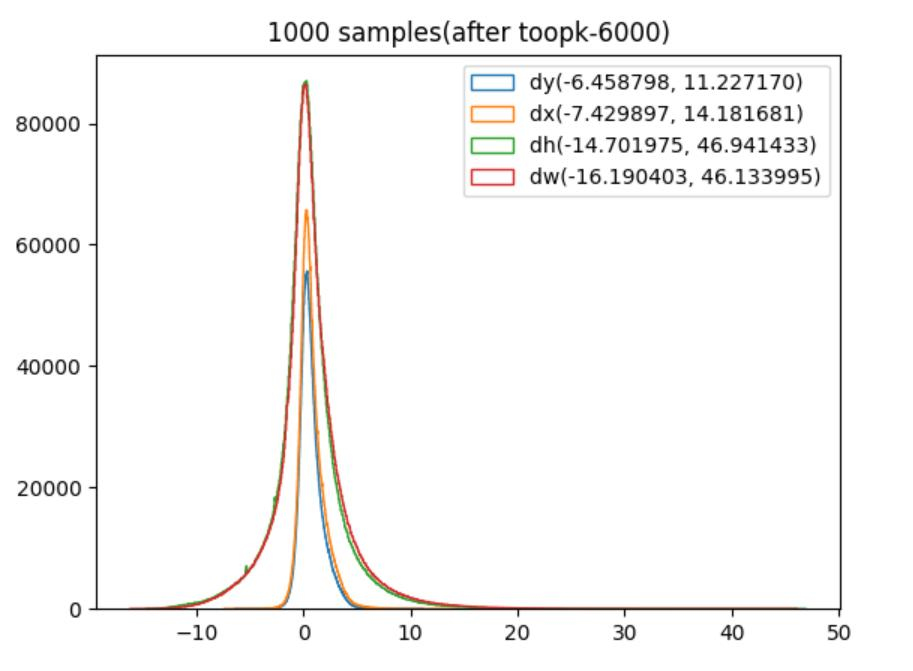|
|**tx分布**|**ty分布**|
|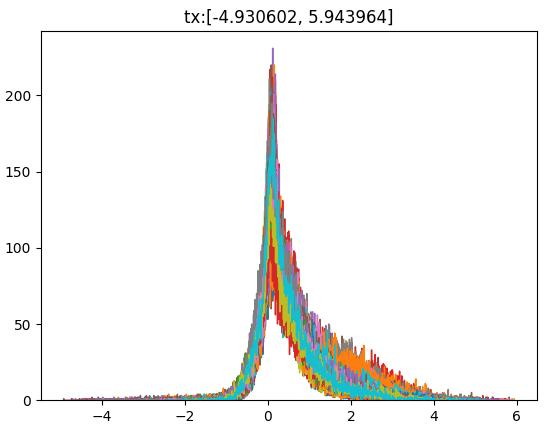|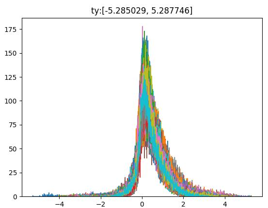|
|**tw分布**|**th分布**|
|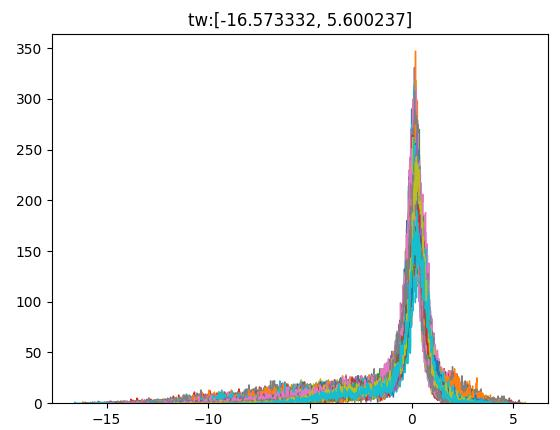|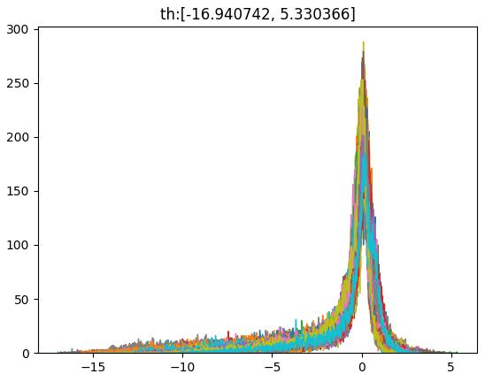|


通过统计中间计算过程的数据分布，我们可以得到一系列量化scale，其中exp函数的查找表设计细节可以从前面章节找到对应部分，在此，不再赘述。

clip操作在此处直接饱和即可。


**实现思路及细节：**

这一部分接收anchors以及RPN输出的deltas，做框的调整操作，跟第二阶段的decode_box是相同的操作流程，因此我们可以把这一部分给抽离出来，形成一个单独的算子，名为`boundingbox`层：

```python
def apply_box_deltas_graph(boxes, deltas):
    """Applies the given deltas to the given boxes.
    boxes: [N, (y1, x1, y2, x2)] boxes to update
    deltas: [N, (dy, dx, log(dh), log(dw))] refinements to apply
    """
    # Convert to y, x, h, w
    height = boxes[:, 2] - boxes[:, 0]
    width = boxes[:, 3] - boxes[:, 1]
    center_y = boxes[:, 0] + 0.5 * height
    center_x = boxes[:, 1] + 0.5 * width
    # Apply deltas
    center_y += deltas[:, 0] * height
    center_x += deltas[:, 1] * width
    height *= tf.exp(deltas[:, 2])
    width *= tf.exp(deltas[:, 3])
    # Convert back to y1, x1, y2, x2
    y1 = center_y - 0.5 * height
    x1 = center_x - 0.5 * width
    y2 = y1 + height
    x2 = x1 + width
    result = tf.stack([y1, x1, y2, x2], axis=1, name="apply_box_deltas_out")
    return result
```

大致思路就是要保证计算过程中的任何一个节点不会产生过大的量化误差，误差来源有floor误差、round误差以及主要关注的溢出误差。

##### 4.1.3.3 NMS量化

**NMS:**

tensorflow标准NMS调用流程如下所述，将框、分数、NMS内部选取个数、nms阈值四个参数传给tf标准实现，返回来的是有效框的下标位置，我们基于此位置信息抽取有效框，假如小于self.proposal_count个数则进行补零（这是为了方便后续处理，以及底层实现）。
```python
# Non-max suppression
def nms(boxes, scores):
    indices = tf.image.non_max_suppression(
        boxes, scores, self.proposal_count,
        self.nms_threshold, name="rpn_non_max_suppression")
    proposals = tf.gather(boxes, indices)
    # Pad if needed
    padding = tf.maximum(self.proposal_count - tf.shape(proposals)[0], 0)
    proposals = tf.pad(proposals, [(0, padding), (0, 0)])
    return proposals
proposals = utils.batch_slice([boxes, scores], nms,
                                self.config.IMAGES_PER_GPU)
return proposals
```
我们先看下float实现过程：

```python
def single_nms(self, box, score, max_nms_box_num):
    """
    多分类时的NMS也是按照每一类分别进行NMS的；
    params:
        box: 候选框
        score：候选框对应的概率；
        max_nms_box_num： 输出框个数上限；
    return:
        目标框对应的下标；

    """
    nms_box = torch.zeros((max_nms_box_num, 4))
    nms_score = torch.zeros((max_nms_box_num))
    keep = torch.zeros((max_nms_box_num))

    y0 = box[:, 0]
    x0 = box[:, 1]
    y1 = box[:, 2]
    x1 = box[:, 3]
    iou_threshold =  self.get_param('iou_threshold')
    areas = (y1 - y0) * (x1 - x0)# 算出所有候选框的面积；
    order = score[:].argsort(dim=-1,descending=True) #降序排序，选出概率最大的框；
    keep_idx = 0
    boxNum_perclass_single = 0
    device = x0[0].device
    while order.size()[0] > 0:
        boxNum_perclass_single += 1
        i = order[0]  #把分数最高的先存起来，因为，这个最有可能是目标框；

        keep[keep_idx] = i
        nms_box[keep_idx, :] = box[i, :]
        nms_score[keep_idx] = score[i]

        keep_idx += 1
        if keep_idx >= max_nms_box_num: #目标框够了，不能再多了，返回。
            break

        xx0 = torch.max(x0[i], x0[order[1:]])
        yy0 = torch.max(y0[i], y0[order[1:]])
        xx1 = torch.min(x1[i], x1[order[1:]])
        yy1 = torch.min(y1[i], y1[order[1:]])
        w = torch.max(torch.tensor(0.0).to(device), xx1 - xx0)
        h = torch.max(torch.tensor(0.0).to(device), yy1 - yy0)
        inter = w * h
        union = areas[i] + areas[order[1:]] - inter # 并集=A+B-交集；

        inter_area_thresh = union * iou_threshold # 交并比除法转成乘法操作；
        inds = torch.where(inter <= inter_area_thresh)[0] # IoU大于阈值的则大概率是重叠框，去除掉；
        order = order[inds + 1] # IoU小于阈值的才有可能是另外一个检测目标，存起来，下次用。

    boxNum_perclass = boxNum_perclass_single
    nms_box = nms_box[0:boxNum_perclass, :]
    nms_score = nms_score[0:boxNum_perclass]
    keep = keep[0:boxNum_perclass]
    return nms_box, nms_score, boxNum_perclass, keep

```

NMS定点化中会面临的几个问题点：

1. 计算过程中存在大量连续计算步骤，对应溢出风险较大，如何解决？
2. 溢出处理时如何处理精度跟溢出的权衡？
3. NMS出现小框丢失的情况时，量化如何调优？
4. iou_thresh如何在全定点部署环境中实现量化同时尽可能保证精度？

我们量化算法包中均已较好解决上述问题，限于篇幅，在此不赘述。

##### 4.1.3.4 PyramidRoIAlign量化

**PyramidRoIAlign：**
Mask R-CNN中源码如下：

```python
class PyramidROIAlign(KE.Layer):
    """Implements ROI Pooling on multiple levels of the feature pyramid.
    """

    def __init__(self, pool_shape, **kwargs):
        super(PyramidROIAlign, self).__init__(**kwargs)
        self.pool_shape = tuple(pool_shape)

    def call(self, inputs):
        # Crop boxes [batch, num_boxes, (y1, x1, y2, x2)] in normalized coords
        boxes = inputs[0]

        # Image meta
        # Holds details about the image. See compose_image_meta()
        image_meta = inputs[1]

        # Feature Maps. List of feature maps from different level of the
        # feature pyramid. Each is [batch, height, width, channels]
        feature_maps = inputs[2:]

        # Assign each ROI to a level in the pyramid based on the ROI area.
        y1, x1, y2, x2 = tf.split(boxes, 4, axis=2)
        h = y2 - y1
        w = x2 - x1
        # Use shape of first image. Images in a batch must have the same size.
        image_shape = parse_image_meta_graph(image_meta)['image_shape'][0]


        # 这部分计算ROI属于哪个level时，为了兼容移植，可以考虑判断实现方案；
        # Equation 1 in the Feature Pyramid Networks paper. Account for
        # the fact that our coordinates are normalized here.
        # e.g. a 224x224 ROI (in pixels) maps to P4
        image_area = tf.cast(image_shape[0] * image_shape[1], tf.float32)
        # roi_level限制在[2.5]之间，对应[P2,P3,P4,P5]
        roi_level = log2_graph(tf.sqrt(h * w) / (224.0 / tf.sqrt(image_area)))
        roi_level = tf.minimum(5, tf.maximum(
            2, 4 + tf.cast(tf.round(roi_level), tf.int32)))
        # 压缩roi_level的axis=2的轴，shape变化[batch, num_boxes,1]->[batch, num_boxes]
        roi_level = tf.squeeze(roi_level, 2)

        # Loop through levels and apply ROI pooling to each. P2 to P5.
        pooled = []
        box_to_level = []
        for i, level in enumerate(range(2, 6)):
            ix = tf.where(tf.equal(roi_level, level))
            # 提取满足索引的对应boxes
            level_boxes = tf.gather_nd(boxes, ix)

            # Box indicies for crop_and_resize.
            # 指定第i个方框要使用的图像，即指定第i个box对应batch中哪一张图像
            box_indices = tf.cast(ix[:, 0], tf.int32)

            # Keep track of which box is mapped to which level
            box_to_level.append(ix)

            # Stop gradient propogation to ROI proposals
            level_boxes = tf.stop_gradient(level_boxes)
            box_indices = tf.stop_gradient(box_indices)

            # Crop and Resize
            # Result: [batch * num_boxes, pool_height, pool_width, channels]
            # 使用tf.image.crop_and_resize实现简化的ROIAling，每个bin只取一个点
            pooled.append(tf.image.crop_and_resize(
                feature_maps[i], level_boxes, box_indices, self.pool_shape,
                method="bilinear"))

        # Pack pooled features into one tensor
        pooled = tf.concat(pooled, axis=0)

        # Pack box_to_level mapping into one array and add another
        # column representing the order of pooled boxes
        # 将box_to_level映射到一个数组中，并新增一列表示池化顺序
        box_to_level = tf.concat(box_to_level, axis=0)
        box_range = tf.expand_dims(tf.range(tf.shape(box_to_level)[0]), 1)
        box_to_level = tf.concat([tf.cast(box_to_level, tf.int32), box_range],
                                 axis=1)

        # Rearrange pooled features to match the order of the original boxes
        # Sort box_to_level by batch then box index
        # TF doesn't have a way to sort by two columns, so merge them and sort.
        '''由于所有经过RPN推荐产生的ROIs都经过refined，
        因此其scale没有严格遵守RPN_ANCHOR_SCALES = (32, 64, 128, 256, 512)变化，
        这会导致pooled_features的顺序与原始boxes的顺序不同，因此需要重新排序。
        '''
        # 排序原则是首先根据batch排序，再根据box_index排序
        # 这里box_to_level[:, 0]为batch轴，×100000是为了加大权重，得到排序tensor
        sorting_tensor = box_to_level[:, 0] * 100000 + box_to_level[:, 1]
        # 根据sorting_tensor得到其top_all的排序索引，转置后得到升序索引
        ix = tf.nn.top_k(sorting_tensor, k=tf.shape(
            box_to_level)[0]).indices[::-1]
        # ix为pooled_features的重排序升序索引，排序依据为batch->box_index
        ix = tf.gather(box_to_level[:, 2], ix)
        pooled = tf.gather(pooled, ix)

        # Re-add the batch dimension
        pooled = tf.expand_dims(pooled, 0)
        return pooled

    def compute_output_shape(self, input_shape):
        return input_shape[0][:2] + self.pool_shape + (input_shape[2][-1], )
```

PyramidRoIAlign比RoIAlign就多了个特征金字塔部分，整体关系是，输入进来的nor_box，先判断是属于哪个特征层，紧接着就是直接做RoIAlign操作。

首先计算ROI属于哪一个特征层，计算代码如下：

```python
# Equation 1 in the Feature Pyramid Networks paper. Account for
# the fact that our coordinates are normalized here.
# e.g. a 224x224 ROI (in pixels) maps to P4
image_area = tf.cast(image_shape[0] * image_shape[1], tf.float32)
# roi_level限制在[2.5]之间，对应[P2,P3,P4,P5]
roi_level = log2_graph(tf.sqrt(h * w) / (224.0 / tf.sqrt(image_area)))
roi_level = tf.minimum(5, tf.maximum(
    2, 4 + tf.cast(tf.round(roi_level), tf.int32)))
# 压缩roi_level的axis=2的轴，shape变化[batch, num_boxes,1]->[batch, num_boxes]
roi_level = tf.squeeze(roi_level, 2)
```

> 这里可能会有些疑问，比如为什么是这么个计算公式?为什么超参值是224？
> 可以参见 https://github.com/matterport/Mask_RCNN/issues/128 上的回答。

知道属于哪一层了，紧接着就每一个nor_box做RoIAlign,整体流程如下所述

```python
for box in nor_box:
    roi_level = box_to_level(box)
    RoIAlign(box, roi_level)
```

> 注：
>
> RoIAlign与RoIpooling两者再算法上的异同点，即ROI Pooling采用了两次量化操作，而ROIAlign则没有采用量化操作，而是使用了线性插值算法；
>
> 可以认为RoIAlign是 RoIPooling的改进版，解决了映射误差和均分误差的问题，提高了总体的检测准确率。RoIAlign取消了量化操作，利用双线性插值的方法获得坐标为浮点数的像素点上的图像数值，从而将量化误差给最小化。

**代码移植：**

在双线性插值时，我们把ROIs一个一个进行处理,先做下预处理，把RIOS归一化坐标取出来，换算出ROI的w，然后除以pool_size_w,得到了每个section的步长，结合起点坐标就得到了每个section的坐标，然后把超出feature map的坐标给剔除掉;

```python
    resize_feature = torch.zeros((nor_box.shape[1], resize_height_, resize_width_, channel_))
    # for batchidx in range(feature.shape[0]):
    batch_idx = 0
    for boxidx in range(nor_box.shape[1]):
        y0 = nor_box[batch_idx, boxidx, 0]
        x0 = nor_box[batch_idx, boxidx, 1]
        y1 = nor_box[batch_idx, boxidx, 2]
        x1 = nor_box[batch_idx, boxidx, 3]
        image_width=feature.shape[1]
        image_height=feature.shape[2]
        channel=feature.shape[3]
        height_scale = (y1 - y0) * (image_height - 1) / (resize_height_ - 1)
        width_scale = (x1 - x0) * (image_width - 1) / (resize_width_ - 1)

        x = (image_width-1) * x0 + torch.arange(0,resize_width_, device=out.device) * width_scale
        y = (image_height-1) * y0 + torch.arange(0,resize_height_, device=out.device) * height_scale

        yy = torch.clamp(y, 0,  image_width- 1)
        xx = torch.clamp(x, 0, image_height - 1)

        top_y_index = (torch.floor(yy)).int()
        bottom_y_index = (torch.ceil(yy)).int()
        y_lerp = (yy - top_y_index).reshape(resize_height_,1).repeat(1, channel)
        # y_lerp = torch.repeat(y_lerp, channel).reshape(resize_height_, channel)
        left_x_index =(torch.floor(xx)).int()
        right_x_index=(torch.ceil(xx)).int()
        x_lerp = (xx - left_x_index).reshape(resize_width_,1).repeat(1,channel)
        # x_lerp=torch.repeat(x_lerp,channel).reshape(resize_width_,channel)
```

针对上面算出来的每一个点，我们可以直接求出临近的四个像素坐标（floor加ceil操作），然后按照双线性插值的公式[^25]直接求出结果即可，如下图示：

| 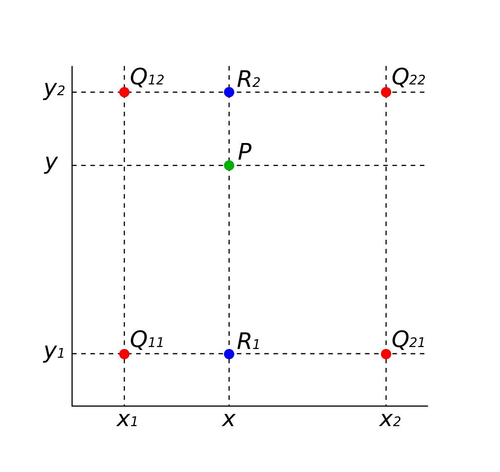 | 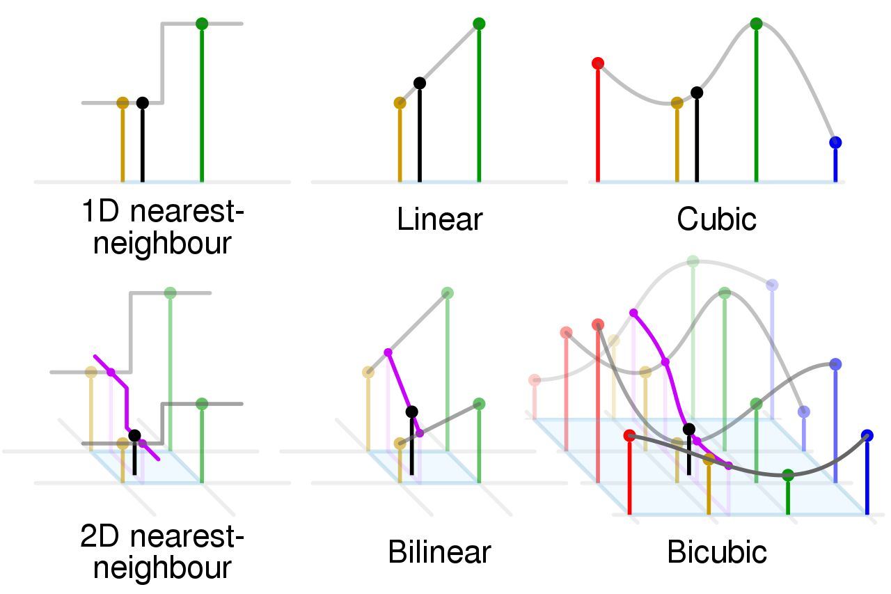 |
| ------------------------------- | ------------------------------- |

代码中按照公式直接进行计算即可。

```python
    for idxh in range(resize_height_):
        for idxw in range(resize_width_):
            #get 4 pointq
            top_left     = feature[0, top_y_index[idxh], left_x_index[idxw], :] #Q12
            top_right    = feature[0, top_y_index[idxh], right_x_index[idxw], :] #Q22
            bottom_left  = feature[0, bottom_y_index[idxh], left_x_index[idxw], :]#Q11
            bottom_right = feature[0, bottom_y_index[idxh], right_x_index[idxw], :]#Q21

            #bilinear interpretate
            # f(x,y)=Q12*(1-x_lerp)*(1-y_lerp)+Q22*x_lerp*(1-y_lerp)+Q11*(1-x_lerp)*y_lerp+Q21*x_lerp*y_lerp
            # Q11=bottom_left
            # Q12=top_left
            # Q21=bottom_right
            # Q22=top_right
            # data=top_left*(1-x_lerp[idxw,:])*(1-y_lerp[idxh,:])+top_right*(1-y_lerp[idxh,:])*x_lerp[idxw,:]
            # data=data+bottom_left*(1-x_lerp[idxw,:])*y_lerp[idxh,:]+bottom_right*x_lerp[idxw,:]*y_lerp[idxh,:]
            xy=y_lerp[idxh,:]*x_lerp[idxw,:]
            fourpoint_sum=(top_left+bottom_right-top_right-bottom_left)*xy
            top = top_left + (top_right-top_left)* x_lerp[idxw,:]
            bottom=(bottom_left - top_left) * y_lerp[idxh,:]
            data = fourpoint_sum+top+bottom

            resize_feature[boxidx, idxh, idxw, :] = data
```

**PyramidRoIAlign量化方案：**

主要关注下溢出问题即可，保证计算过程中的值累加不溢出。

其次，我们知道，P2~P5的分布是不一样的，这就导致量化后会出现如下问题，输出的box中有四种scale，而且位置是没有规律的，于是想要严格量化的话将是一个很难的问题；


我们可以选择加权该量化参数，从而平均最小化量化误差，我们看个实际的例子：

|      | P2     | P3    | P4     | P5     | nor_box |
| ---- | ------ | ----- | ------ | ------ | ------- |
| max  | 26.95  | 25.42 | 31.63  | 19.58  | 1.0     |
| min  | -26.11 | -25.2 | -25.29 | -20.97 | 0       |

可见，P2~P5的误差不是很大，因此我们可以直接选择max接近中位数的P2，作为输出的量化误差。实测精度较好（见4.1.4 结果分析部分），将来需要进一步调优模型时可以考虑进一步优化此部分。

关于具体实现细节，限于篇幅，在此不详细介绍。

#### 4.1.4 结果分析
如表所示：

|mAP@0.5  @100samples|float|quant|drop|
|:----:|:----:|:----:|:----:|
|**int8  @ 1   sample calibration**|68.01%|66.89%|1.12%|
|**int8  @ 100 sample calibration**|68.01%|66.68%|1.33%|
|**int16 @ 1   sample calibration**|68.01%|67.35%|0.66%|
|**int16 @ 100 sample calibration**|68.01%|67.65%|0.36%|

### 4.2 Stable Diffusion
Stable Diffusion[^26][^27] (v1.4) 是一个著名的开源图片生成式模型。其可以从文字或图片中提取特征并生成编码，并据此经过多次迭代生成符合编码提示的图片。经过模型的不断迭代，扩散模型已经取代对抗模型，VAE等，成为了主流的图像生成式模型。
下图是Stable Diffusion在Zhouyi Compass工具链上的实测demo:

 (Prompt: Japanese garden at wildlife river and mountain range, highly detailed, digital illustration, artstation, concept art, matte, sharp focus, illustration, dramatic, sunset, hearthstone, art by Artgerm and Greg Rutkowski)


可以看到，生成的图像逐渐在每一步的去噪中“浮现”出来。

#### 4.2.1 扩散方法
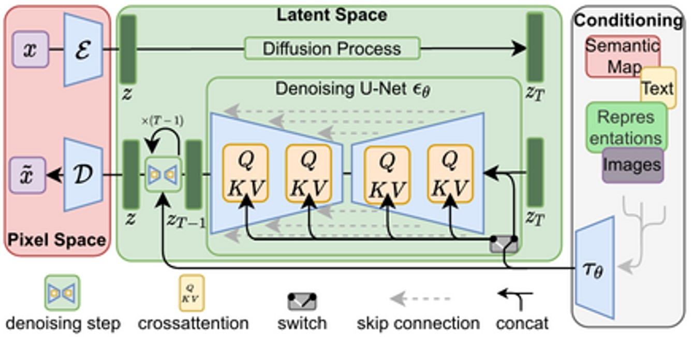
Image from theaisummer.com/diffusion-models/

**经典的DDPM扩散方法(Denoising Diffusion Probalistic Models)**

https://arxiv.org/abs/2006.11239

噪声扩散方法是精巧数学交响乐，每一个音符都是后面音符的铺垫，并在最后奏响最美妙的画卷。其可视化的迭代过程在众多深度学习（具有参数量大、解释性差等特性）算法中显得独树一帜。

首先让我们假设一个有序的图像序列$Z$，其初始时刻为$Z_0$。已知高斯模糊与高斯分布类似，拥有两个参数$\alpha,\beta$。我们将此刻的图片应用一次高斯模糊，显然，它变糊了。这时这张图像成为了$Z_1$。通过调整$\alpha,\beta$的大小（比如线性的方差scheduler），我们可以控制图像变模糊的成度。为了让这个过程逐渐发生，我们把这个加噪声的过程分解成1000步，直到最后的图像完全成为一张随机噪声图像为止。于是我们得到了$Z_0, Z_1, ..., Z_{999}$. 此时，整个噪声扩散的过程就可以描述为999个高斯概率分布的叠乘，也就成为了一个马尔科夫链。

而DDPM就是通过这个规律，把整个过程逆向，从随机噪声图片$Z_t$，逐步去噪而还原出图像$Z_0$。对于每一步逆向过程，有$q(z_{t-1}|z_t, z_0) = N(z_{t-1}; \alpha(z_t,z_0); \beta I)$。而其均值$\alpha$和方差$\beta$则是由训练后的UNet网络提供的。换句话来说，UNet网络（在提示编码的限制下）“背下了”每一步去噪过程中噪声的分布规律。因此，只要给一个任意噪声$Z_t$，再预测其（逆扩散的）噪声分布，再用$Z_t$减去噪声，得到$Z_{t-1}$。重复训练次数，比如1000步，就可以得到原图$Z_0$了。

**Stable Diffusion Breakdown**

以上是扩散方法的基本原理，下面介绍一下Stable Diffusion的模型功能分解。
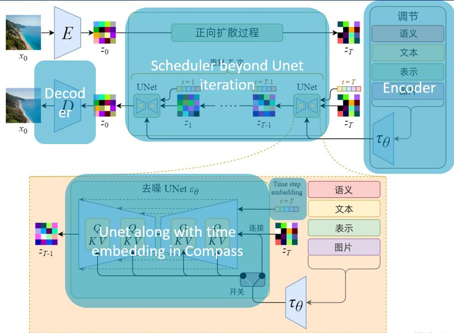
Image created from blog.csdn.net/m0_51976564/article/details/134744189


整个功能被分成了四个主要模块：

- Encoder（编码器）：用于将收到的文本提示词转换成隐藏维度的编码。主要由Transformer的Encoder部分组成。输出结果会直接被Unet里各个Transformer的Decoder模块当成k，v值计算。
- UNet（噪声预测）：根据给出的松弛量$Z_t$，预测其在t时刻的噪声分布。UNet里也包含对timestep嵌入到ResNets里的自动处理。因为UNet里有MatMul，Softmax等transformer相关的算子，其计算量会非常巨大。如果要生成512x512的图像，则最终需要计算一些512x512 x 512x512 = 262144 x 262144的张量，这是一个比较恐怖的计算量。因此，在松弛空间上进行扩散、去噪。以较多的Channel维度换取更小的特征图。同样生成512x512x3的图像，只需要在64x64x4的松弛空间上扩散，最终只需要处理8x4096x4096的张量。
- VAE Decoder（解码器）：把松弛空间的张量还原到像素空间。
- Scheduler（调度器）：根据扩散方法的原理，需要有一个调度器来协调高斯模糊的两个参数。在一些步数较少的去噪过程中，噪声会在前几步降的很快，再慢慢平缓。调度器还需要根据guidance scale参数把噪声从$Z_t$中减去。显然，DDPM的调度器本身不会很复杂，但目前主流应用的调度器中（尤其是DPMs类型的），因为要解算很多方程，所以调度器的实现就逐渐变得比较复杂了。

**DDPM to DDIM**

https://arxiv.org/abs/2010.02502

传统的扩散方法DDPM虽然简洁，但毕竟繁琐。如果UNet是根据1000步模糊训练的数据集，那么生成图像的也必须经历1000次逆过程，这大大限制了其应用价值。

DDIM（Denoising Diffusion Implicit Model）就是解决这个问题的一种尝试。DDIM的特点“隐式”体现在弱化DDPM的马尔科夫链的特点，将一头一尾都考虑到去噪的过程中，从而跳过中间许多步。实践中，只需要20-50步迭代即可达到1000步生成图像的相同的效果。

**DPM-Solver to UniPC**

[DPMs]https://arxiv.org/abs/2206.00927

DPM Solver是除了DDIM之外另一种加速DDPM的尝试。显然DDPM是一种离散的过程，需要多次采样。而DPM则把整个去噪过程看作一个连续过程，并用解析式表达出来，只需要采样少数几步，并解方程即可得到中间的迭代。同样的，DPM Solver也可以在几十步之内生成图像。

[UniPC]https://arxiv.org/abs/2302.04867
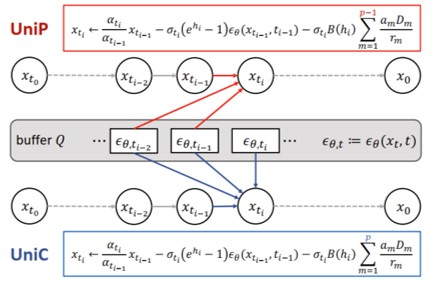

而UniPC则是DPMs的一个改进版，其采用了预测-修正模式，并考虑了多个step的修正。实践发现7-10步即可生成同样质量的图像。上图的Demo就是使用UniPC生成的。

#### 4.2.2 顶层优化

因为在三个网络中，UNet网络最大、计算成本最高，所以着重对其进行介绍。

**UNet结构**

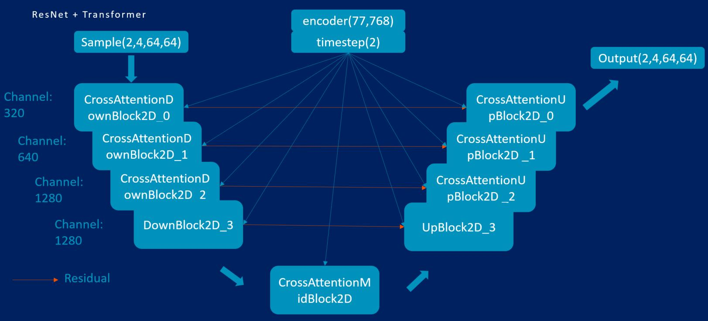
可以看到UNet由多个Block组成，其中包括CrossAttention Block以及Down、Up Block。带有CrossAttention的Block包含Transformers和ResNet，而不带的只包含ResNet。张量从第一个Block进入网络，随着网络的加深，其特征图越来越小，而通道越来越多，直到中间层。然后再慢慢上采样回原来的特征图大小以及通道数。在这个过程中，会有残差层从上面连到下面避免梯度消失。timestep作为当前去噪幅度的引导给到ResNet里，encoder则作用为transformer中decoder的k-v输入。

**网络简化**

在1.4版本的SD中，因为使用了默认的transformer库，所以在模型导出的时候会把Attention mask也导出。但图像模型并不需要这个特性，所以我们将所有attention mask都裁剪掉，减少了很多对大特征图张量的操作。

计算transformer中的K、V向量之后，需要对其矩阵乘积KxV除以$\sqrt{d_k}$。这部分系数可以直接合进量化后的MatMul之中，节省了大量layout转换时间。

经过NN compiler的处理后，原模型从导出ONNX时的三千多个node精简到一千七百个node左右，极大的提高了性能。

同时，我们也将Softmax的Channel均匀切分到多个NPU核中，以及将多头注意力按头的数量分到NPU的多核中去，提高了多核利用率。

#### 4.2.3 混合精度量化

SD的量化方案最终确定为混合精度量化，即大量的int8量化算子，少量的int16量化算子，以及个别float16算子。

首先float16算子包括LayerNorm, GroupNorm以及Softmax。因这三个算子对精度非常敏感，不适合进行int8量化，又因当前这三个算子的fp16版本性能优化更为完善，所以我们没有量化所有Norm以及Softmax算子。

对于剩余的算子，我们采用了以Block来区分其量化位宽。
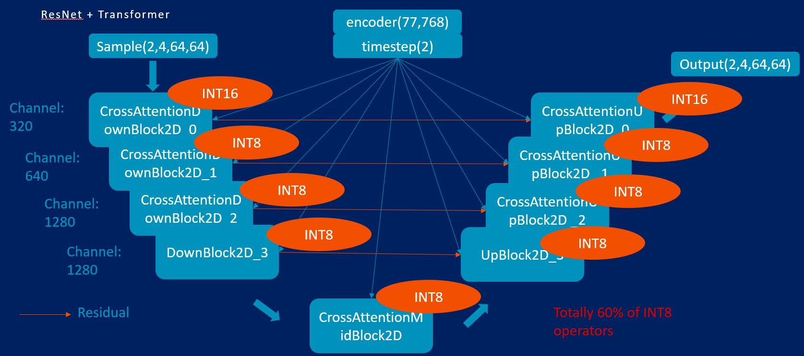
对于特征图大的、且通道数小的Block我们选择INT16量化，而特征图小、通道数大的Block可以进行INT8量化。因此，只有一头一尾两个Block采用了INT16量化。总共60%的算子采用了INT8量化，大大提升了性能。这样选择的原因是当通道数变多时，更多的信息被通道分割开保存，而Compass支持weight per-channel量化，因此可以给每个通道分配更灵活的channel scale，来保证精度。

#### 4.2.4 影响精度的主要因素

截至2023 Q4，UNet的量化Cosine精度（对比fp32）为$1-4\times10^{-5}$

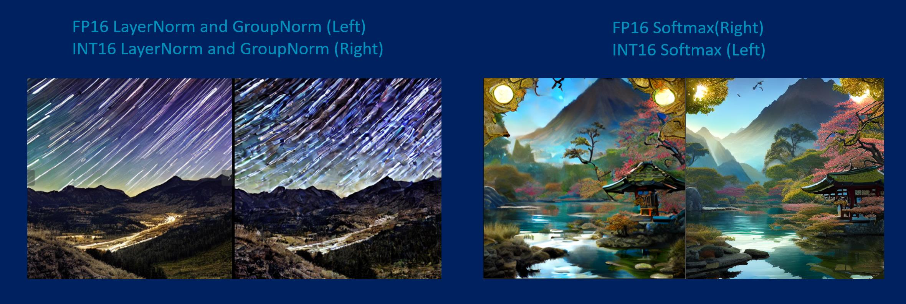

根据实践，Norm算子与Softmax对于精度异常敏感。因为各个Channel的均值通常有所差别，而现阶段Compass只支持activation per-tensor的量化，所以无法很好覆盖各个channel的值域。

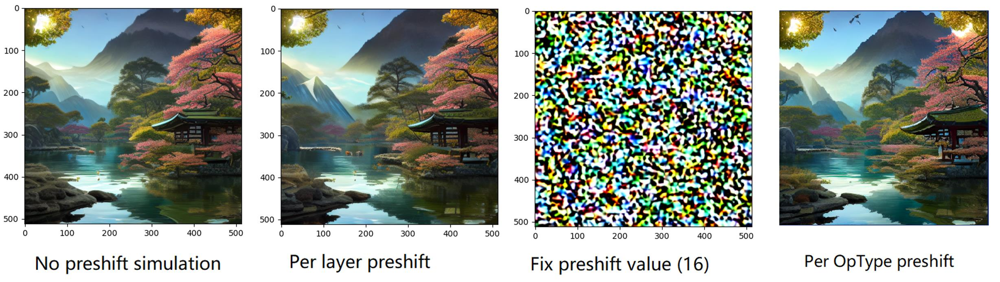
而计算型算子FullyConnected、Convolution以及MatMul因为Zhouyi NPU的计算特性需要调整pre-shift值来确保数值不会溢出。在NPU的计算单元MAC中，16比特数据乘加得到的数据位宽为48位，而后续乘以scale和右移shift的过程则在ITP中处理。ITP只会接收32位的数据。因此需要提前把shift右移一部分以适配ITP的位宽要求。而拆分右移的过程会造成一定的rounding误差。实践中，需要按算子调整拆分shift的大小以适配各个算子的值域特点。

#### 4.2.5 影响性能的主要因素

根据乘加操作数与内存访问量的对比，常见的语言大模型都是带宽密集型模型，即，限制模型推理速度的不是计算资源而是带宽资源。尤其是KV Cache的引入使得计算量与内存访问量几乎达到了1：1。而Stable Diffusion则不同，根据统计，UNet里最大的transformer结构中，总共访问了约5MB的内存，而进行了约79GB的乘加操作，远大于内存的访问量。这证明SD仍然是一个计算密集型模型。

在Zhouyi NPU中，最常见的影响性能的因素是因为流程设计原因导致被动增加的LayoutConvert操作，导致冗余的大量数据被搬运往复。这些问题在调试的过程中被逐一发掘并解决。

### 4.3 LLAMA2 模型

作为Meta在2023年发布的SOTA开源大语言模型（LLM)，llama2是llama1的升级版，模型架构基本一致，但训练所用的token翻了一倍至2万亿，同时对于使用大模型重要的上下文长度限制增加到4096，llama2模型[^28]包含了7B,13B,34B,70B参数的模型，本章以7B参数模型作为例子。

#### 4.3.1 模型架构


图左来自https://zhuanlan.zhihu.com/p/647862867，右图来自https://arxiv.org/abs/2310.01208

llama的架构相比其他LLM的架构有下面几个不同：

1. llama用RMSnorm替代了传统的layernorm，减少了inferece 时间
2. llama用ROPE替代了传统的绝对位置编码，ROPE考虑到上下文信息这样使得模型能理解每个字词之间的相关性
3. llama2使用GQA替代MHA减少了计算量，使得推理时间更短
4. llama FFN的激励函数使用swiGlu
5. 为了减少模型参数，FFN的隐藏层的长度为embedding_dim的8/3，其他模型则一般是embedding_dim*4

#### 4.3.2 GQA介绍

理解GQA之前先理解MHA，多头是指把嵌入的特征划成多个子特征，比如llama2的embedding_dim是4096, 如果多头是32，则每个头对应的特征变成

$d_k = embedding\_dim/h = 4096/32 = 128$

假定h=32, embedding_dim=4096
$$
attention(Q,K,V)=softmax(QK^T)/\sqrt d_k
$$

$$
d_k = embedding\_dim/h
$$

$$
multihead(Q,K,V)=Concat(head_i,.....head_h)W^o
$$

$$
head_i = attention(QW_i^Q,KW_i^K,VW_i^V)
$$

运算过程图示（https://towardsdatascience.com/transformers-explained-visually-part-3-multi-head-attention-deep-dive-1c1ff1024853）：


Multi-Query Attention(MQA)是MHA的一种变形，MQA的每个head的Q保持不变，但是每个head不再有独立的K,V，而是每个head共享一个K,V. llama2的GQA是介于MQA和MHA之间的一种变形，就是Q还是不变，每个head有group数个K,V共享，比如llama2的group是8，GQA理解成每8个head的Q可以有一个对应的K, V. MQA的计算过程如图（https://zhuanlan.zhihu.com/p/650575426）：


图中可以看出，计算$QK^T$时每个head有个Q，但K,V需要broadcast给相应的head，此处可以节约参数的个数，后面的参数统计为了适应于其他网络的统计，没考虑llama的GQA可以节约的参数数。

#### 4.3.3 KV cache

KV cache的存在是因为，每一次的推理只能出一个有效的token输出，当前输出的token和输入的token拼接在一起做为下一轮推理的输入token序列，可见在下一轮的推理过程只有一个新token, 因此下一轮推理过程的计算一定有些重复的，所以利用k,V cache以避免一些重复的计算，如下图所示，输出的一个新token产生新的Q K V, 在计算attention矩阵的$QK^T$时K矩阵cache了前面n-1 个K, V也是同样的过程（https://medium.com/@joaolages/kv-caching-explained-276520203249）：


具体的矩阵shape是$QK^T$中Q是$[1,h,1,d_k]$, $K^T$是$[1,h,d_k,k_{cache}+1]$, $k_{cahe}$是利用了cache里的K的个数。

#### 4.3.4 需要的算力评估

由模型结构可以看出，llama2需要的算力主要分为attention部分和ffn网络部分。

##### 4.3.4.1 Attention部分的算力评估

假定一次输入一个token，它嵌入特征后的shape是$[1, d_{model}]$, 然后通过fc计算转换成相应的Q,K,V，这里的计算如下：

$Q=XW_q$, $K=KW_k$, $V=VW_v$, $W_q, W_k, W_v$的shape是$[d_{model}, d_{model}]$, 矩阵乘需要乘累加，所以这个过程需要的$FLOPs = 2 \times 3 \times d_{model}^2$.

$X_{out} = softmax(QK_{cache}^T/\sqrt d_k) \times V \times W_o+X$这个过程中$QK_{cache}^T$shape分别是$[1, h, 1, d_k]$, $[1, h, d_k, k_{cache}+1]$，所以$FLOPs = 2 \times h \times d_k \times (k_{cache}+1)$, 同样的，乘以V时也需要这么多FLOPs, 所以$FLOPs = 4 \times h \times d_k \times (k_{cache}+1) = 4 \times d_{model} \times (k_{cache}+1)$.

与$W_o$做fc运算需要$FLOPs = 2 \times d_{model}^2$.

整个这个attention部分需要的$FLOPs = 8\times d_{model}^2 + 4 \times d_{model} \times (k_{cache}+1)$.

##### 4.3.4.2 MLP, FFN部分的算力评估

这部分计算的主要公式$x = (f_{silu}(x_{out}W_1)x_{out}W_2)W_3+x_{out}$. $W_1, W_2, W_3$的shape都是$[d_{model}, 8d_{model}/3]$所以这个过程的$FLOPs = 2 \times 3 \times d_{model} \times 8d_{model}/3 = 16d_{model}^2$

最后需要把logits通过FC映射到词表中：$[1,1,d_{model}] \times [d_{model}, V]$. 则需要的$FLOPs = 2 \times d_{model} \times V$

这部分总的算力需求为：$16d_{model}^2 + 2 \times d_{model} \times v$

##### 4.3.4.3 整网评估

结合上面两部分的算力，运行一个block的推理，总的算力需求$FLOPs_{per\_block} = 24 \times d_{model}^2 + 4\times d_{model} \times (k_{cache}+1)$.

运行整个网络32 blocks的算力为：$FLOPs = 32*FLOPs_{per\_block} + 2\times d_{model} \times v$

根据算力结合处理器给的算力$n_{flops}$, 则tokens/s = $\frac{n_{flops}}{FLOPs}$.

#### 4.3.5 Memory需求分析

Memory的需求大小主要跟模型的参数相关，llama2的参数计算如图（https://zhuanlan.zhihu.com/p/647862867）：


图[^29]中V指词表的大小，H是嵌入特征长度，也就是算力描述中的$d_{model}$. 图中虚线框中的参数量从下到上依次为V H，代表的是logits映射成词时的FC的weigth的大小。

$3H^2$代表了输入token经过3个FC的运算变成Q, K, V的相应的权重$W_q, W_k, W_v$的大小，$H^2$是attention后的输出需要乘d_model以$W_o$的大小，$2 \times H \times 4H$是FFN网络过程相应的FC的weight大小，所以一个block参数总数为$P_{per\_block} = 12d_{model}^2$.

32个blocks需要的参数为$P = 32 \times P_{per\_block} + Vd_{model}$.

如果KV cache使能了，则需要另外的memory存储kv cache的结果，则需要$2d_{model}(k_{cache}+n)$.

假设参数以$n_{btyes}$存储的，参数4bit量化则$n_{bytes} = 0.5$，KV cache 16bit量化则$n_{bytes\_kv} = 2$.

同样如果给定了系统memory带宽$n_{memory\_bandwidth}$, 则tokens/s = $\frac{n_{memory\_bandwidth}}{P\times n_{bytes} + n_{bytes\_kv}\times kv\_cache}$, P是参数总量。

#### 4.3.6 影响精度的主要因素

模型新增的算子RMSnorm量化过程等同于layernorm，请参考算子部分的介绍，整个网络中由于涉及到mask的问题，如图（https://arxiv.org/abs/2310.01208）：


从图中可以看出如果带mask，计算attention时$X_{out} = softmax(QK_{cache}^T/\sqrt d_k) \times V \times W_o + X$, 希望softmax出来的方阵是下三角方阵，也就当前的特征不能关联将来的特征，只能关联过去的特征，所以会在一些层出现-inf的数，$QK^T/\sqrt d_k$后的结果需要加上相应的mask也就是图中的左图中的黑色方格都是-inf，这样softmax结果是下三角方阵。由于加mask用到eltwise算子，量化过程遇到-inf，得到的scale为畸异值（在网络中传递下去会引起一系列大的误差），所以根据实际量化的bit数，把-inf截断到合理的区间即可。由于LLM是序列解码网络，对量化损失累计误差比较敏感，所以一般不可以全部8bit量化，先尝试全16bit量化，为了再进一步节约计算资源，可以混合量化，混合量化的策略，可以参考4.2中的实践。

#### 4.3.7 影响性能的主要因素

由4.3.4, 4.3.5的分析，综合来看[^30][^31]，LLM的推理过程主要受限于内存和带宽。在Zhouyi X3新一代架构中，针对transformer结构和LLM,SD等大模型的特性做了大幅优化升级，敬请期待。

## 5. FAQ
### 5.1 如何度量模型量化后的精度损失？
最可靠的度量方式为收集一个目标应用场景下的标准测试集，在此测试集上分别测试量化前后模型的精度指标（top-k accuracy, mAP, mIoU, ...）并加以比较。如果因为种种原因，无法获得带标签的测试集，那么可以收集或构造一批不带标签的目标应用场景下的测试样本，然后分别输入给量化前后的模型得到对应的输出张量$y_f$和$y_q$, 在应用合适的距离度量函数计算$y_f$和$y_q$的相似度，常用的距离度量函数为余弦相似度$\cosine(y_f,y_q)$, 当碰到$y_f$或$y_q$含有较多比例零值等不利于用余弦相似度的情况，也常将$y_f$按其量化系数$s_y, zp_y$量化后得到$y_q'$, 再比较$y_q'$和$y_q$的差异（如$abs(y_q'-y_q)$的最大元素、非零值比例等）。

### 5.2 如何定位量化精度损失的瓶颈层？
首先可以对量化前后模型的相应各层输出张量计算其相似度（如余弦相似度），然后观察哪些层（或者是哪些算子类型）对应的相似度（Optimizer会自动将相似度信息记录在输出的*model_name*\_opt_template.json文件里）相对大幅偏低，对于重点怀疑的张量，可以进一步将量化前后的数据分布可视化加以深入分析。最后，根据相似度分析的结果，可以做模型精度指标影响的最终验证，验证方式为将疑似的瓶颈层量化前向运算时实际反量化后在浮点域上执行（在Optimizer上可通过fake_quant_scopes_for_debug参数指定相应的疑似瓶颈层），并观察模型精度是否可明显改善。

### 5.3 如何降低模型量化后的精度损失？
首先，如果能够获得模型对应的训练数据，则最好采用量化训练的方式，将量化潜在的误差引入训练阶段并加以优化解决。其次，如果因为种种原因无法获得训练数据，则可以针对模型应用场景挑选合适的（各类别均衡，涵盖大部分输入样本空间数值范围）无标签校准数据集，同时针对模型参数和激活响应的分布特点，选取尝试不同的校准算法并微调其参数。最后，可以分析影响量化精度的瓶颈层，并针对性提高其量化位宽（对应有使用lut的非线性函数运算的，还可以提升其lut表大小）或通过指定其min,max值精调其量化系数，或者直接换用精度更优的量化算法方案。

### 5.4 模型量化的比特位宽该如何选择？
为达到性能和精度的较好平衡，一般建议使用默认的8bit位宽量化，当分析出部分算子类型或模型网络中的部分层量化损失过大时，可以提升其量化位宽，经验上来说，一般较深的层产生的激活响应张量尺度较小，提升量化位宽带来的计算开销增加较少，同时对模型精度的改善贡献较大，提升其量化位宽性价比较高。

### 5.5 模型精度异常问题如何具体排查？
如果是在模拟器或者真实平台上执行发现精度异常，但在Optimizer上度量结果正确，则可以在Optimizer上将每层的参数和输入输出张量通过dump功能保存出来，逐一和目标平台上的结果对比排查。如果在Optimizer上度量结果异常，可以参见以下流程排查：
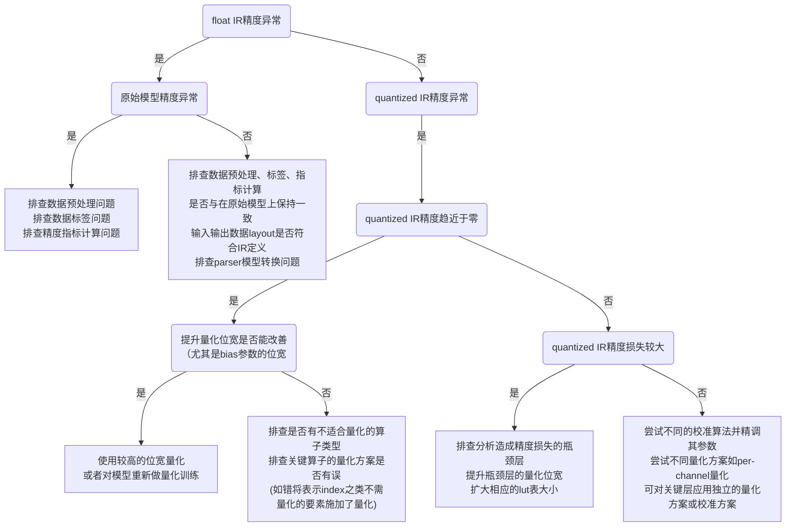

多数情况下，模型量化后的精度损失不会很大，通过调节校准算法参数即可进一步提升。需要注意的是，常用的校准算法都是基于校准数据集上的各种统计指标加以综合得到最终的min,max值，因此除了校准算法本身的参数外，影响统计指标的参数也同样可以调节，比如校准数据集的规模、batch_size、是否shuffle、batch间的统计量加权参数momentum、直方图的bins大小等。

### 5.6 如何提升模型量化后的运行性能？
首先在模型量化前，参考第一章的内容，可以运用模型裁剪、模型稀疏化、计算图优化等方法获得一个尽可能精简的部署用模型。其次在量化时根据硬件特性尽量选取适当的量化位宽，同时设计量化算法时尽量减少在前向运算时引入不必要的量化相关运算（如冗余的scale对齐操作，冗余的多次查表操作等）。最后在算子实现时不断通过perf数据迭代优化相应的核心算子。

[^1]: Accelerating Very Deep Convolutional Networks for Classification and Detection. https://arxiv.org/pdf/1505.06798.pdf
[^2]: Distilling the Knowledge in a Neural Network. https://arxiv.org/pdf/1503.02531.pdf
[^3]: MEAL V2: Boosting Vanilla ResNet-50 to 80%+ Top-1 Accuracy on ImageNet without Tricks. https://arxiv.org/pdf/2009.08453.pdf
[^4]: Learning Transferable Architectures for Scalable Image Recognition. https://arxiv.org/pdf/1707.07012.pdf
[^5]: Searching for MobileNetV3. https://arxiv.org/pdf/1905.02244.pdf
[^6]: MnasNet: Platform-Aware Neural Architecture Search for Mobile. https://arxiv.org/pdf/1807.11626.pdf
[^7]: Sparsity in Deep Learning: Pruning and growth for efficient inference and training in neural networks. https://arxiv.org/pdf/2102.00554.pdf
[^8]: https://www.tensorflow.org/guide/graph_optimization
[^9]: https://onnxruntime.ai/docs/resources/graph-optimizations.html
[^10]: https://github.com/pytorch/glow/blob/master/docs/Optimizations.md
[^11]: https://github.com/jiazhihao/TASO

[^12]: Quantization and Training of Neural Networks for Efficient Integer-Arithmetic-Only Inference. https://arxiv.org/pdf/1712.05877.pdf
[^13]: Quantizing deep convolutional networks for efficient inference: A whitepaper. https://arxiv.org/pdf/1806.08342.pdf
[^14]: Fast Algorithms for Convolution Neural Networks. https://arxiv.org/pdf/1509.09308.pdf
[^15]: TVM: An Automated End-to-End Optimizing Compiler for Deep Learning. https://arxiv.org/pdf/1802.04799.pdf

[^16]: Range-Based Linear Quantization. https://intellabs.github.io/distiller/algo_quantization.html#quantization-algorithms
[^17]: https://www.tensorflow.org/lite/performance/quantization_spec

[^18]: 8-bit inference with tensorrt. page37-39. https://on-demand.gputechconf.com/gtc/2017/presentation/s7310-8-bit-inference-with-tensorrt.pdf
[^19]: Up or Down? Adaptive Rounding for Post-Training Quantization. https://arxiv.org/pdf/2004.10568.pdf
[^20]: Mask R-CNN. https://arxiv.org/pdf/1703.06870.pdf
[^21]: Mask R-CNN source code and pre-trained model, tensorflow version. https://github.com/matterport/Mask_RCNN
[^22]: Mask R-CNN source code and pre-trained model, pytorch/caffe2 version. https://github.com/facebookresearch/detectron2
[^23]: Faster R-CNN: Towards Real-Time Object Detection with Region Proposal Networks. https://arxiv.org/pdf/1506.01497.pdf
[^24]: Deep Residual Learning for Image Recognition. https://arxiv.org/pdf/1512.03385.pdf
[^25]: https://en.wikipedia.org/wiki/Bilinear_interpolation
[^26]: High-Resolution Image Synthesis with Latent Diffusion Models. https://arxiv.org/abs/2112.10752
[^27]: https://github.com/CompVis/stable-diffusion
[^28]: Llama 2: Open Foundation and Fine-Tuned Chat Models. https://arxiv.org/abs/2307.09288
[^29]: https://zhuanlan.zhihu.com/p/647862867
[^30]: https://kipp.ly/transformer-inference-arithmetic/
[^31]: https://www.baseten.co/blog/llm-transformer-inference-guide/
